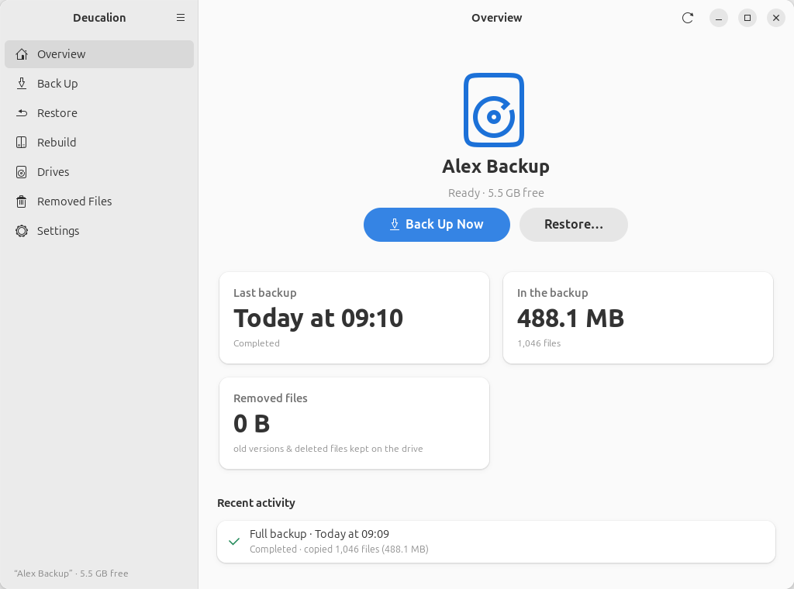
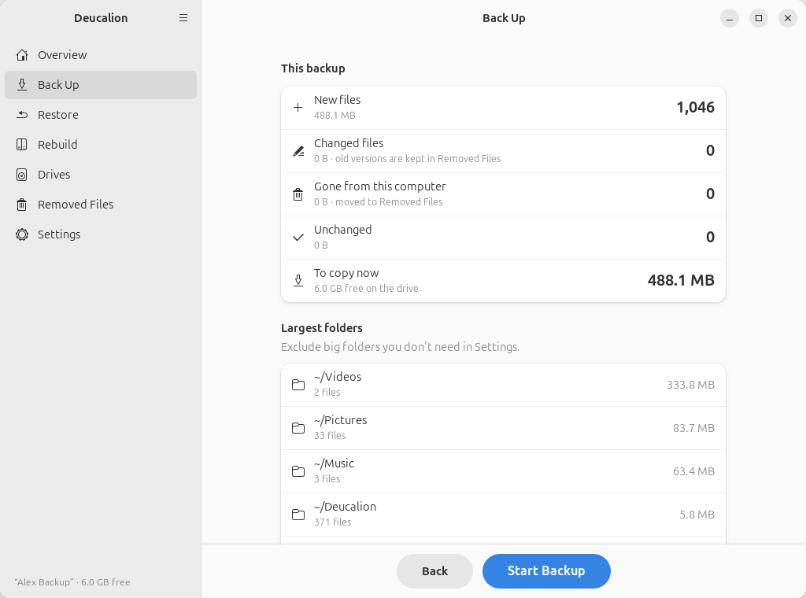
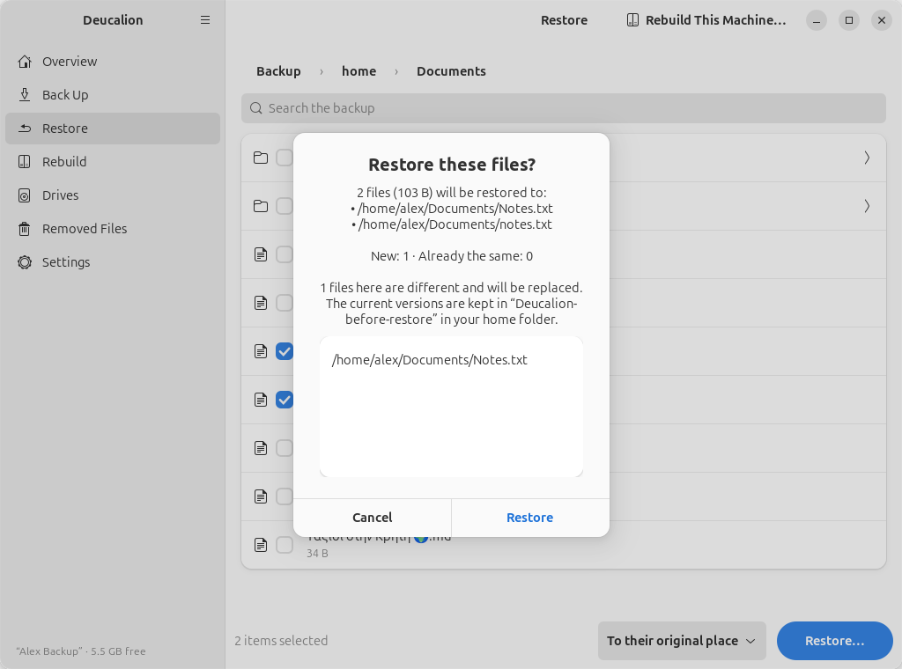
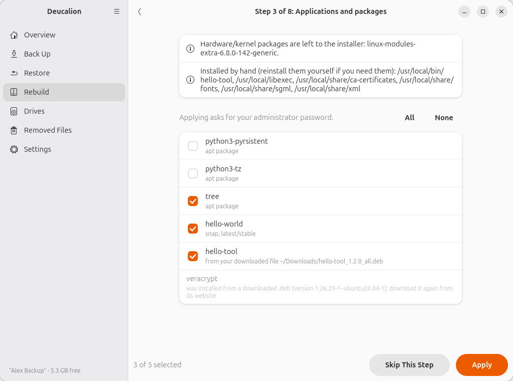

<div align="center">


# Deucalion

**Back up your Ubuntu computer to an external drive, and rebuild it later:
on a new computer or a new Ubuntu release, step by step.**

[](https://github.com/Dimitrios-Kafetzis/Deucalion/actions/workflows/tests.yml)
[](https://dimitrios-kafetzis.github.io/Deucalion/)
[](https://github.com/Dimitrios-Kafetzis/Deucalion/releases/latest)
[](LICENSE)
[](https://dimitrios-kafetzis.github.io/Deucalion/troubleshooting/faq/#which-ubuntu-versions-does-it-work-on)
[](https://www.python.org)

[**Documentation**](https://dimitrios-kafetzis.github.io/Deucalion/) ·
[Install](https://dimitrios-kafetzis.github.io/Deucalion/getting-started/install/) ·
[Tutorials](https://dimitrios-kafetzis.github.io/Deucalion/tutorials/) ·
[Changelog](CHANGELOG.md) ·
[Discussions](https://github.com/Dimitrios-Kafetzis/Deucalion/discussions)

</div>

<p align="center">
  <picture>
    <source media="(prefers-color-scheme: dark)" srcset="docs/assets/screenshots/dark/overview-dark.png">
    
  </picture>
</p>

## Why Deucalion?

Reinstalling Ubuntu, or moving to a new laptop, usually means a weekend of putting things back:
files, apps, software sources, desktop settings, Wi-Fi passwords, the changes you once made in `/etc`.
Most backup tools give you back your files. Deucalion also gives you back **the setup**.

It mirrors your home folder to an external drive as **plain files** you can open anywhere. It saves a
readable **system recipe** of how your computer was set up. Then it **rebuilds** a fresh Ubuntu from
both, one step at a time, showing what will change before anything does.

It is made for people who are not system administrators. Everything works in a GNOME app with
buttons, and everything also works from the terminal.

## Features

| | |
|---|---|
| 📂 **Plain files on the drive** | The backup is ordinary folders and files. Open it on Linux, Windows or macOS, with no special tool. |
| 🛡️ **Nothing is lost silently** | Files that changed or were deleted move to *Removed Files* on the drive, never deleted. Only you empty it. |
| 🎯 **Exact restores** | Permissions, owners, links and names that exFAT can't store are kept in a manifest and put back on restore. |
| 👀 **Preview first, always** | Every backup, restore and rebuild step shows its plan. Anything a restore replaces is kept in `~/Deucalion-before-restore/`. |
| 🔁 **Rebuild a computer** | Software sources, apt packages, snaps and downloaded `.deb` files, your home folder, desktop settings, `/etc` changes, groups, scheduled tasks, services and network connections. Works across Ubuntu releases, even with a different user name. |
| 🔒 **Optional encryption** | Encrypt the whole drive, part of it, or a folder on it: VeraCrypt (opens on Linux, macOS and Windows) or LUKS. |
| ⚡ **Fast and frugal** | Only changes are copied. Millions of files with little memory. Interrupt at any time: the next run carries on. |
| 🧰 **App and command line** | A GTK 4 / libadwaita app that follows your light or dark theme, and a `deucalion` command for terminals, scripts and SSH. |

## Screenshots

<table>
  <tr>
    <td width="50%"></td>
    <td width="50%"></td>
  </tr>
  <tr>
    <td align="center"><b>See the plan before every backup</b></td>
    <td align="center"><b>Restore with a preview</b></td>
  </tr>
  <tr>
    <td></td>
    <td></td>
  </tr>
  <tr>
    <td align="center"><b>Rebuild step by step</b></td>
    <td align="center"><b>Set up and encrypt a drive</b></td>
  </tr>
</table>

## Install

**Requirements:** Ubuntu 24.04 or newer for the app. The command line also works on Ubuntu 22.04.
Python 3.10 or newer (Ubuntu's own).

```bash
sudo apt install git
git clone https://github.com/Dimitrios-Kafetzis/Deucalion.git
cd Deucalion
./install.sh                    # checks what is needed and installs it (asks first),
                                # then adds Deucalion to the app menu and the 'deucalion' command
./install.sh --system-helper    # recommended: also install the administrator helper system-wide
```

The installer checks for the GTK and libadwaita libraries, UDisks, cryptsetup, `exfatprogs`, dconf
and gnupg, and offers to install what is missing. It can also install
[VeraCrypt](https://www.veracrypt.fr), needed only for VeraCrypt drives, after checking the package's
signature against VeraCrypt's key. `./install.sh --uninstall` removes Deucalion and keeps your backups
and settings.

No installation needed to try it: run `bin/deucalion` from the clone. Every backup drive that
Deucalion prepares also carries a copy of it, in a `Deucalion-Tool` folder.

➡️ Step by step, with screenshots: [Install Deucalion](https://dimitrios-kafetzis.github.io/Deucalion/getting-started/install/).

## Quick start

**In the app:** open **Deucalion** from the app menu, go to **Drives** → **Set Up a Drive…**, choose
how to store the backup, then click **Back Up Now** on the Overview page.

**In a terminal:**

```bash
deucalion setup-drive           # prepare a drive: format and/or encrypt it
                                # (or use a drive as it is: deucalion register /media/$USER/MyDrive)
deucalion backup --dry-run      # see what would be copied, and the largest folders
deucalion backup                # back up
deucalion restore ~/Documents/report.pdf
deucalion status
```

Press <kbd>Ctrl</kbd>+<kbd>C</kbd> once to stop safely; the next backup continues where it stopped.
See [Your first backup](https://dimitrios-kafetzis.github.io/Deucalion/getting-started/first-backup/)
and the [command reference](https://dimitrios-kafetzis.github.io/Deucalion/cli/).

## Rebuilding a computer

On a freshly installed Ubuntu, with any user name:

1. Plug in the backup drive and open its `Deucalion-Tool` folder in a terminal.
2. `bin/deucalion open` to unlock the backup (or `register` an unencrypted drive).
3. `bin/deucalion` and go to **Rebuild**, or run `bin/deucalion rebuild` in the terminal.

The rebuild runs eight steps: check the backup, software sources, apps and packages, your home
folder, paths in your settings (if your user name changed), desktop settings, `/etc` files (each one
shown as a diff), and groups, scheduled tasks, services and network connections. Each step shows its
plan first and can be skipped. It never removes packages and never changes Ubuntu's own sources. You
can stop and continue later, and running it twice changes nothing.

➡️ The full walk-through: [Rebuild your computer](https://dimitrios-kafetzis.github.io/Deucalion/tutorials/rebuild/).

## What is on the drive

```text
Deucalion-Backup/
├── backup.json          which computer and user this is, the last run, the results
├── home/                your home folder, as normal files
├── system/              the system recipe (readable text files)
├── extras/              folders outside your home folder that you added
├── _removed/<date>/     old versions and deleted files, until you empty them
└── .deucalion/          the manifest (permissions, original names, checksums) and logs
```

## How your data is protected

- **A backup only reads your computer, and never deletes anything on the drive.** Tests compare every
  file before and after, and check that every version ever backed up is still there.
- **A restore never loses a local file.** Anything it replaces is moved aside first, never copied and
  deleted, and put back if the restore fails.
- **Interruptions are safe.** Kill it, unplug the drive or fill it up at any moment: the next run
  repairs the backup.
- **Administrator work is narrow.** One small helper with a fixed list of checked operations. It
  refuses to touch the system disk.

Tested with unit and integration tests on plain folders, exFAT and LUKS. Also with a randomized
torture test that kills backups and restores at random moments, administrator and VeraCrypt checks,
full rebuilds of fresh Ubuntu 26.04 virtual machines from 24.04 backups, and a real-data backup of
about 700,000 files. Details:
[How Deucalion protects your data](https://dimitrios-kafetzis.github.io/Deucalion/concepts/safety/).

## Documentation

The documentation is written for everyone, not just developers. Every tutorial shows the app first,
then the command line, with real screenshots and real output.

| | |
|---|---|
| [Getting started](https://dimitrios-kafetzis.github.io/Deucalion/getting-started/) | Install Deucalion and make your first backup. |
| [Choosing a drive](https://dimitrios-kafetzis.github.io/Deucalion/choosing-a-drive/) | The five drive layouts, with or without encryption. |
| [Tutorials](https://dimitrios-kafetzis.github.io/Deucalion/tutorials/) | Every task, step by step: backups, restores, rebuilds, encrypted drives, and opening a backup without Deucalion. |
| [The app](https://dimitrios-kafetzis.github.io/Deucalion/app/) and [the command line](https://dimitrios-kafetzis.github.io/Deucalion/cli/) | Every page and every command. |
| [Troubleshooting](https://dimitrios-kafetzis.github.io/Deucalion/troubleshooting/) | Messages you might see, and what to do. |
| [For developers](https://dimitrios-kafetzis.github.io/Deucalion/developers/) | Architecture, tests, and how the documentation is made. |

## Project status

Deucalion is at version 0.2. Backups, restores, rebuilds, drive setup and encryption work, in the app
and on the command line. Not there yet: scheduled backups (it runs when you start it) and a history of
snapshots (it keeps one up-to-date copy plus *Removed Files*). See the
[plan](https://dimitrios-kafetzis.github.io/Deucalion/developers/plan/) and the [changelog](CHANGELOG.md).

## Contributing

Bug reports, ideas, documentation fixes and code are all welcome. Please read
[CONTRIBUTING.md](CONTRIBUTING.md) first. Questions go to
[Discussions](https://github.com/Dimitrios-Kafetzis/Deucalion/discussions), and everyone taking part
follows the [Code of Conduct](CODE_OF_CONDUCT.md).

Found a security problem? Please report it privately, as described in [SECURITY.md](SECURITY.md).

## License

Deucalion is free software: you can redistribute it and/or modify it under the terms of the
[GNU General Public License](LICENSE), version 3 or (at your option) any later version.

Copyright © 2026 Dimitrios Kafetzis.

---

<sub>In Greek myth, Deucalion survived the great flood in an ark he had built, then started the world
again. This tool is meant to be that ark for your computer.</sub>
