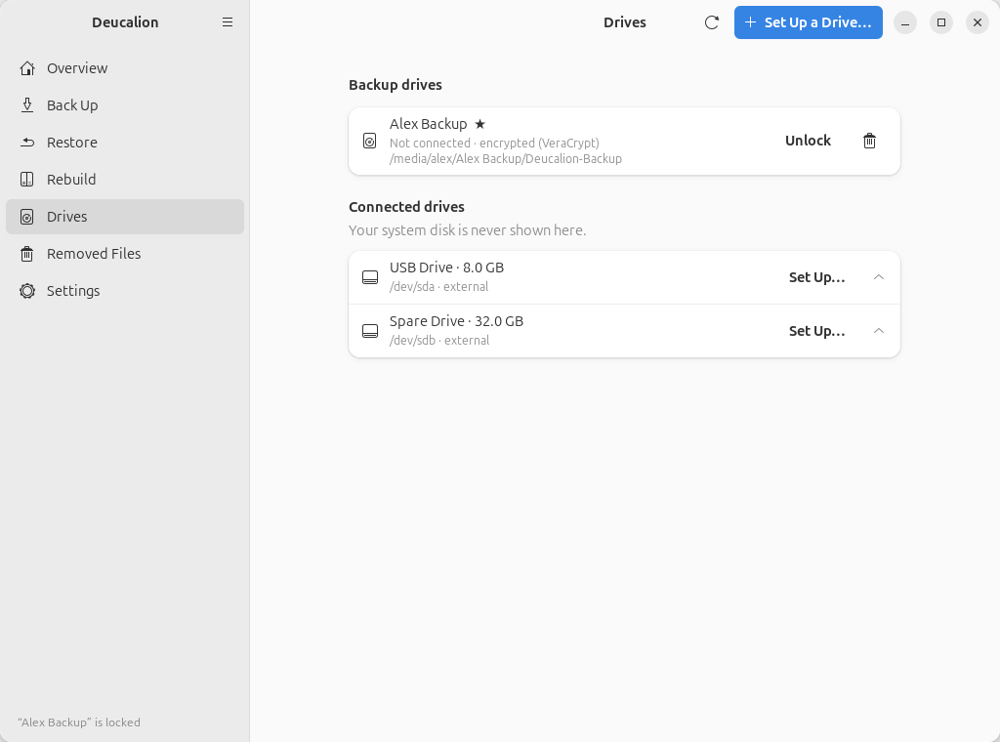
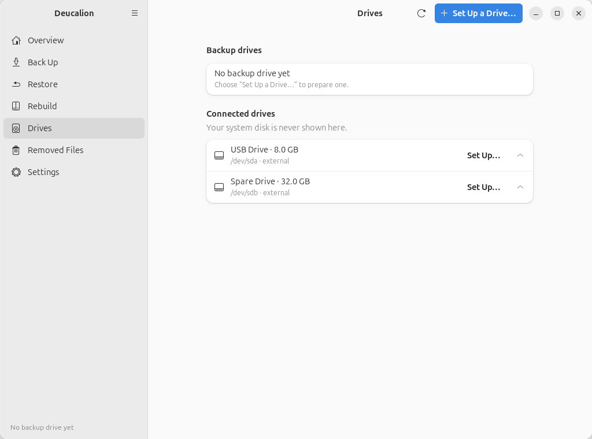
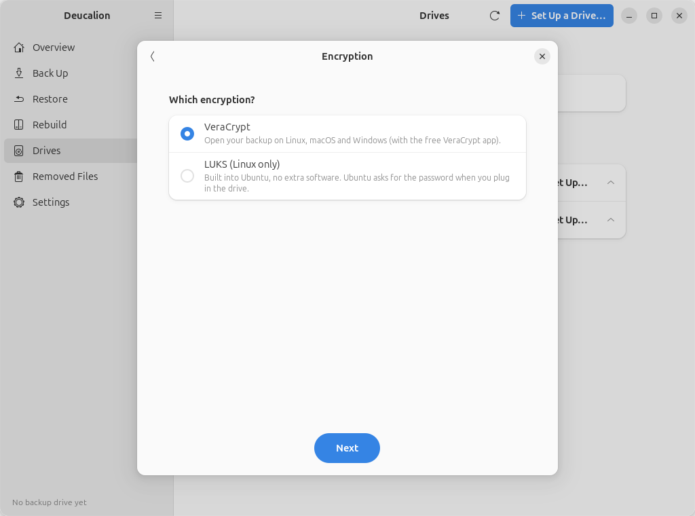
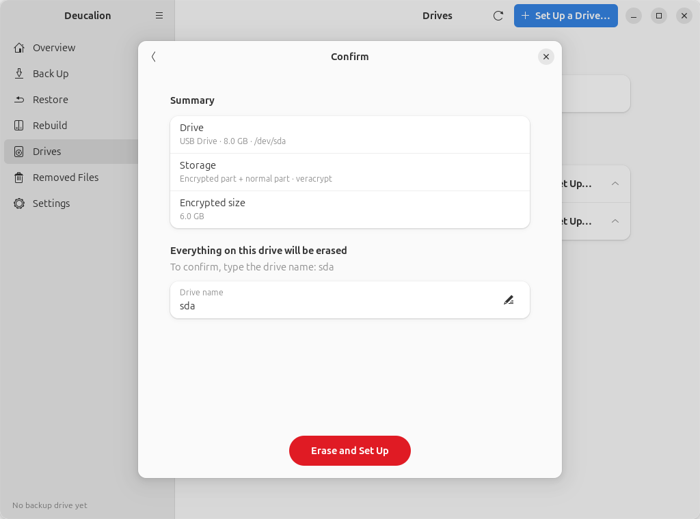

# Drives and drive setup

The **Drives** page lists your backup drives and the drives plugged into your computer, and lets you
prepare a new backup drive.

{ .shot }

## Backup drives

Every drive registered for backups, with:

- its name, and a **★** for the **default** drive (the one Deucalion backs up to);
- **Connected** or **Not connected**, the encryption (**VeraCrypt** or **LUKS**) and the free space;
- where it is mounted.

Buttons on each row:

| Button | What it does |
|---|---|
| **Lock** (encrypted drives) / **Unmount** (others) | Closes the drive so you can unplug it safely. |
| **Unlock** | Shown when the default drive is plugged in but locked. Asks for its password. |
| ★ (star button, *Use this drive for backups*) | Makes it the default drive. Shown on drives that aren't the default. |
| 🗑 **Forget this drive** | Deucalion stops using the drive. **The backup on it is not deleted**; you can add it again later. Asks first. |

With two backup drives, the default one has a ★ after its name, and the other one a star button:

{ .shot }

When the default drive is plugged in but locked, its row has **Unlock**:

{ .shot }

{ .shot }

## Connected drives

Every drive plugged in, **except the disk your system runs from**, which is never shown. Click a
drive's row to see its parts (*partitions*): name, format, size and where it is mounted, and tags
such as *encrypted* or *Deucalion backup*. **Set Up…** starts the setup wizard for that drive.

{ .shot }

The refresh button (⟳) looks for drives again. The page also updates by itself when you plug a drive
in or out.

## The setup wizard

**Set Up a Drive…** (top right), or **Set Up…** next to a drive, opens the wizard. It takes you
through these pages. **Nothing on the drive changes until the last page.** You can go back with the
arrow at the top left, or close the wizard with ✕.

### 1. Choose a drive

Shown when you start from **Set Up a Drive…**. Lists the external drives; your system disk is never
listed. Pick one and click **Next**.

{ .shot }

### 2. Storage

Shows what is on the drive now, then **How should the backup be stored?** The five
[layouts](../choosing-a-drive.md) are explained in a line each. Those that erase the drive say
**⚠ Erases the drive.** The two that keep the drive's files (**Encrypted folder on this drive** and
**No encryption, keep the drive as it is**) need a drive that already has a filesystem with files;
on an empty drive they are greyed out.

{ .shot }

### 3. Encryption

Only for the three encrypted layouts. Choose **VeraCrypt** (open the backup on Linux, macOS and
Windows) or **LUKS (Linux only)**.

{ .shot }

If VeraCrypt isn't installed, the page says so, and **LUKS** is chosen. **Install** downloads
VeraCrypt, checks its signature and installs it (Ubuntu asks for your administrator password).

{ .shot }

### 4. Details

- **Name of the backup drive**: the name Deucalion and Ubuntu show (default: `Deucalion`). On the
  drive itself, the name is limited to 11 letters, digits, spaces, `.`, `_` and `-`.
- **Size of the encrypted part (GB)** (encrypted part + normal part) or **Size of the encrypted
  folder (GB)** (encrypted folder). An encrypted folder **can't grow later**, so leave room.
- **Password** and **Type it again** (encrypted layouts). The hint below tells you when the password
  is long enough (at least 8 characters) and when the two match; **Next** stays greyed out until
  then. 12 characters or more is recommended.

{ .shot }

### 5. Confirm

A summary of your choices. For layouts that erase the drive, the page says **Everything on this drive
will be erased**, and you must type the drive's device name (shown there, for example `sda`) before
the red **Erase and Set Up** button works. For the other layouts the button is **Set Up**.

If something is missing (for example the `exfatprogs` package needed to create exFAT), the page says
**One more thing is needed**, with an **Install** button; other problems (for example *"This drive is FAT32, which cannot hold
files of 4 GB or more."*) are shown with **Can't continue**.

{ .shot }

### 6. Setting up

A log shows each step. For VeraCrypt, Ubuntu asks for your administrator password. The window can't
be closed until it finishes.

{ .shot }

When it is ready, click **Done**. The new drive becomes your **default** backup drive.

If something goes wrong, the page says **Setup failed**, with the reason at the end of the log; click
**Close**. A drive that was being erased may be left half-prepared: fix the cause and run the setup
again. Don't close the app while a drive is being set up: that stops the setup half way.

{ .shot }

## Related

- [Choosing a drive](../choosing-a-drive.md) and the [drive setup tutorials](../tutorials/drive-veracrypt.md)
- [Unlock and lock an encrypted drive](../tutorials/unlock-lock.md)
- [`deucalion drives`](../cli/drives.md), [`setup-drive`](../cli/setup-drive.md), [`open` and `close`](../cli/open-close.md)
