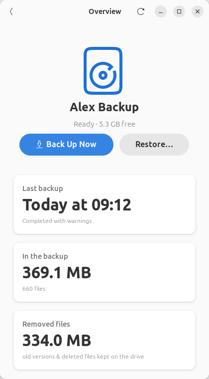
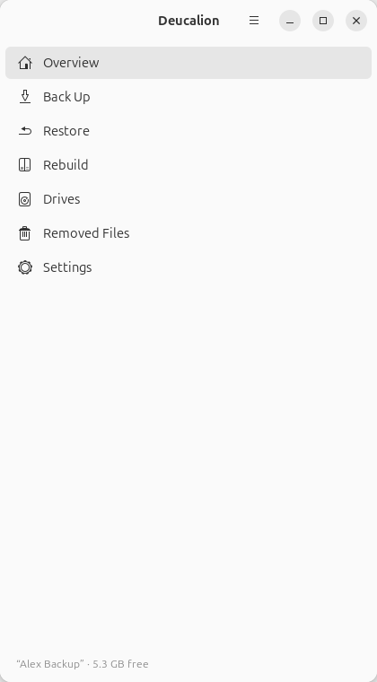
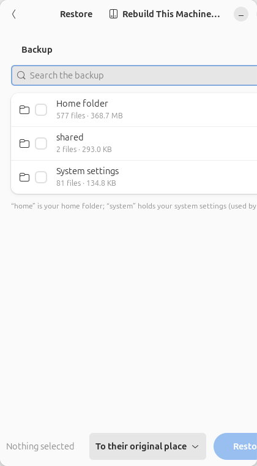
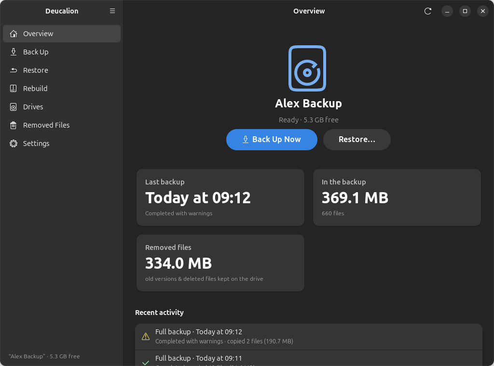
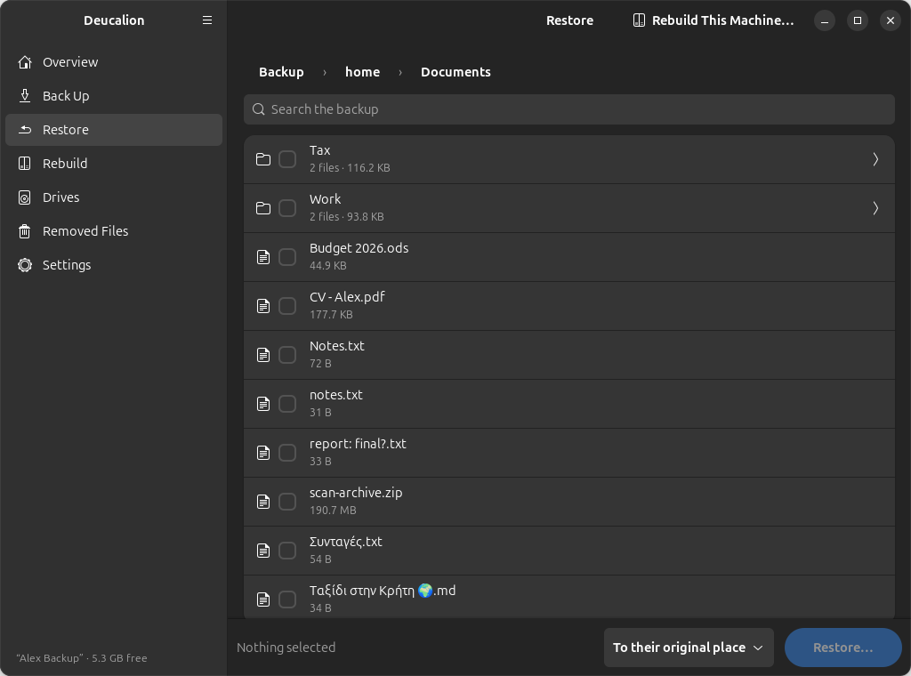
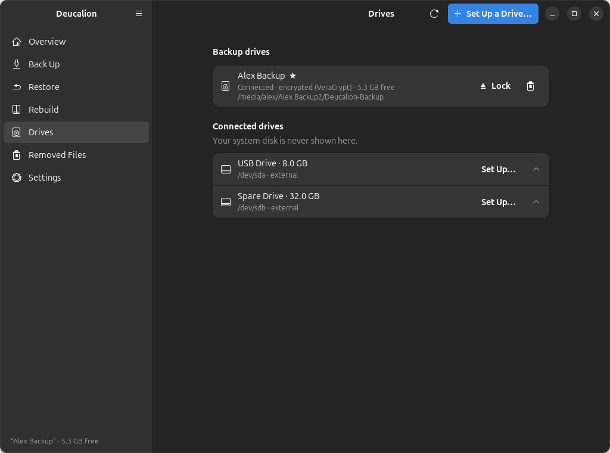
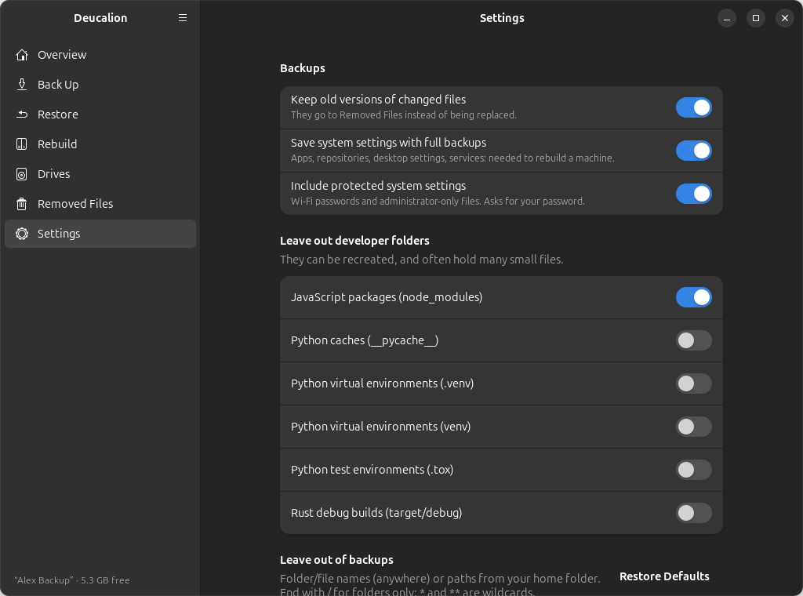

# Using the app

Open **Deucalion** from your app menu (press the ++super++ key and type "Deucalion"), or type
`deucalion` in a terminal. The app follows your desktop's light or dark style.

## The window

{ .shot }

- **The sidebar** (left) lists the pages. Click one to open it.
- **The main menu** (☰, at the top of the sidebar) has **About Deucalion**.
- **The line at the bottom of the sidebar** always tells you about your backup drive: its name and
  free space, or that it is *not connected*, *locked*, or that there is *No backup drive yet*.

| Page | What it is for |
|---|---|
| [Overview](overview.md) | Your backup drive at a glance, the last backups, and **Back Up Now**. |
| [Back Up](backup.md) | Back up everything or chosen folders, see what will be copied, watch the progress. |
| [Restore](restore.md) | Browse and search the backup, and restore files or folders. |
| [Rebuild](rebuild.md) | Set up this computer from a backup, step by step. |
| [Drives](drives.md) | Your backup drives and connected drives; set up a new drive; lock and unlock. |
| [Removed Files](removed-files.md) | Old versions and deleted files kept on the drive; free space. |
| [Settings](settings.md) | What to leave out, extra folders, and backup options. |
| [About](about.md) | Version and website. |

## In a narrow window

When the window is narrow (less than about 680 pixels wide, for example on half of a small screen),
the app shows one pane at a time: the sidebar, or a page. Use the back arrow at the top left of a
page to go back to the sidebar.

{ .shot .narrow }

{ .shot .narrow }

{ .shot .narrow }

## Light and dark

The app uses your desktop's style. In Ubuntu's **Settings → Appearance**, choose **Dark** and the app
follows:

{ .shot }

{ .shot }

{ .shot }

{ .shot }

## Long tasks run in the background

Backups, restores, rebuild steps and drive setup run without freezing the window. While one runs,
you can look at other pages, but you can't start a second task on the same drive.
