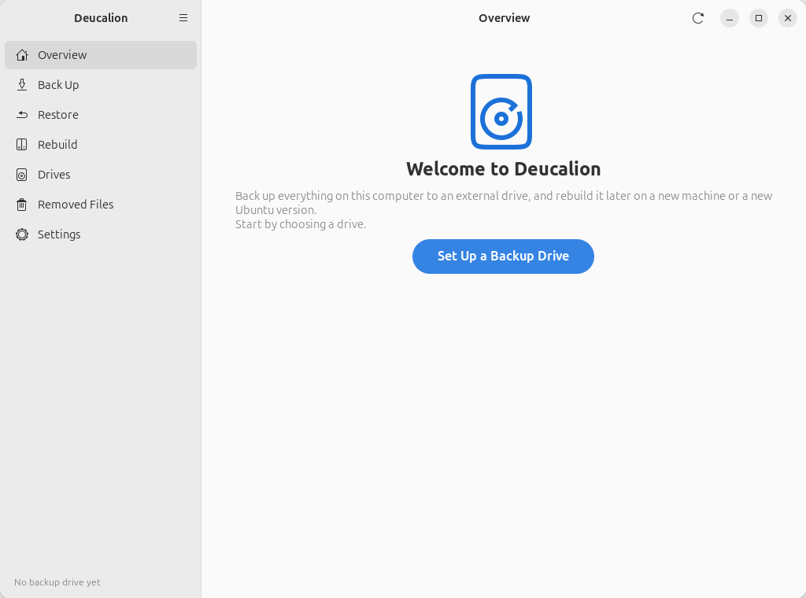
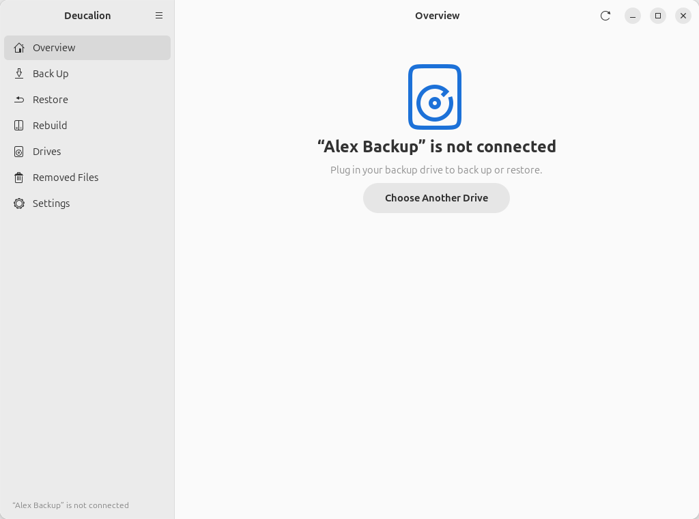
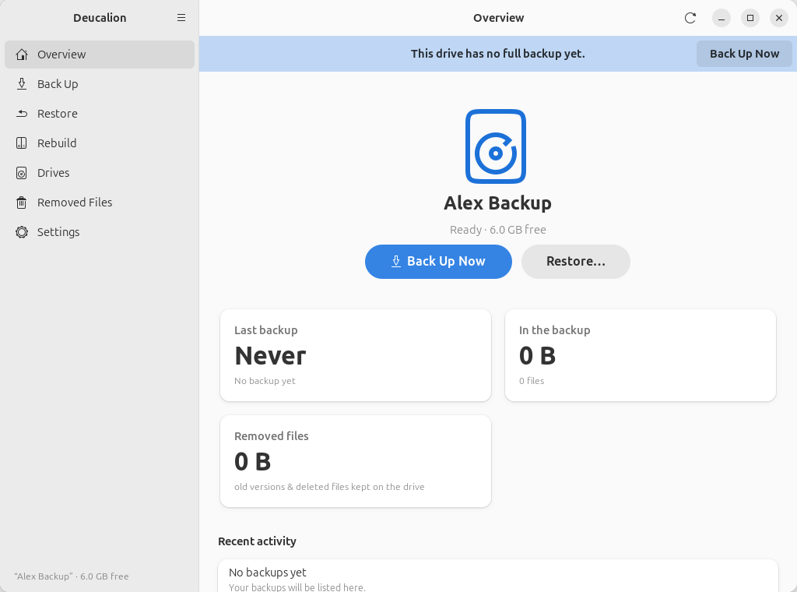

# Overview

The **Overview** page is the first page you see. It shows your backup drive and what it holds.

{ .shot }

## What it shows

- **The drive's name and state**: **Ready** with the free space, or one of the states below.
- **Back Up Now**: starts a full backup (it first shows you what it will copy; nothing is copied
  until you click **Start Backup**). See [Back Up](backup.md).
- **Restore…**: opens the [Restore](restore.md) page.
- **Last backup**: when the last backup finished, and how it ended: *Completed*, *Completed with
  warnings*, *Stopped*, *Failed*, or *Interrupted* (the computer or Deucalion stopped in the middle).
- **In the backup**: the size and number of files in the backup.
- **Removed files**: how much space old versions and deleted files take on the drive (see
  [Removed Files](removed-files.md)).
- **Recent activity**: the last six backups, full or partial, with how many files each copied
  (**No backups yet** before the first one).
- **The refresh button** (⟳, top right): looks at the drive again, for example after you plugged
  it in.

A **bar** at the top of the page reminds you when the drive has **no full backup yet**, or when **your last
full backup was 7 or more days ago**. Its **Back Up Now** button opens the Back Up page.

## The other states

=== "No drive yet"

    The first time, the page welcomes you. **Set Up a Backup Drive** opens the
    [drive setup wizard](drives.md#the-setup-wizard).

    { .shot }

=== "Locked"

    The drive is plugged in but encrypted and locked. **Unlock** asks for its password.

    { .shot }

=== "Not connected"

    The drive isn't plugged in (or Deucalion can't find it). Plug it in; the page updates by itself.
    **Choose Another Drive** opens the [Drives](drives.md) page.

    { .shot }

=== "No full backup yet"

    Right after setting up a drive.

    { .shot }

## Related

- [Your first backup](../getting-started/first-backup.md)
- [`deucalion status`](../cli/status.md) shows the same information in a terminal.
