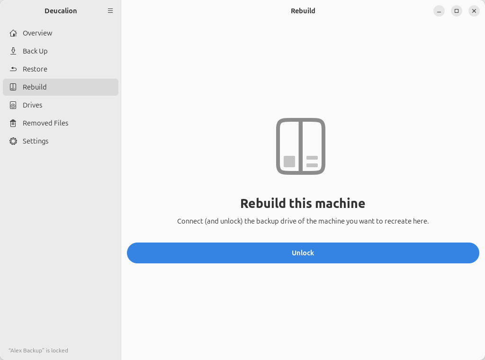
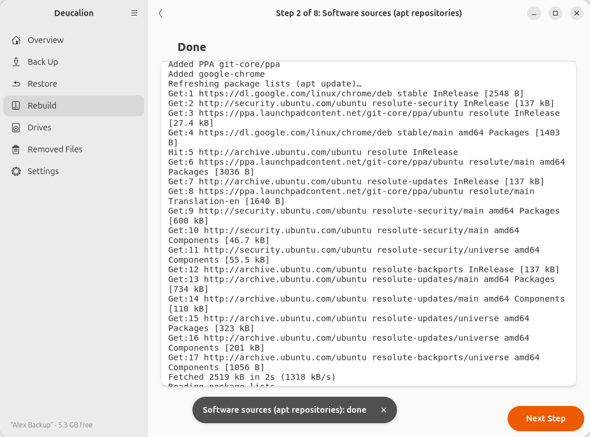

# Rebuild

The **Rebuild** page sets up this computer from a full backup, in eight steps. For the full
walk-through, see [Rebuild your computer](../tutorials/rebuild.md); for what each step does and
doesn't do, see [What a rebuild restores](../concepts/rebuild.md).

{ .shot }

## The list of steps

- The title says which computer and user the backup comes from, its Ubuntu version and when it was
  made.
- Each step shows **Not done yet**, **Done**, **Skipped** or **Failed**, with when. Click a step to
  open it (also to run it again).
- **Start** opens the first step; later it reads **Continue** (the first step not done or skipped), or
  **All Steps Done**.

If the drive isn't connected the page says so; if it is locked it has an **Unlock** button:

{ .shot }

## A step

{ .shot }

- While the step looks at the backup and this computer, it says *Looking at the backup and this
  machine…*. Nothing is changed.
- **Notes** (with an ⓘ) explain things worth knowing.
- **Items** have tick boxes; greyed-out items are for information only. The count at the bottom left
  says how many are selected. With more than three, **All** and **None** buttons appear.
- In step 7, **Show Changes** next to each file shows the difference between this computer's file and
  the backup's (`+` lines from the backup, `-` from this computer).
- *Applying asks for your administrator password* appears on steps that need it.

Buttons:

| Button | What it does |
|---|---|
| **Skip This Step** | Marks the step **Skipped** and opens the next one. |
| **Apply** | Applies the ticked items. A log shows what happens; step 4 also shows a progress bar. |
| **Continue** | (Instead of **Apply**, when the step has nothing to do.) Marks it done and opens the next one. |
| **Next Step** | After applying: opens the next step. |
| ‹ (top left) | Back to the list. |

{ .shot }

When a step fails, it says **This step failed** with the reason in the log. Fix the cause and open the
step again from the list.

## Related

- [`deucalion rebuild`](../cli/rebuild.md)
