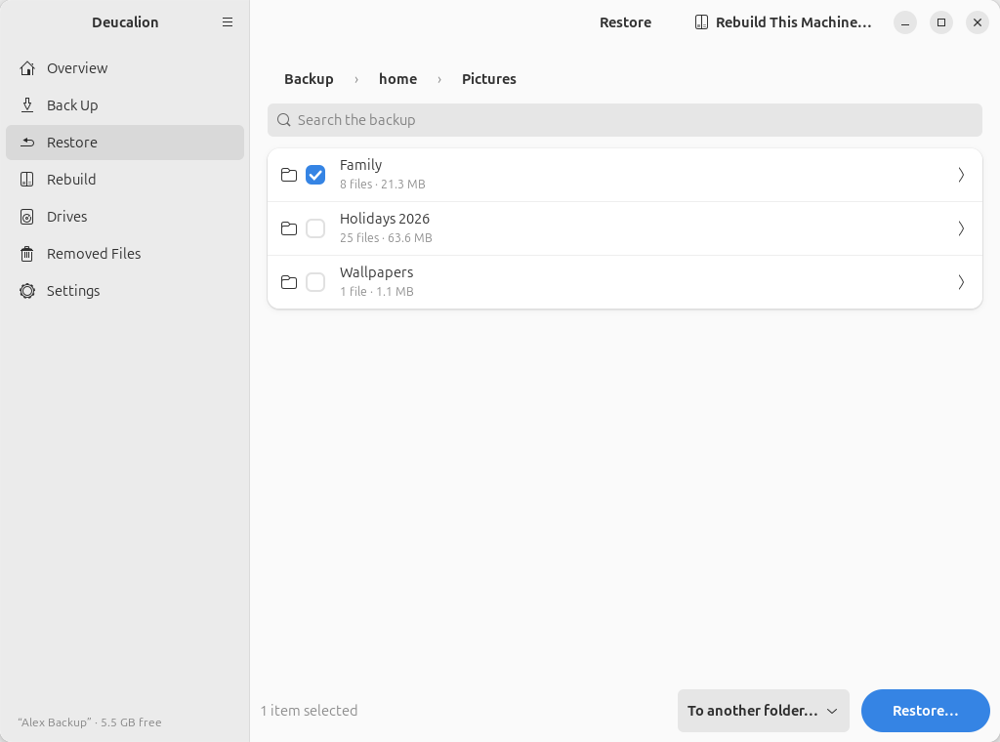
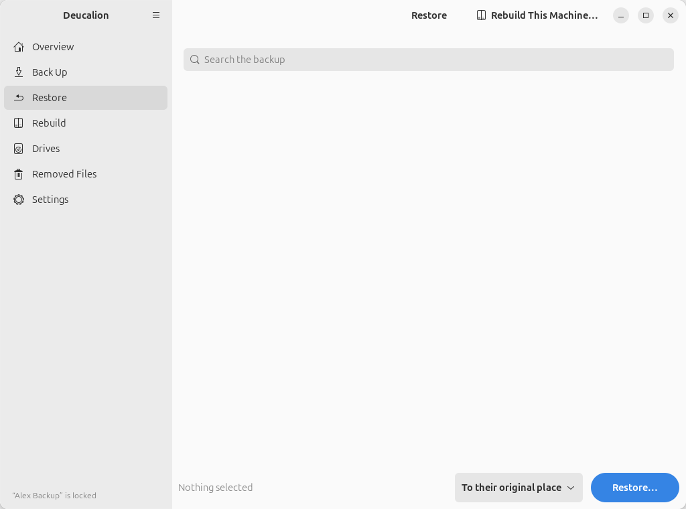

# Restore

The **Restore** page lets you browse your backup with the original file names, pick files or
folders, and copy them back. A preview always shows what will happen first, and anything a restore
replaces is kept in the undo folder.

{ .shot }

## Browsing

- At the top level you see **Home folder** (your home folder), **System settings** (the
  [system recipe](../concepts/system-recipe.md), used by Rebuild) and, if you added any, your
  **extra folders**.
- Click a folder's row (the arrow ›) to open it. The **breadcrumbs** above the list (**Backup › home ›
  Documents**) take you back up.
- Each row shows the size, and for folders the number of files. Links show where they point.
- Folders with more than 600 items show the first 600; use the search to find others.

{ .shot }

## Searching

Type in **Search the backup** to find files and folders by name anywhere in the backup (upper and
lower case don't matter for Latin letters). Each result shows the folder it is in. Clear the search
box to go back to browsing.

{ .shot }

## Choosing what to restore

Tick the box in front of each file or folder you want. A ticked folder includes everything inside
it. The bottom bar counts what you selected.

{ .shot }

Then choose where they go, with the list at the bottom:

- **To their original place**: back where they were. Files there that are different are replaced
  (and kept in the undo folder first).
- **To another folder…**: you choose a folder; each selected item is restored inside it, with its
  own name. Nothing in its original place is touched. Use this to look at an old version without
  replacing the current one.

    { .shot }

!!! note "System settings"
    The system recipe can't be restored "in place": use [Rebuild](rebuild.md) for that. To look at
    the recipe's files, restore them **To another folder…**.

## The preview

**Restore…** shows what will happen before anything changes:

{ .shot }

- How many files will be restored, and where.
- **New**: items that don't exist there now. **Already the same**: items that are already identical
  and won't be copied.
- Files that are **different and will be replaced**, listed one by one. Their current versions are
  first moved to the undo folder **Deucalion-before-restore** in your home folder.
- Files that are **missing on the drive** (for example after a drive problem) and can't be restored.

If everything is already the same, it says so and restores nothing. Click **Restore** to go ahead,
or **Cancel**.

## After the restore

{ .shot }

- **Open Replaced Files** opens the undo folder for this restore, so you can get your previous
  version back (see [Undo a restore](../tutorials/undo-restore.md)).
- **Done** clears the selection and goes back to browsing.
- Any problems are listed as warnings below.

**Stop** (while it runs) stops after the current file. What was restored stays; what was being
replaced is put back.

## The Rebuild This Machine… button

At the top right, **Rebuild This Machine…** opens the [Rebuild](rebuild.md) page.

## When the drive isn't available

If the drive isn't connected the page says **Nothing to restore yet**. If it is locked, it has an
**Unlock** button.

{ .shot }

## Related

- [Find and restore a file](../tutorials/restore-file.md) · [Restore a folder to another place](../tutorials/restore-elsewhere.md) · [Undo a restore](../tutorials/undo-restore.md)
- [`deucalion restore`](../cli/restore.md) and [`deucalion ls`](../cli/ls.md)
