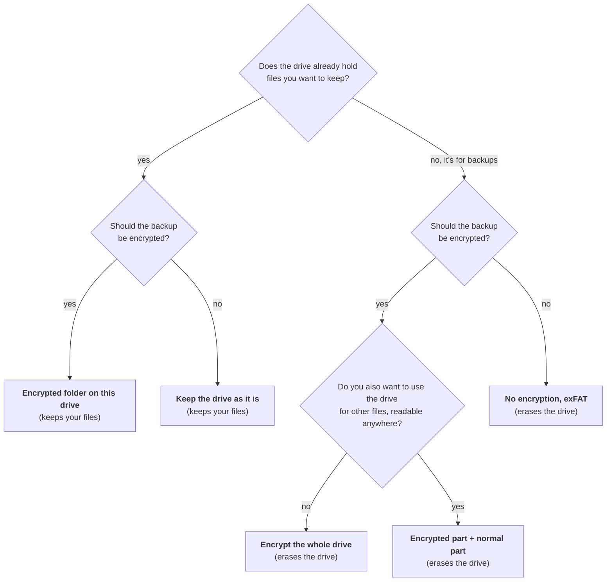

# Choosing a drive and encryption

Before your first backup, Deucalion prepares the drive in one of five ways (*layouts*). Three of
them encrypt the backup with a password, using one of two kinds of encryption. This page helps you
choose.

## The quick answer

Then pick the encryption:

- **VeraCrypt** if you might ever need to open the backup on **Windows or macOS** (they need the free
  VeraCrypt app installed).
- **LUKS** if you only use **Linux**. It is built into Ubuntu: no extra software, and Ubuntu asks for
  the password itself when you plug the drive in.

!!! tip "Our suggestion"
    For a drive used only for backups: **Encrypted part + normal part** with **VeraCrypt**. The
    backup is encrypted, it can be opened on any computer, and the normal part carries a copy of
    Deucalion and a READ-ME file, which makes a [rebuild](tutorials/rebuild.md) on a new computer
    easy.

## The five layouts

| Layout | Erases the drive? | Encrypted? | Where the backup can be opened |
|---|---|---|---|
| **Encrypt the whole drive** | yes | yes | VeraCrypt: Linux, Windows, macOS (with VeraCrypt). LUKS: Linux only. |
| **Encrypted part + normal part** | yes | the backup part | Encrypted part: as above. Normal part: everywhere. |
| **Encrypted folder on this drive** | no | yes (one file) | As above; the rest of the drive stays as it was. |
| **No encryption, exFAT** | yes | no | Everywhere (Linux, Windows, macOS), no password. |
| **No encryption, keep the drive as it is** | no | no | Depends on the drive's format: exFAT everywhere; NTFS on Windows and Linux, read-only on macOS; ext4 on Linux. |

### Encrypt the whole drive

The whole drive becomes one encrypted volume. **The safest choice for a dedicated backup drive.**
The drive shows nothing without the password.

- Inside: exFAT (VeraCrypt) or ext4 (LUKS).
- There is no unencrypted part, so **no copy of Deucalion and no READ-ME file** on the drive. To
  rebuild a new computer, you first [install Deucalion](getting-started/install.md) on it (and
  VeraCrypt, for a VeraCrypt drive).
- Tutorial: [Whole drive, VeraCrypt](tutorials/drive-veracrypt.md) · [Whole drive, LUKS](tutorials/drive-luks.md)

### Encrypted part + normal part

The drive is split in two: an **encrypted part** for the backup, and a **normal exFAT part** for
anything else, readable on any computer. You choose the size of the encrypted part (80 % of the
drive is suggested).

- The normal part holds a `Deucalion-Tool` folder (a copy of Deucalion) and `READ-ME-FIRST.txt`
  (how to open the backup on Linux, Windows and macOS). Both are refreshed after every backup.
- The encrypted part is marked as a Linux partition, so Windows doesn't offer to "format" it.
- The two parts have the same name. When both are open, Ubuntu shows the encrypted part as, for
  example, **Alex Backup** and the normal part as **Alex Backup1**.
- Tutorial: [Encrypted part + normal part](tutorials/drive-split.md)

### Encrypted folder on this drive

Keeps everything already on the drive. The backup lives inside **one big encrypted file**
(`Deucalion-Backup.hc` for VeraCrypt, `Deucalion-Backup.luks` for LUKS) that opens like a folder
when you unlock it.

- **Its size is fixed when you create it** and can't grow later, so leave room for the future. The
  suggestion is 80 % of the free space.
- A drive formatted as FAT32 can't hold a file of 4 GB or more; choose a smaller size or another
  layout.
- The drive also gets `Deucalion-Tool` and `READ-ME-FIRST.txt`.
- Tutorial: [Encrypted folder on a drive you use](tutorials/drive-encrypted-folder.md)

### No encryption, exFAT

The whole drive is erased and formatted as exFAT, with no password. **Anyone who has the drive can
read your backup**, including saved Wi-Fi passwords and SSH keys. Deucalion warns you about keys and
logged-in sessions when the drive isn't encrypted.

- exFAT is formatted with 8 KB clusters (instead of 128 KB), so millions of small files don't waste
  space. It still works on every system.
- Tutorial: [Plain exFAT, no encryption](tutorials/drive-exfat.md)

### No encryption, keep the drive as it is

Uses the drive with its current format and files (for example an NTFS drive that came from the shop)
and adds a `Deucalion-Backup` folder to it. Nothing is erased.

- Your files on the drive are not touched.
- Tutorial: [Use a drive as it is](tutorials/drive-as-is.md)

## VeraCrypt or LUKS?

| | VeraCrypt | LUKS |
|---|---|---|
| Opens on | Linux, Windows, macOS, with the free VeraCrypt app | Linux only (built into Ubuntu) |
| Extra software on Ubuntu | VeraCrypt, to *create* the drive (Deucalion can install it). Opening works without it. | none |
| Administrator password | needed to create, unlock and lock it | not needed |
| When you plug the drive in | unlock it in Deucalion (or the VeraCrypt app) | Ubuntu asks for the password itself |
| Filesystem inside | exFAT | ext4 (keeps Linux permissions natively) |
| Creating it | fills the encrypted space with encrypted data: takes from minutes to hours on a large drive | quick |

Both use strong, well-known encryption (VeraCrypt: AES with SHA-512; LUKS2: Ubuntu's defaults).

!!! warning "There is no way back from a forgotten password"
    Whichever you choose, the password can't be recovered by anyone. Write it down and keep it
    somewhere safe.

## How big should the drive be?

At least as big as what Deucalion will copy (shown before every backup), plus room for
[Removed Files](concepts/mirror-and-removed.md). **Twice the size of your home folder** is a
comfortable choice. Before each backup Deucalion checks that there is enough space and stops,
without copying anything, if there isn't.

## Related

- [What is on the drive](reference/drive-contents.md)
- [The drive setup wizard](app/drives.md#the-setup-wizard) and [`deucalion setup-drive`](cli/setup-drive.md)
