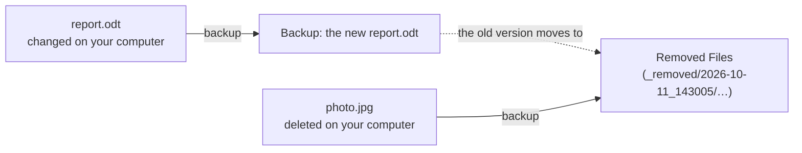

# One copy, and Removed Files

## One up-to-date copy

Your backup drive holds **one copy** of your files, as they were at your last backup. This is
called a *mirror*. When you back up again, Deucalion compares your computer with the backup and
copies only:

- files that are **new** on your computer;
- files that **changed** since the last backup.

Files that didn't change are not copied again, so later backups are much faster than the first one.

## Nothing is thrown away: Removed Files

A mirror has a risk: if you delete a file by mistake and then back up, the backup would lose it
too. Deucalion avoids this. When a backup would replace or remove something on the drive, it
**moves the old copy to Removed Files** instead of deleting it:

- When a file **changed**, the previous version goes to Removed Files and the new version takes its
  place in the backup.
- When a file was **deleted** from your computer (or you [left it out](../tutorials/leave-out.md)),
  its copy in the backup goes to Removed Files.

On the drive, Removed Files is the folder `Deucalion-Backup/_removed`. Each backup that moved
something there gets its own folder named after the date and time it started, for example
`_removed/2026-10-11_143005/`. Inside, files keep their usual folders
(`_removed/2026-10-11_143005/home/Documents/report.odt`), so you can find and open them directly.

**Nothing in Removed Files is ever deleted by Deucalion.** Only you can empty it, in the app's
**Removed Files** page or with `deucalion removed empty`. This is how you free space when the drive
fills up: see [Free space on the drive](../tutorials/free-space.md).

!!! note "Turning off old versions"
    In **Settings**, the switch **Keep old versions of changed files** decides what happens to the
    previous version of a file that changed. When it is off, the old version is replaced directly
    instead of going to Removed Files. Files deleted from your computer still go to Removed Files.
    It is on by default.

## What this is not

Removed Files is not a full history: it holds the versions that were replaced or removed by each
backup, but not a complete picture of your computer on each day. If you need to go back to a
specific day, look in the folder of the backup that ran right after that day. Snapshot history is
planned for a later version.

## Related

- [Free space on the drive](../tutorials/free-space.md)
- [The Removed Files page](../app/removed-files.md) and [`deucalion removed`](../cli/removed.md)
