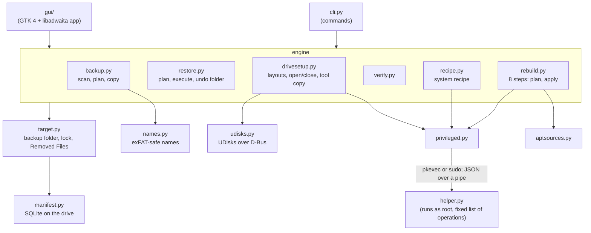

# For developers

Deucalion is written in Python 3 (3.10+) using only the standard library, plus PyGObject for the app
and for talking to UDisks. It runs straight from a folder (`bin/deucalion`), which is what makes the
copy on a backup drive work on a fresh Ubuntu.

## Architecture

| Module | Role |
|---|---|
| `cli.py` | The `deucalion` commands (argparse), terminal output, questions. |
| `gui/app.py`, `gui/pages/*.py`, `gui/common.py` | The app: window, pages, dialogs, background work, app state. `gui/shots.py`: the screenshot mode's entry syntax. |
| `backup.py` | The backup engine: a scan builds a plan (kept in a temporary SQLite file, so millions of files use little memory), then the copy step carries it out; Removed Files; space and identity checks. |
| `restore.py` | Restore planning (create, overwrite, same, missing) and execution with the undo folder. |
| `rebuild.py` | The eight rebuild steps, each with `plan()` and `apply()`; progress in `rebuild.json`. |
| `recipe.py` | Collects the system recipe into `~/.local/state/deucalion/system`. |
| `aptsources.py` | Reads and writes apt sources (one-line and deb822), adapts them to a new release, checks availability. |
| `verify.py` | Quick and full checks of the backup. |
| `manifest.py` | The SQLite manifest on the drive. |
| `names.py` | exFAT-safe names (look-alike characters, case collisions, length). |
| `target.py` | A backup folder: identity, registration, lookup, lock, Removed Files. |
| `drives.py` | Lists drives with `lsblk`, never the system disk. |
| `drivesetup.py` | The five layouts, VeraCrypt and LUKS open and close, the tool copy and READ-ME on the drive. |
| `udisks.py` | A small UDisks2 client (partition, format, LUKS, unlock, mount) that needs no administrator rights. |
| `privileged.py` | Starts the administrator helper once per task (pkexec, sudo or `sudo -n`) and talks to it. |
| `helper.py` | The administrator helper: 16 argument-checked operations; refuses the system disk; standard library only. |
| `deps.py` | Checks and installs dependencies; the signature-checked VeraCrypt install. |
| `config.py` | The configuration and exclusion patterns. |
| `util.py`, `logs.py` | Helpers (mount points, system disk detection, sizes) and per-run logs. |

## Design principles

- The engine never prints: it reports through progress callbacks, and the CLI and the app show it in
  their own way.
- Plan first, then act: backups, restores and every rebuild step can show exactly what they will do.
- A backup only reads the computer, and never deletes anything on the drive.
- Administrator work is narrow and goes through one audited helper.

The [plan for version 1](plan.md) records the decisions and their reasons.

## Contributing

Read [CONTRIBUTING.md](https://github.com/Dimitrios-Kafetzis/Deucalion/blob/main/CONTRIBUTING.md)
first. Run the [tests](testing.md) before and after a change. If you change how the app looks or what
a command prints, make the [screenshots and outputs](documentation.md) again. Report problems on
[GitHub](https://github.com/Dimitrios-Kafetzis/Deucalion/issues), ask questions in
[Discussions](https://github.com/Dimitrios-Kafetzis/Deucalion/discussions), and report security
problems privately (see
[SECURITY.md](https://github.com/Dimitrios-Kafetzis/Deucalion/blob/main/SECURITY.md)).

Deucalion is licensed under the
[GNU General Public License, version 3 or later](https://github.com/Dimitrios-Kafetzis/Deucalion/blob/main/LICENSE).
