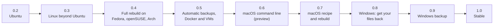

# Roadmap: versions 0.3 to 1.0

This page is the working plan for Deucalion after version 0.2. It says what each version will give
users, the steps to build it, how each step is tested, and what must be true before a release. It is
also where progress is tracked: every finished step is ticked here, in the same commit that finishes
it.

The technical background (which code is portable, how each platform works, the risks and the test
machines) is in [Portability: technical reference](portability.md). The decisions and design of
version 1 are in the [plan for version 1](plan.md).

!!! note "Plans can change"
    Versions further away are less certain. Each version is planned in detail when the one before it
    is released. Dates are not promised.

## 1. Where we are

- **Released:** version 0.2.1 (2026-10-12). Ubuntu 22.04 (command line) and 24.04 or newer (app and
  command line).
- **Done:** the planning in this page and in [Portability](portability.md) (2026-10-13). The test
  suite passes: 133 tests, 27 skipped where GTK or a drive isn't available.
- **Next step:** [0.3, step 1: characterization tests](#v03-step1).

## 2. The versions at a glance

| Version | Theme | What users get, in one line |
|---|---|---|
| **0.3** | Linux beyond Ubuntu | Deucalion on Debian, Linux Mint, Fedora, openSUSE and Arch; a rebuild can move your files and settings between distributions. |
| **0.4** | Full rebuild everywhere on Linux | Software sources, packages and `/etc` changes rebuilt on Fedora, openSUSE and Arch too. |
| **0.5** | Hands-off backups | Automatic backups (when the drive is plugged in, or on a schedule); Docker and virtual machines saved properly. |
| **0.6** | macOS command line (preview) | Back up a Mac to an exFAT drive, browse, restore and verify, from the terminal. |
| **0.7** | macOS rebuild (preview) | A Mac's apps saved as a Homebrew list and installed again on a fresh Mac. |
| **0.8** | Windows: get your files back | Open a Deucalion drive on a Windows PC: browse, search, restore and verify. |
| **0.9** | Windows backup | Back up a Windows home folder, including files that are in use. |
| **1.0** | Stable | A drive format that stays readable for good, and a safety campaign on every platform. |
| **Later** | | Snapshot history, full-disk image, apps for macOS and Windows, and more (§11). |

### Platforms and features by version

"✓" means it works in 0.2. A number is the version that brings it. "–" means not planned.

| Feature | Ubuntu | Debian, Mint | Fedora, openSUSE, Arch | macOS | Windows |
|---|---|---|---|---|---|
| Back up home and extra folders | ✓ | 0.3 | 0.3 | 0.6 | 0.9 |
| Browse, restore, verify | ✓ | 0.3 | 0.3 | 0.6 | 0.8 |
| Set up a drive: plain exFAT, or as it is | ✓ | 0.3 | 0.3 | 0.6 | 0.9 |
| LUKS layouts | ✓ | 0.3 | 0.3 | – (Linux only) | – (Linux only) |
| Create VeraCrypt drives | ✓ | 0.3 | 0.3 | later | later |
| Use a VeraCrypt drive unlocked with VeraCrypt's own app | ✓ | 0.3 | 0.3 | 0.6 | 0.8 |
| Unlock VeraCrypt drives from Deucalion | ✓ | 0.3 | 0.3 | 0.7, only if CI can prove it | later |
| System recipe saved | ✓ | 0.3 | 0.3 (basic), 0.4 (full) | 0.7 | later |
| Rebuild on the same family | ✓ | 0.3 | 0.4 | 0.7 | later |
| Rebuild from another family (the portable part) | 0.3 | 0.3 | 0.3 | – | – |
| The app (GTK 4) | ✓ | 0.3 | 0.3 | later | later |
| Automatic backups | 0.5 | 0.5 | 0.5 | later | later |
| Docker and VM export | 0.5 | 0.5 | 0.5 | later | later |

## 3. Decisions

Decided with the project owner on 2026-10-13:

| Topic | Decision |
|---|---|
| Rebuild across distribution families (for example Ubuntu → Fedora) | **The portable part only**: home folder, path updates, desktop settings, Flatpak apps, network connections, scheduled tasks, your own services, and groups (with `sudo` ↔ `wheel`). Packages are shown for reference only. Software sources and `/etc` never cross families. |
| Testing on macOS | **GitHub's macOS runners only**, no real or rented Mac. macOS releases are labelled *preview*, and only features that a CI job can prove are offered. |
| Windows | **Read-only first (0.8), then full backup (0.9).** |
| Features already planned in [plan.md §12](plan.md#12-later-versions) | **Automatic backups and Docker/VM export in 0.5**, after the Linux work. Snapshot history and the full-disk image stay "later". |

Recommended and assumed in this plan; they can still be changed before the version that needs them:

| Topic | Assumption | Needed by |
|---|---|---|
| Distributions | Debian 13; Linux Mint 22; the two supported Fedora releases (43 and 44 today); openSUSE Tumbleweed and Leap 16; Arch. No immutable systems (Silverblue, Aeon), no NixOS. | 0.3 |
| The app on macOS and Windows | None yet. The command line first, with a `--json` mode (0.6) so that any later front end can drive it. Decide after 0.7. | after 0.7 |
| Encryption on macOS and Windows | Deucalion uses volumes you unlocked with VeraCrypt's own app. It doesn't create them, and doesn't handle passwords there. | 0.6, 0.8 |
| Paid items | None for now: no Apple Developer Program, no Windows code-signing certificate. Distribution as a folder, a Git clone or a Homebrew tap. | 0.6, 0.8 |
| Flatpak or Snap packages | Not planned: the administrator helper and the rebuild need the real system (see [Portability §7](portability.md#packaging)). | – |
| Python on Windows | Installed by the user (python.org or `winget`). Carrying Python on every drive is decided in 0.8. | 0.8 |

## 4. Rules for every version

These come from how 0.1 and 0.2 were built, and they don't change:

1. **Never lose or damage data.** Every change is judged against this first. A backup only reads the
   computer. Nothing on the drive is deleted except by the user. A restore moves anything it replaces
   aside first.
2. **Ubuntu behaviour stays the same** unless a change is meant for Ubuntu too. In that case, it is
   listed in the changelog and has its own test.
3. **Tests never touch real drives.** Drive tests use disk images, and administrator and rebuild tests
   run inside throwaway virtual machines (`docs/tools/vm.py`) or CI runners.
4. **Every bug fix comes with a regression test**, and the whole suite passes before every commit:
   `python3 -m unittest discover -s tests`.
5. **Plan first, then act.** Every new destructive or system-changing step shows its plan before it
   does anything, like the existing rebuild steps.
6. **Administrator work stays narrow:** one helper per platform, with a fixed list of operations whose
   arguments are checked.
7. **Old backups stay readable.** Every version reads drives written by every older version. A version
   refuses to *write* to a drive written by a newer version it doesn't understand (from 0.3, step 5).
8. **Documentation is part of the version.** Pages, screenshots and command output are updated before
   a release, from real runs only.
9. **Public actions need the owner's approval:** releases and tags, new public accounts or
   repositories (Open Build Service, AUR, a Homebrew tap), repository settings, and new workflows.
   Ordinary pushes to `main` after a finished step don't.
10. **Downloads of VM images and ISOs are announced with their size and approved first.**

### How a step is done

1. Read the step here and the related section of [Portability](portability.md).
2. Write the tests first where possible (characterization tests before any refactor).
3. Make the change. Run the whole suite, and the VM or CI checks the step lists.
4. Update the documentation the step lists.
5. Tick the step in this page, add a line to `CHANGELOG.md` under "Unreleased", and commit.

### How a version is released

1. Every step of the version is ticked, and every CI job is green.
2. The version's manual checks (listed in its section) are done and recorded in its "Status" list.
3. The "Unreleased" changelog section becomes the version's section, and `__version__`, `mkdocs.yml`'s
   copyright line and the README are updated.
4. After the owner approves, the tag `vX.Y.0` is pushed; `.github/workflows/release.yml` publishes the
   release.
5. Patch versions (`X.Y.1`, …) only fix bugs; new features always wait for the next minor version.

## 5. Version 0.3: Linux beyond Ubuntu

**Goal:** Deucalion works on the main Linux distributions, not only Ubuntu. The code gets a platform
layer that later versions (macOS, Windows) build on, with Ubuntu's behaviour unchanged.

### What users get

- **Deucalion on Debian 13, Linux Mint 22, Fedora, openSUSE (Tumbleweed and Leap 16) and Arch**, as
  well as Ubuntu: the app, the command line, every drive layout (plain exFAT, as-is, VeraCrypt, LUKS),
  backups, restores and verify.
- **`install.sh` and `deucalion deps` use the distribution's own package manager** (apt, dnf, zypper or
  pacman) to install what is missing. VeraCrypt is installed from its signed package where VeraCrypt
  publishes one, or from the distribution's repository on Arch.
- **The full eight-step rebuild on Debian and Linux Mint**, as on Ubuntu: software sources, packages,
  home folder, paths, desktop settings, `/etc`, groups, scheduled tasks, services and network
  connections.
- **Rebuild between distribution families (the portable part).** An Ubuntu backup restored on Fedora,
  or the other way round, brings back:
    - your home folder, with paths updated if your user name changed;
    - desktop settings (GNOME, Cinnamon, MATE, Budgie through dconf; KDE and Xfce through their files in
      your home folder);
    - Flatpak apps and their remotes;
    - Wi-Fi, VPN and wired connections;
    - your scheduled tasks (crontab) and your own systemd services;
    - your groups, with `sudo` and `wheel` treated as the same.

  Packages from the old system are shown for reference. Software sources and `/etc` files are never
  carried to another family.
- **Rebuild installs Flatpak apps** (0.2 only listed them), on every distribution.
- **On Fedora, openSUSE and Arch, a full backup saves a basic system recipe:** system information,
  the list of installed packages, Flatpak apps, desktop settings, services, scheduled tasks and network
  connections. `/etc` changes and software sources are saved from 0.4 on.
- **Protection against newer drive formats:** an older Deucalion refuses to write to a backup made by
  a newer one it doesn't understand, and never replaces a newer `Deucalion-Tool` copy on the drive with
  an older one.

**Not in 0.3:** rebuilding packages, software sources or `/etc` on Fedora, openSUSE or Arch (0.4);
immutable distributions.

### Steps

**Step 1. Characterization tests (the safety net for the refactor).**
The existing tests cover the engine well, but they barely cover the system layer. The only patch
points are `util.run` and `cli.run`, plus `FakePrivileged` in `tests/test_rebuild.py`. This step
records what the system layer does *today*, so that the refactor can be proved not to change it.

- A `FakeSystem` test helper that replaces `subprocess.run` / `util.run` / `Popen`: it records every
  command and returns prepared output per command (for example `apt-mark showmanual`,
  `dpkg-query -W`, `snap list`, `flatpak list`, `dconf dump /`, `systemctl list-unit-files`,
  `lsblk -J`, `findmnt -J`).
- A fake root folder for files the code reads directly (`/etc/os-release`, `/etc/apt/…`,
  `/var/lib/dpkg/status`, `/var/lib/dpkg/info/*`, `/etc/NetworkManager/system-connections`,
  `/sys/class/dmi/id/*`). Where a path is a module constant (`helper.ETC`, `helper.DPKG_INFO`,
  `helper.DPKG_STATUS`, `recipe.APT_KEY_DIRS`), it is patched; elsewhere, a small indirection is added
  in this step, with no change in behaviour.
- Tests that pin down:
    - `recipe.collect`: every file it writes under `system/`, byte for byte, and the commands it runs;
    - `helper.scan_etc` and `helper.collect_etc` on the fake `/etc` and dpkg tree;
    - each rebuild step's `plan()` (items, labels, details, pre-selection) and `apply()` (the exact
      helper calls, through `FakePrivileged`);
    - `deps.report`, `deps.missing_packages` and the commands of `deps.apt_install`;
    - `drivesetup.DriveSetup.run` for each layout with a fake UDisks that records its calls, and the
      `helper` VeraCrypt operations' command lines;
    - `drives.list_drives` and `util.backing_disks` / `is_on_system_disk` on recorded `lsblk` and
      `findmnt` output (including a loop device and a btrfs subvolume).
- A **command inventory test**: a list of every external program the code can run (found with a
  `grep` of `run([`, `_lines([`, `subprocess.*([`, `_out([` and `_run_streaming([`) kept in
  `tests/data/commands.txt`. The test fails when a new program appears that isn't listed, so every new
  dependency is a conscious choice.
- **Done when:** these tests pass on the current code. Nothing outside `tests/` changes except tiny
  indirections that keep behaviour identical.

**Step 2. Platform layer skeleton.**

- New package `deucalion/platform/` (layout and interfaces in
  [Portability §2](portability.md#platform-layer)): `__init__.py` with `current()`, `base.py` with the
  interfaces, and `linux.py`.
- Platform detection: `sys.platform`, then for Linux `/etc/os-release` `ID`, `ID_LIKE`,
  `VERSION_ID`, `VERSION_CODENAME`, `UBUNTU_CODENAME` → a `Distro` record with `family` (`debian`,
  `fedora`, `suse`, `arch`, `unknown`).
- Make `import pwd`, `import grp` and `import fcntl` lazy in `backup.py`, `target.py`, `recipe.py` and
  `drivesetup.py`. `helper.py` keeps its own imports: it stays Linux-only and self-contained.
- **Done when:** the whole suite and the characterization tests pass, and nothing calls the new layer
  yet.

**Step 3. Move the Linux code behind the platform layer (no change in behaviour).**

- Move, without editing the logic:
    - from `util.py`: `mount_info`, `mount_points`, `fs_type`, `is_posix_fs`, `backing_disks`,
      `is_on_system_disk`, `is_encrypted`, `os_release`, `REMOVABLE_MOUNTS`;
    - from `target.py`: `candidate_roots`, `_SYSTEM_MOUNTS`, and the lock (`fcntl.flock`);
    - from `privileged.py`: the start method choice (pkexec, sudo, `sudo -n`, direct);
    - `config.config_dir` and `config.state_dir`;
    - the metadata calls in `backup.py` and `restore.py` (`os.geteuid`, `os.statvfs`, `os.sync`,
      `os.uname`, `pwd`/`grp` lookups, `chown`, `chmod`).
- The old names stay as thin re-exports (`util.mount_info` and so on), so existing imports and
  test patch points keep working.
- **Done when:** the whole suite and the characterization tests pass unchanged. A short torture run
  (`tests/torture.py --rounds 10 --kill`) passes on an exFAT disk image. `tests/manual/vm_rebuild_check.py`
  passes in a fresh Ubuntu 26.04 VM from a 24.04 backup. Commit as "Platform layer (no behaviour
  change)".

**Step 4. Distribution families in the recipe and the rebuild.**

- `info.json` in the recipe gets `os.id`, `os.id_like`, `os.family` and `os.ubuntu_codename` (new keys
  only; `recipe.FORMAT` stays 1). For older backups without them, the family is worked out from
  `os.name`.
- `rebuild.Context` gets `old_family` and `new_family`, and a `mode`: `same-family` or `portable`.
- **Done when:** unit tests cover family detection for each distribution's real `os-release` (kept as
  test data), and a 0.2 backup without the new keys still rebuilds unchanged on Ubuntu.

**Step 5. Forward-compatibility guard.**

- Reading: a drive whose `backup.json` `format` or manifest `schema` is newer than this version knows
  can still be browsed and restored from, with a warning.
- Writing: backup, `removed empty`, `verify` (which marks files to copy again) and `register` refuse
  to write to it, with a message to update Deucalion.
- `drivesetup.install_tool_copy` never replaces a `Deucalion-Tool` copy whose `drive.json` `version`
  is newer than this one.
- **Done when:** regression tests with a fake "format 2" drive and a newer tool copy pass.

**Step 6. Dependencies per distribution.**

- `deps.py`: the checks look for capabilities, not package names (can `gi` with GTK 4 and Adw 1 be
  imported, is `udisksctl` / `cryptsetup` / `mkfs.exfat` / `pkexec` / `dconf` / `gpg` there), and the
  package names to install come from a table per family (see
  [Portability §3.2](portability.md#distro-backends)). The installer uses `apt-get`, `dnf`, `zypper`
  or `pacman`.
- `deps._has_package` no longer crashes where `dpkg-query` is missing.
- VeraCrypt:
    - Ubuntu: unchanged.
    - Debian and Mint: the Debian package for Debian, and the Ubuntu package matching
      `UBUNTU_CODENAME` for Mint.
    - Fedora and openSUSE: the official `.rpm` with its `.sig`, checked against the pinned key exactly
      like the `.deb`.
    - Arch: the `veracrypt` package from Arch's repository.
    - **To verify:** VeraCrypt's current release asset names for each distribution.
- `install.sh`: no apt-specific lines (everything goes through `deucalion deps --install`); the app
  menu entry and the polkit policy install the same way on every distribution.
- **Done when:** unit tests cover each family's commands with `FakeSystem`, and `./install.sh` works in
  fresh Debian 13, Fedora 44, openSUSE Tumbleweed and Arch VMs (step 11).

**Step 7. Debian and Linux Mint: the full rebuild.**

- **Software sources:**
    - `rebuild.DISTRO_SOURCE_FILES` becomes a table per distribution: `ubuntu.sources` and the ESM
      files on Ubuntu, `debian.sources` and `sources.list` on Debian, and
      `official-package-repositories.list` on Mint.
    - `aptsources.Repo.kind` learns each distribution's own archive (`deb.debian.org`,
      `security.debian.org`, `packages.linuxmint.com`), so they are never touched.
    - Codename mapping: Debian maps its codenames (for example `bookworm` → `trixie`). On Mint, Mint's
      own repositories use the Mint codename, while PPAs and third-party Ubuntu repositories use
      `UBUNTU_CODENAME` from `os-release`.
- **Snaps:** skipped when `snapd` isn't installed or is blocked (Mint's `nosnap.pref`). The snaps are
  then listed as "not available here".
- **Netplan:** used only where `netplan` exists. Otherwise NetworkManager keyfiles are used (step 9
  makes them available from Ubuntu backups too).
- **The root crontab:** `/var/spool/cron/crontabs/` on the Debian family (unchanged), and
  `/var/spool/cron/` on Fedora, openSUSE and Arch (in `helper.op_collect_admin` and `op_put_crontab`).
- **Wording:** the app and the messages say "Linux" or the distribution's name instead of "Ubuntu",
  where it isn't about Ubuntu. Examples: the LUKS choice in `gui/pages/drives.py`, and
  `cli.app_problem`.
- **Done when:** unit tests pass with Debian and Mint `os-release`, sources and keys as test data, and
  the VM checks in step 11 pass (Ubuntu 24.04 backup → Debian 13 rebuild).

**Step 8. Basic recipe on Fedora, openSUSE and Arch.**

- `recipe.collect` chooses collectors by family:
    - The family-independent ones run everywhere: system information, Flatpak, other tools, desktop,
      services, manually installed software, containers and VMs.
    - Package lists: `dnf repoquery --userinstalled`, `zypper packages --userinstalled`,
      `pacman -Qqe` and `pacman -Qqm` (AUR). These go to `packages/<manager>-manual.txt`, with the
      full installed list for reference. **To verify:** the exact commands on each distribution
      (dnf 5).
    - The apt collector runs only on the Debian family.
- **The `/etc` scan is skipped outside the Debian family** in 0.3, with a note in the recipe and in
  `deucalion backup`'s summary. Without a package database to compare with, the current scan would
  treat every file in `/etc` as unowned. 0.4 adds proper detectors.
- **Done when:** characterization tests show the Ubuntu recipe unchanged, and new tests cover each
  family's recipe from recorded command output.

**Step 9. The portable rebuild.**

- In `portable` mode, the rebuild shows these steps:
    - **Check**;
    - **Packages, for reference only:** the old list. Nothing is selectable, except Flatpaks;
    - **Home**, **Paths** and **Desktop**: unchanged;
    - **Services:** groups (with the mapping), crontab, your own services, and network connections.
      System services are shown unselected.

  Software sources and `/etc` are shown as "not carried across distribution families".
- **Flatpak installation** (in both modes): add the remotes, then install the apps, as the user. System
  installations go through Flatpak's own permission prompt, so the administrator helper needs no new
  operation. If `flatpak` is missing, it is offered as a package first (Debian family in 0.3;
  everywhere in 0.4).
- **Group mapping:** `sudo` ↔ `wheel` (only when the old group was one of them and the new one exists);
  other groups only if a group with the same name exists (as today).
- **Network connections from Ubuntu 23.10 and newer:** NetworkManager stores them as netplan files
  there (`/etc/netplan/90-NM-*.yaml`), which other distributions can't use. From 0.3, a backup with
  administrator access also saves the keyfiles NetworkManager generates from them
  (`/run/NetworkManager/system-connections/*.nmconnection`, root-only) to
  `network/generated-connections/`. Rebuilds on other distributions import those. This only adds
  files: Ubuntu rebuilds still use the netplan files, as before.
- **Done when:** unit tests cover the step plans in both modes, and the VM check (step 11) passes:
  Ubuntu 24.04 backup → Fedora 44, and Fedora 44 backup → Ubuntu 26.04. Nothing local may be lost,
  the second run must change nothing, and no package or source may be changed.

**Step 10. CI on other distributions.**

- `tests.yml` gets a `distros` job with containers: `debian:13`, `fedora:44`, `opensuse/tumbleweed`,
  `archlinux:latest`. Each installs Python, PyGObject, GTK 4, libadwaita and gnupg with its own
  package manager, then runs the suite. The exFAT job stays on the Ubuntu runner, because containers
  can't mount. The full proposal is in [Portability §6.4](portability.md#ci-matrix).
- The tests that need `findmnt`, `lsblk` or UDisks skip themselves cleanly where these tools are
  missing.
- The workflow change is shown to the owner before it is pushed.
- **Done when:** every job is green.

**Step 11. VM checks on other distributions.**

- `docs/tools/vm.py` learns `--distro` (`ubuntu`, `debian`, `fedora`, `opensuse`, `arch`), with each
  image's URL and verification method (table in [Portability §6.1](portability.md#vm-images)). In the
  cloud-init user data, the `groups:` line is dropped; the `sudo:` rule already gives access.
- Every image download is announced with its size and approved first (about 1.8 GB in total for
  the four new images).
- Linux Mint has no cloud image. A one-time manual installation from its ISO (about 3 GB, approved
  first) is kept as a base disk; tests use copies of it.
- Checks, in VMs only, with disk images plugged in as USB drives:
    - `install.sh`;
    - drive setup in each layout (plain, as-is, LUKS, VeraCrypt);
    - backup, restore and verify;
    - `tests/manual/admin_checks.py`, adapted per distribution;
    - rebuilds: Ubuntu 24.04 → Debian 13 (same family); Ubuntu 24.04 → Fedora 44 (portable);
      Fedora 44 → Ubuntu 26.04 (portable); Ubuntu 24.04 → Mint 22 (same family);
    - a second run of every rebuild changes nothing.
- **Done when:** all of these pass, and the results are recorded in this page's 0.3 status list.

**Step 12. Documentation.**

- "Ubuntu" becomes "Linux" where it applies to all distributions: the home page, getting started, the
  FAQ (which distributions), and the concepts pages for the rebuild and the system recipe.
- The install page gets tabs per distribution.
- A new concept section: what a rebuild carries across distribution families, and what it doesn't.
- Real output from Fedora for at least `deucalion deps`, `backup --dry-run` and `rebuild`.
- The README's tagline, badges and requirements are updated at release time.

### Risks and safeguards

| Risk | Safeguard |
|---|---|
| The refactor changes Ubuntu behaviour unnoticed | Step 1's characterization tests and command inventory; VM rebuild check before and after step 3. |
| A rebuild writes another family's files into `/etc` | `/etc` and software sources are never offered in portable mode; tests check that no item is offered. |
| The `/etc` scan on Fedora treats everything as changed (as 0.2 would) | Skipped outside the Debian family until 0.4. |
| An old Deucalion writes to a newer drive format | Step 5's guard. |
| SELinux labels on Fedora and openSUSE | No `/etc` writes there in 0.3; handled in 0.4. |

### Status

- [ ] 1. Characterization tests and command inventory
- [ ] 2. Platform layer skeleton, lazy imports
- [ ] 3. Linux code behind the platform layer (no behaviour change), VM check on 26.04
- [ ] 4. Distribution families in recipe and rebuild
- [ ] 5. Forward-compatibility guard
- [ ] 6. Dependencies per distribution, `install.sh`
- [ ] 7. Debian and Mint full rebuild
- [ ] 8. Basic recipe on Fedora, openSUSE, Arch
- [ ] 9. Portable rebuild, Flatpak install, group mapping, generated NM keyfiles
- [ ] 10. CI on other distributions
- [ ] 11. VM checks on other distributions
- [ ] 12. Documentation
- [ ] Release 0.3.0

## 6. Version 0.4: full rebuild on Fedora, openSUSE and Arch

**Goal:** a rebuild within the Fedora, openSUSE or Arch family is as complete as on Ubuntu.

### What users get

- **The full eight-step rebuild on Fedora, openSUSE and Arch:** third-party software sources (COPR,
  RPM Fusion and other `.repo` repositories on Fedora; Open Build Service and other repositories on
  openSUSE; extra repositories in `pacman.conf` on Arch), packages, home folder, paths, desktop, `/etc`
  changes, groups, scheduled tasks, services and network connections.
- **A rebuild onto a newer release** (for example Fedora 43 → 44, Leap 16.0 → 16.1) adapts software
  sources the way it does for Ubuntu, and checks that each one exists for the new release first.
- **`/etc` changes are found properly** on these distributions, by comparing with the package
  database (rpm or pacman), and are shown as diffs as on Ubuntu.
- **SELinux:** restored `/etc` files get the correct security label (Fedora, and openSUSE where
  SELinux is on).
- **Across distribution families**, packages with exactly the same name are offered as *unselected*
  suggestions, after checking that they exist here. Everything else stays for reference.
- **AUR packages** (Arch) are listed, never installed automatically.
- *Optional, if the owner approves:* packages for each distribution, built by the openSUSE Build
  Service, and an AUR package.

### Steps

1. **Package backends.**
    - The `Install` part of `PackagesStep` becomes one backend per manager: apt (unchanged), dnf,
      zypper, pacman.
    - New helper operations `dnf_install`, `zypper_install` and `pacman_install`, each with a checked
      package-name pattern. `helper.HELPER_VERSION` is increased.
    - **Never remove a package:** dnf without `--allowerasing`; zypper with `--non-interactive` and
      without force resolution; pacman with `--needed`. **To verify in VMs:** that a conflict makes
      each of them fail instead of removing something.
    - A VM test compares the installed-package list before and after a rebuild: nothing may disappear.
2. **Collect the full recipe on these families.**
    - **Fedora:** `/etc/yum.repos.d/*.repo` (third-party only; `fedora*.repo` and the distribution's
      own files are never touched), the keys they reference (`gpgkey=file://…`), and the COPR and
      RPM Fusion release packages.
    - **openSUSE:** `/etc/zypp/repos.d/*.repo` and keys.
    - **Arch:** `/etc/pacman.conf` (extra repository sections) and `/etc/pacman.d/` files that are not
      the mirror list.
3. **Software sources step per family**, with an availability check per repository (`repomd.xml` for
   dnf and zypper, `<repo>.db` for pacman), as `aptsources.available` does for apt. Version mapping:
    - **Fedora:** nothing to map, because `$releasever` does it. RPM Fusion and COPR release packages
      are offered for the new version.
    - **openSUSE:** Open Build Service URLs contain the release (`openSUSE_Tumbleweed`,
      `openSUSE_Leap_16.0`), so they are mapped like Ubuntu codenames.
    - **Arch:** rolling, nothing to map.
4. **`/etc` detectors.** `helper.scan_etc` gets a backend per package database:
    - **dpkg:** unchanged.
    - **rpm:** the file list, digests and "config file" flags from `rpm -qa --qf` (one call).
    - **pacman:** `/var/lib/pacman/local/*/files`, whose `%BACKUP%` section lists configuration files
      with their checksums.

    The "never copied", "generated" and "installed by the installer" lists are kept per family (for
    example `/etc/pki/` private keys and `/etc/selinux/` policy stores). Ubuntu's results must stay
    byte-identical (characterization tests).
5. **SELinux.** After `put_etc_file`, the helper runs `restorecon` on the file when SELinux is enabled
   (`/sys/fs/selinux/enforce` exists). Tested in a Fedora VM with SELinux enforcing: a restored
   `/etc/ssh/sshd_config.d/*.conf` must keep `sshd` working.
6. **Same-name package suggestions across families**, unselected, after an availability check with
   the new system's package manager.
7. **Generalize `tests/manual/vm_rebuild_check.py`** for every family. Nothing local is lost,
   everything is restored, paths are updated only as whole paths, no package is removed, the
   distribution's own sources are untouched, and a second run changes nothing.
8. **VM checks:** Fedora 43 → Fedora 44; openSUSE Leap 16 → Tumbleweed (same family, newer); Arch →
   Arch with a different user name; the 0.3 portable checks again.
9. **Distribution packages (optional, needs approval):** an Open Build Service project building
   `.deb`, `.rpm` and Arch packages from one spec; an AUR `PKGBUILD`. The packages install the
   command, the app entry, the system helper and the polkit policy.
10. **Documentation:** rebuild tutorials per family, software sources per family, and the SELinux
    note.

### Status

- [ ] 1. Package backends (dnf, zypper, pacman), helper operations
- [ ] 2. Full recipe collection on Fedora, openSUSE, Arch
- [ ] 3. Software sources step per family
- [ ] 4. `/etc` detectors (rpm, pacman)
- [ ] 5. SELinux labels
- [ ] 6. Same-name package suggestions across families
- [ ] 7. Generalized VM rebuild check
- [ ] 8. VM checks
- [ ] 9. Distribution packages (optional)
- [ ] 10. Documentation
- [ ] Release 0.4.0

## 7. Version 0.5: automatic backups, Docker and virtual machines

**Goal:** the backups happen without the user having to remember, and the two kinds of large data that
0.2 only lists are saved properly. This version is Linux-only, like the app.

### What users get

- **Automatic backups**, turned on in the app's Settings or with
  `deucalion auto enable --when plugged|daily|weekly`:
    - when the backup drive is plugged in, or on a schedule (for example every day at 13:00, run as
      soon as possible if the computer was off);
    - a notification when a backup starts, ends, or needs attention;
    - `deucalion status` and the app's Overview show when the next automatic backup will run, and how
      the last one went.
- **Unattended backups are cautious:**
    - They never ask for a password. An encrypted drive is used only if it is already unlocked, and
      settings that need administrator access keep their copy from the last manual backup (as
      partial backups do today).
    - They stop and notify instead of continuing:
        - when the drive holds another computer's backup;
        - when the drive is too full;
        - when the plan would move an unusual amount to *Removed Files* (for example more than 5 % of
          the files, or more than 10 GB; both can be set). This protects against a folder that has
          just been emptied or a drive that isn't mounted.
    - They don't run on battery below a set level (20 % by default).
- **Docker:** the images you choose are saved with `docker save`, and volumes are saved as archives,
  using Docker's own tools only (Docker's internal storage is never read directly). The rebuild loads
  them again. Podman is supported the same way (`podman save`, `podman volume export`).
- **Virtual machines:**
    - libvirt and virt-manager machines are saved: their definitions, and the disks of machines that
      are switched off (a running machine's disks are never copied, because the copy would be
      damaged).
    - VirtualBox machines in your home folder are left out while they run, with a warning.
    - The rebuild defines the virtual machines again, with paths updated.
- **Space checks** for both: their size is shown before copying, with a warning that exFAT stores
  sparse disk images at their full size.

### Steps

1. **Unattended mode in the engine.** `BackupJob` gets an `unattended` option. With it:
    - the mass-removal guard is on;
    - `identity_problem` and `space_problem` stop the backup instead of asking;
    - no administrator access is requested;
    - the result goes to a notification.

    Unit tests cover each stop condition.
2. **`deucalion auto`** (`enable`, `disable`, `status`) writes **systemd user units** (all supported
   distributions use systemd):
    - a timer for the schedule, with `Persistent=true`;
    - a small `deucalion watch` service that listens to UDisks for the registered drive's ID
      appearing.

    No root is needed. The units are removed by `disable` and by `./install.sh --uninstall`.
3. **Notifications** with `Gio.Notification` (falling back to `notify-send`), and the Settings and
   Overview pages in the app.
4. **Docker and Podman export.** These become new optional components in the configuration and the
   Back Up page.
    - **Images:** export one archive per image, under `extras/docker/images/`. An image is exported
      again only when its ID changed; the IDs are recorded in `extras/docker/state.json`.
    - **Volumes:** archived through a temporary container made from an image that is already on the
      computer (no download). **To decide in the step:** `docker cp` from a stopped container, or a
      `tar` inside it.
    - **Space:** the old archives move to *Removed Files* like any changed file. The size warning
      says so.
5. **libvirt export.**
    - `virsh dumpxml` for each machine, for the user session and, with administrator access, the
      system session.
    - The disks of machines that are switched off are copied. Machines that are running are skipped
      with a warning.
    - The system session's disks in `/var/lib/libvirt/images` are read through a new, checked helper
      operation.
6. **Rebuild:**
    - a new "Containers and virtual machines" step after Home, with `docker load`, `podman load`, the
      volume import and `virsh define`, with paths mapped;
    - a test that the step never replaces an existing image, volume or machine of the same name.
7. **VM checks:**
    - plugging the drive (QMP) starts a backup;
    - killing the automatic backup at random moments is safe;
    - the mass-removal guard triggers when the home folder is replaced by an empty one;
    - Docker and libvirt round trips in a VM (with nested KVM switched off, so machines are only
      defined, not started).
8. **Documentation:**
    - tutorials: turn on automatic backups; back up Docker and virtual machines;
    - the concept page on safety, for unattended runs;
    - the plan's §12 is updated.

### Status

- [ ] 1. Unattended mode and mass-removal guard
- [ ] 2. `deucalion auto`, systemd user units, drive watcher
- [ ] 3. Notifications and app pages
- [ ] 4. Docker and Podman export
- [ ] 5. libvirt export
- [ ] 6. Rebuild step for containers and VMs
- [ ] 7. VM checks
- [ ] 8. Documentation
- [ ] Release 0.5.0

## 8. Versions 0.6 and 0.7: macOS (preview)

**Goal:** Deucalion runs on a Mac from the terminal. Because these versions are tested only on GitHub's
macOS runners (§3), they are labelled **preview**, and features that a CI job can't prove aren't
offered.

### What users get in 0.6

- **Back up a Mac** (home folder and extra folders) to an exFAT drive, a drive used as it is, or a
  VeraCrypt volume you unlocked with VeraCrypt's own app. Only changes are copied; *Removed Files*,
  the manifest and interruptions work as on Linux.
- **Browse, search, restore and verify**, including backups made on Linux. Linux names that a Mac
  can't hold side by side are reported before anything is restored:
    - `Notes` and `notes` in one folder;
    - two Unicode spellings of the same name.

  Nothing is overwritten silently.
- **Mac specifics handled:**
    - Finder tags and other extended attributes are saved (small ones in the manifest; a warning for
      large ones).
    - Files kept only in iCloud ("Optimize Mac Storage") are skipped with a warning instead of being
      downloaded.
    - Folders macOS protects (Mail, Messages, Safari) are reported with how to give the Terminal
      *Full Disk Access*.
    - Sensible default exclusions inside `~/Library` (caches, logs, containers' caches).
- **Set up a drive on a Mac:** erase and format as exFAT (with 8 KB clusters), or use it as it is. The
  internal disk is never offered.
- **`--json` output** for every long-running command (progress, warnings and results as one JSON
  object per line), for scripts and for a future app.
- Needs Python 3.10 or newer (from python.org or Homebrew). Optional Homebrew tap, if the owner
  approves.

### What users get in 0.7

- **A system recipe for the Mac:**
    - a Homebrew Brewfile (formulae, casks, taps, Mac App Store apps, VS Code extensions);
    - the apps in `/Applications` and your launch agents, for reference;
    - your crontab, and `/etc/hosts` changes.
- **Rebuild a Mac:**
    - check;
    - install the Brewfile (`brew bundle`), never removing anything;
    - Mac App Store apps (if you are signed in);
    - home folder, paths (`/Users/old` → `/Users/new`);
    - launch agents, crontab and `/etc/hosts` (as a diff, with administrator access).

  If Homebrew isn't installed, the rebuild says how to install it from Homebrew's own site; it never
  runs a downloaded script by itself.
- **From Linux to Mac, or Mac to Linux:** files only, with the other system's lists for reference.
- **Unlocking VeraCrypt drives from Deucalion**, only if a CI job proves that VeraCrypt with FUSE-T
  (no kernel extension) works reliably. Otherwise you keep unlocking them in VeraCrypt's own app.

### Steps for 0.6

1. **`platform/macos.py`:**
    - system information (`sw_vers`, `sysctl hw.model`);
    - config in `~/Library/Application Support/Deucalion`, logs in `~/Library/Logs/Deucalion`;
    - mounts from `os.statvfs` and `diskutil info -plist <path>`;
    - drives from `diskutil list -plist`;
    - finding the system disk through APFS containers' physical stores, and refusing to guess;
    - backup folders under `/Volumes`;
    - the lock with `fcntl.flock` (tested on exFAT in CI);
    - administrator access with `sudo` and the same JSON-over-pipe helper (macOS operations only).
2. **Names:**
    - `NamePolicy.fold` also treats Unicode spellings (NFC and NFD) as equal. Before the change, a
      test proves it on Linux: existing drives with twin names keep their stored names, nothing moves
      to *Removed Files*, and the torture test passes.
    - A restore pre-check for case-insensitive and normalization-insensitive destinations, on all
      platforms. It tests the destination folder and reports collisions in the plan as a new item
      type, `conflict`.
3. **Extended attributes** through `ctypes` (`listxattr`, `getxattr`, `setxattr` in libc). Python's
   `os.getxattr` is Linux-only. They are stored in a new manifest table (`xattrs`), which older
   versions ignore. Values over 64 KB, and resource forks over the same limit, are reported, not
   stored.
4. **iCloud and Full Disk Access:**
    - skip files with the `SF_DATALESS` flag (`st_flags`), with a warning;
    - before the first backup, probe the protected folders and explain *Full Disk Access* when they
      are unreadable. The scanner already keeps what is backed up when a folder can't be read.
5. **Default `~/Library` exclusions**, kept as a list per platform next to `DEFAULT_HOME_EXCLUDES`.
6. **Drive setup:**
    - the `plain` layout with `diskutil eraseDisk`, then `newfs_exfat` for 8 KB clusters (**to verify:**
      the flag);
    - the `as-is` layout;
    - the encrypted and LUKS layouts are not offered;
    - the system disk refusal is tested on attached disk images.
7. **`--json` mode** in `cli.py` for `backup`, `restore`, `verify`, `rebuild`, `setup-drive` (one
   event per line: `progress`, `warning`, `plan`, `result`, `error`). Platform-independent, with its
   own tests.
8. **CI:** a `macos` job on `macos-15` and `macos-26`:
    - the suite;
    - an exFAT disk image (`hdiutil create -fs ExFAT`, then attach) for the exFAT run and a short
      torture run;
    - case-sensitive and case-insensitive APFS images for the restore-collision tests;
    - a Linux-made backup (made by the Ubuntu job and passed as a build artifact) restored on macOS.
9. **Documentation:** install on macOS (Python, Full Disk Access), "what the macOS preview does and
   doesn't do", and the macOS tabs in the backup and restore tutorials (command line only).

### Steps for 0.7

1. **Recipe collectors for macOS:**
    - `brew bundle dump --file=<recipe>/packages/Brewfile`, plus `mas list` if installed;
    - the apps in `/Applications` (name, bundle ID, version);
    - launch agents in `~/Library/LaunchAgents` (already in the home folder, listed for the rebuild);
    - crontab, and `/etc/hosts`;
    - system and hardware information.
2. **Rebuild steps for macOS:**
    - Check;
    - Homebrew (check, or explain how to install it);
    - Brewfile (`brew bundle install --no-upgrade`; never `brew bundle cleanup`);
    - Mac App Store;
    - Home, Paths;
    - launch agents (`launchctl bootstrap gui/<uid>`);
    - crontab;
    - `/etc/hosts` (as a diff, through `sudo`).
3. **CI as a "fresh Mac":** each runner is a new machine. One job backs up a prepared home folder with a
   small Brewfile and uploads the backup as an artifact. A second job, on a new runner, rebuilds from it
   and checks that every tool is installed and every file is back. A second rebuild must change
   nothing.
4. **VeraCrypt spike:** a CI job installs VeraCrypt and FUSE-T (Homebrew casks `fuse-t`,
   `veracrypt-fuse-t`), then creates, mounts, writes and unmounts a test container on Linux, and
   reads it on macOS. If it runs reliably 20 times in a row, add `deucalion open` for VeraCrypt on
   macOS (password through `--stdin`, never on the command line). If it doesn't, document why, and
   move it to "later".
5. **Documentation:** the macOS rebuild tutorial, and what crosses between Linux and macOS.

### Risks and safeguards (macOS)

| Risk | Safeguard |
|---|---|
| Names listed by macOS's exFAT driver in another Unicode form → backed-up files treated as leftovers and moved to *Removed Files* | Step 2 of 0.6 (fold with normalization), tested on a real exFAT image in CI before backups are enabled on macOS. |
| Restoring Linux twin names on a case-insensitive Mac | Restore collision check (0.6 step 2). |
| Extended attributes lost silently | Saved, or reported (0.6 step 3). |
| A backup that downloads all of iCloud | Dataless files skipped (0.6 step 4). |
| Things no CI job can show (real Full Disk Access prompts, iCloud accounts, USB drives) | Labelled *preview*; the documentation says exactly what was and wasn't tested; issue reports welcome. |

### Status

- [ ] 0.6 step 1. macOS platform backend
- [ ] 0.6 step 2. Unicode fold, restore collision check
- [ ] 0.6 step 3. Extended attributes
- [ ] 0.6 step 4. iCloud dataless files, Full Disk Access
- [ ] 0.6 step 5. `~/Library` exclusions
- [ ] 0.6 step 6. Drive setup on macOS
- [ ] 0.6 step 7. `--json` mode
- [ ] 0.6 step 8. macOS CI
- [ ] 0.6 step 9. Documentation
- [ ] Release 0.6.0
- [ ] 0.7 step 1. Recipe collectors for macOS
- [ ] 0.7 step 2. Rebuild steps for macOS
- [ ] 0.7 step 3. Fresh-Mac rebuild in CI
- [ ] 0.7 step 4. VeraCrypt spike (decision recorded here)
- [ ] 0.7 step 5. Documentation
- [ ] Release 0.7.0

## 9. Version 0.8: Windows, get your files back

**Goal:** on a Windows PC, a Deucalion drive can be browsed, searched, restored from and verified, safely,
from the command line. The drive is opened **read-only**.

### What users get

- `deucalion targets`, `register` (a drive letter or a folder), `status`, `ls`, `restore` and `verify`
  on Windows.
- **The drive is never changed** in this version. The manifest is opened read-only, no logs are
  written on the drive, and `verify` reports problems without marking files.
- **Safe restores of Linux and macOS backups:**
    - Names Windows can't use are restored under readable look-alike names, as on exFAT, and listed:
        - names containing `: * ? " < > | \`;
        - names ending with a dot or a space;
        - reserved names such as `CON`.
    - Nothing can be written outside the folder you chose.
    - Twin names that differ only in case are reported before anything is restored.
    - Anything replaced is kept in `Deucalion-before-restore`, as on Linux.
- **Symbolic links** are restored when Windows allows it (Developer Mode or administrator), otherwise
  listed. Linux permissions and owners are not applied; restored files get the folder's normal Windows
  permissions.
- **VeraCrypt drives:** unlock them with VeraCrypt's own app, then register the drive letter.
- Needs Python 3.10 or newer (python.org or `winget install Python.Python.3.13`). The drive's
  `Deucalion-Tool` folder gets a `deucalion.cmd` starter.

### Steps

1. **Portable imports, checked by CI.** A Windows CI job imports every module except `helper`,
   `udisks` and `gui`. It fails on any new module-level import that only exists on Unix.
2. **`platform/windows.py` (read-only part):**
    - config in `%APPDATA%\Deucalion`, state in `%LOCALAPPDATA%\Deucalion`;
    - the user name;
    - drives and volumes through `ctypes` (`GetLogicalDrives`, `GetVolumeInformationW`,
      `GetDriveTypeW`) instead of PowerShell (faster, no dependency);
    - the system drive;
    - the lock with `msvcrt.locking`.
3. **Read-only target mode:**
    - `Target.open_readonly()`;
    - the manifest opened with SQLite's `mode=ro` URI;
    - `verify` without `mark_for_recopy`;
    - no `backup.json` or log writes.

    It is also offered on Linux and macOS (`--read-only`), and tested there too.
4. **Windows restore safety, in `restore.py`:**
    - destination names through a Windows name policy (reusing `names.exfat_safe`);
    - every destination resolved and checked to be inside the chosen folder: no drive change, no `:`
      stream names, no `..`;
    - the `\\?\` prefix for long paths;
    - `move_aside` builds undo paths from the drive letter and the path, not from `str(path).lstrip("/")`
      (that expression returns the original path on Windows);
    - the case-collision pre-check from 0.6.
5. **Starters:** `bin/deucalion.cmd` and the `Deucalion-Tool` copy's `deucalion.cmd` find `py` or
   `python` and explain how to install Python when it is missing. **Decision in this step:** whether
   drives also carry the official "embeddable" Windows Python (about 10–15 MB, signature-checked when
   downloaded), so that a fresh Windows needs nothing.
6. **CI:**
    - a `windows` job on `windows-2025`: the portable part of the suite;
    - a Linux-made backup full of awkward names (from `tests/torture.py`'s generator, passed as an
      artifact) restored and verified on Windows;
    - the containment checks;
    - the same on an exFAT virtual disk created with `diskpart`.
7. **Local check in a Windows 11 VM** (see [Portability §6.3](portability.md#windows-vm)): a disk image
   made by Linux, plugged in as a USB drive, then restored from and verified. Needs `swtpm` installed
   (administrator password, announced first) and the evaluation ISO (download approved first).
8. **Documentation:** a new tutorial, "Get your files back on Windows", and updates to "Open your
   backup without Deucalion".

### Status

- [ ] 1. Portable imports checked by CI
- [ ] 2. Windows platform backend (read-only part)
- [ ] 3. Read-only target mode
- [ ] 4. Windows restore safety
- [ ] 5. Starters, decision on carrying Python
- [ ] 6. Windows CI
- [ ] 7. Windows 11 VM check
- [ ] 8. Documentation
- [ ] Release 0.8.0

## 10. Version 0.9: Windows backup

**Goal:** back up a Windows home folder (and extra folders) to a Deucalion drive, with the same
guarantees as on Linux. This is the biggest single piece of work in the plan; it may be split into
0.9 and 0.10 when it is planned in detail.

### What users get

- **`deucalion backup` on Windows**, with *Removed Files*, the manifest, dry runs, interruptions and
  verify, as on Linux.
- **Files that are in use** (an open mailbox, a browser profile) are copied from a **shadow copy**
  (Volume Shadow Copy) when you allow administrator access. Otherwise they are listed and kept from
  the last backup.
- **Sensible default exclusions** for a Windows profile: temporary files, caches, `NTUSER.DAT` and
  its logs (the registry can't be restored onto a running profile), and thumbnail caches.
- **OneDrive files that are only in the cloud** are skipped with a warning instead of being
  downloaded.
- **Windows file attributes** (read-only, hidden) are saved and restored. Windows permissions (ACLs)
  are not saved: restored files get the normal permissions of the folder they go into.
- **Set up a drive on Windows:** erase and format it as exFAT (8 KB clusters), or use it as it is.
  You confirm by typing the drive's name. The system disk is never offered.

### Steps

1. **Change detection on Windows.** On Windows, `st_ctime` is the creation time (deprecated since
   Python 3.12), so `backup._same_content`'s "was it edited and its date put back?" check needs the
   NTFS change time. Read it with `GetFileInformationByHandleEx` (`FILE_BASIC_INFO.ChangeTime`)
   through `ctypes`, in the platform layer.
2. **Windows metadata in the manifest:**
    - attributes in a new column (older versions ignore it);
    - junctions and symbolic links recorded as links;
    - placeholders (`FILE_ATTRIBUTE_RECALL_ON_DATA_ACCESS`, `FILE_ATTRIBUTE_OFFLINE`) skipped with a
      warning.
3. **Long paths** with `\\?\` everywhere in the engine on Windows, and tests with paths over 260
   characters.
4. **The Windows administrator helper:**
    - the same fixed-operation design and JSON protocol;
    - started with UAC elevation (`ShellExecuteExW` "runas");
    - talking over a named pipe whose access is limited to the user's SID;
    - operations: `vss_create`, `vss_delete`, `format_exfat`, `partition`;
    - a security review before release, like the Linux helper's.
5. **Shadow copies:**
    - create one for the source volume;
    - read from its device path;
    - delete it at the end, also after a crash (on the next start);
    - without administrator access, report locked files.
6. **Drive setup on Windows:**
    - PowerShell storage cmdlets through the helper (`Clear-Disk`, `Initialize-Disk`,
      `New-Partition`, `Format-Volume -FileSystem exFAT -AllocationUnitSize 8192`);
    - the system disk refused (`IsBoot`, `IsSystem`);
    - typed confirmation, as on Linux.
7. **Default exclusions for Windows.**
8. **Testing:**
    - the torture test (with random kills) on the CI runner, on NTFS and on an exFAT virtual disk;
    - shadow-copy tests on the runner (it has administrator rights);
    - the local Windows 11 VM for USB drives and for UAC prompts.
9. **Signing and packaging decision** (an unsigned zip, or a code-signing service). Recorded in §3.
10. **Documentation:** the Windows install, backup and drive setup tutorials.

### Status

- [ ] 1. Change detection on Windows
- [ ] 2. Windows metadata in the manifest
- [ ] 3. Long paths
- [ ] 4. Windows administrator helper
- [ ] 5. Shadow copies
- [ ] 6. Drive setup on Windows
- [ ] 7. Default exclusions
- [ ] 8. Testing
- [ ] 9. Signing and packaging decision
- [ ] 10. Documentation
- [ ] Release 0.9.0

## 11. Version 1.0 and later

### 1.0: stable

- **Drive format 1 is frozen and documented** (the manifest schema, `backup.json`, the recipe
  layout). From 1.0, every later version reads it, and changes only add things.
- **A safety campaign on every platform,** as for 0.2:
    - randomized torture tests with kills on Linux (plain, exFAT, LUKS), macOS (exFAT image) and
      Windows (NTFS, exFAT);
    - a real-data backup on a second distribution;
    - cross-version tests: back up with 0.2, then restore and rebuild with 1.0;
    - a 1.0 drive opened by 0.3 (refused for writing, readable).
- A security review of the three administrator helpers.
- The *preview* labels are removed where the checks support it.

### Later (not scheduled)

- Snapshot history with retention (from [plan.md §12](plan.md#12-later-versions)).
- A full-disk image for disaster recovery on the same machine (plan.md §12).
- An app for macOS and Windows, using the `--json` mode: native (SwiftUI, WinUI) or a small local web
  page. To be decided after 0.7.
- Creating VeraCrypt drives on macOS and Windows.
- A system recipe and rebuild for Windows (`winget export`, Wi-Fi profiles, scheduled tasks).
- Signed and notarized macOS app, signed Windows installer.
- Immutable Linux systems (Fedora Silverblue, openSUSE Aeon) and NixOS.
- BitLocker To Go as a Windows-native encrypted layout (Linux can open it with `cryptsetup`).
- Several target drives, and password-manager integration (plan.md §12).

## 12. Continuing this work later

To pick the work up in a new session:

1. Read §1 ("Where we are") and the "Status" list of the current version in this page.
2. Read the related section of [Portability](portability.md) before touching code.
3. Run the tests: `python3 -m unittest discover -s tests`. They must pass before anything changes.
4. Do the next unticked step, following "How a step is done" (§4).
5. Update §1 when a version is released or the next step changes.

Facts that change over time (prices, image names, runner labels) were checked on 2026-10-12. They
are recorded with their sources in [Portability §8](portability.md#checked-facts). Check them again
before relying on them.
