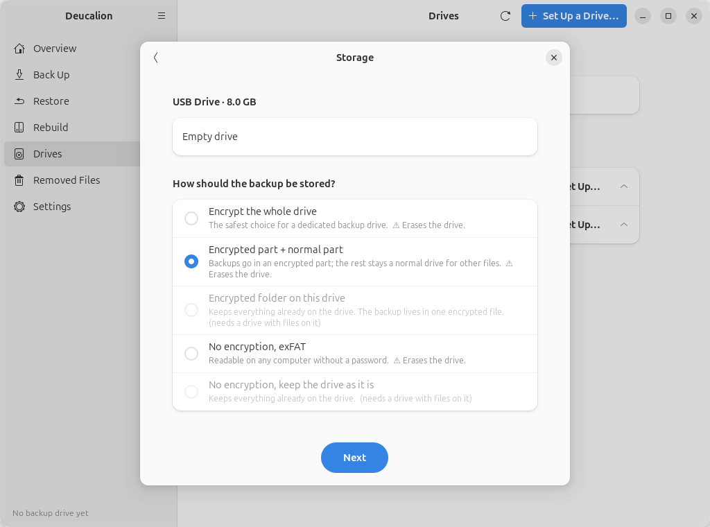
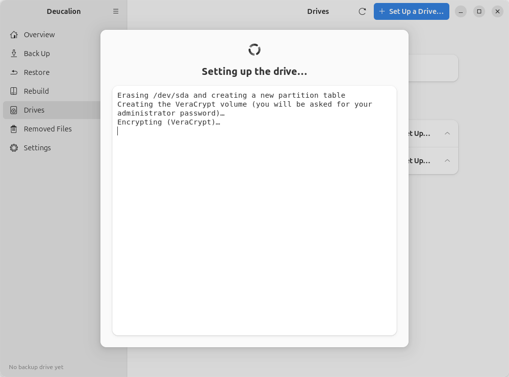
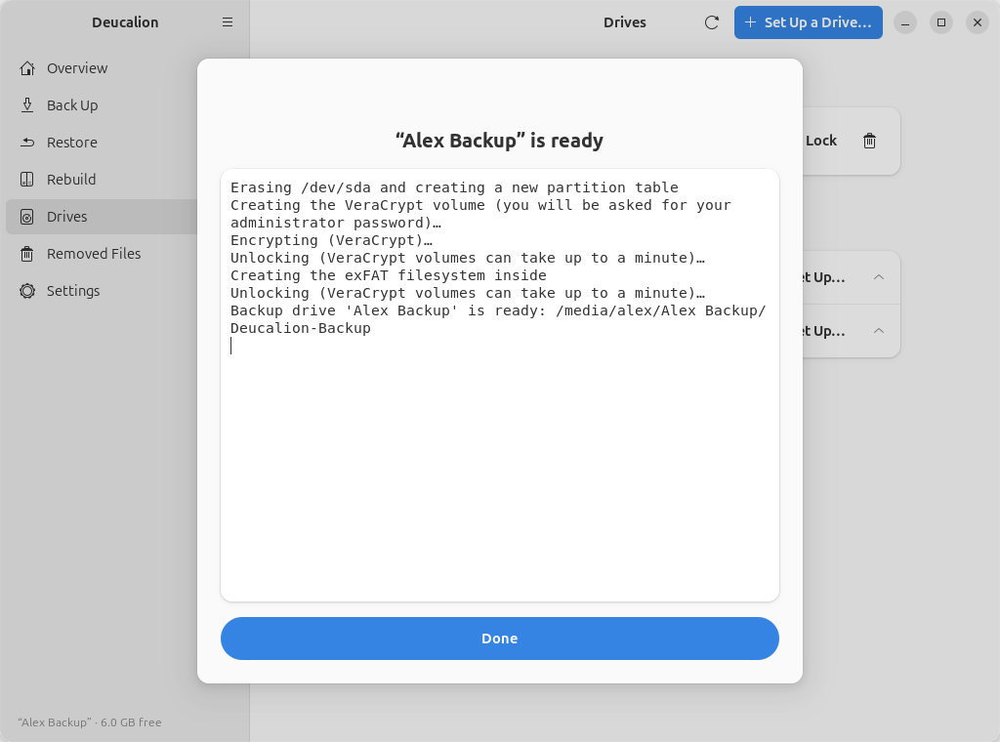

# Your first backup

**What you'll do:** prepare an external drive for backups, then back up your home folder and your
system recipe to it.<br>
**What you need:** Deucalion [installed](install.md); an external drive; if you want encryption, a
password you will not forget.<br>
**How long it takes:** about 10 minutes, plus the copying. A first backup copies everything, so it
can take an hour or more for a large home folder. Later backups copy only what changed.

This page uses the most common choice: an **encrypted part for the backup and a normal part** for
the copy of Deucalion and a READ-ME file. For other choices, see [Choosing a drive](../choosing-a-drive.md).

!!! danger "Preparing a drive this way erases it"
    Everything on the drive is deleted. If the drive has files you want to keep, copy them somewhere
    else first, or choose **Encrypted folder on this drive** or **keep the drive as it is**, which
    keep its files (see [Choosing a drive](../choosing-a-drive.md)).

=== "App"

    1. Plug in the drive.
    2. Open **Deucalion** from the app menu. The **Overview** page welcomes you:

        { .shot }

    3. Click **Set Up a Backup Drive**. A window opens and lists your external drives. Your
       computer's own disk is never listed. Choose your drive and click **Next**.

        { .shot }

    4. Under **How should the backup be stored?**, choose **Encrypted part + normal part** and
       click **Next**.

        { .shot }

    5. Under **Which encryption?**, keep **VeraCrypt** (you can then open the backup on Windows and
       macOS too) and click **Next**.
    6. On the **Details** page:
        - **Name of the backup drive**: a name you'll recognise, for example `Alex Backup`.
        - **Size of the encrypted part (GB)**: how much of the drive holds the backup. The rest stays
          a normal drive. The suggestion (80 % of the drive) is a good choice.
        - **Password** and **Type it again**: the backup's password. Use at least 8 characters; a few
          words make a strong password that is easy to remember.

        { .shot }

        !!! warning "Write the password down"
            Nobody can recover this password, not even with Deucalion. If you forget it, the backup
            is lost. Write it down and keep it somewhere safe, away from the computer.

    7. Click **Next**. The **Confirm** page sums up your choices. To confirm that the drive may be
       erased, type the drive's name shown there (for example `sda`) into **Drive name**, then click
       **Erase and Set Up**.

        { .shot }

    8. Ubuntu may ask for your administrator password (VeraCrypt needs it). Deucalion then prepares
       the drive. This takes a minute or two for the encrypted part to be created; on a large drive,
       creating a VeraCrypt part can take much longer, because the whole part is filled with
       encrypted data.

        { .shot }

    9. When it says **"Alex Backup" is ready**, click **Done**.

        { .shot }

    10. The **Overview** page now shows your drive, and a bar saying **This drive has no full
        backup yet.** Click **Back Up Now**.

        { .shot }

    11. Deucalion first saves your system recipe (Ubuntu may ask for your administrator password),
        then looks at your files. Nothing is copied yet. It then shows what it will copy:

        { .shot }

    12. Check the numbers and the **Largest folders** list. If a big folder you don't need is listed,
        click **Back** and leave it out in **Settings** (see [Leave folders out](../tutorials/leave-out.md)).
        Otherwise click **Start Backup**.

        { .shot }

    13. When it says **Backup complete**, click **Done**. The **Overview** page shows when your last
        backup was and how much is in it.

        { .shot }

    You can keep using your computer during the backup. If you need to stop, click **Stop**: the
    files copied so far are kept, and the next backup continues from there.

=== "Command line"

    1. Plug in the drive and open a terminal (++ctrl+alt+t++).
    2. Prepare the drive. Run:

        ```bash
        deucalion setup-drive
        ```

        Deucalion asks you questions one by one. Type the number of your answer (or the text asked
        for) and press ++enter++. Press ++enter++ alone to accept the default shown.

        - **Which drive?** your external drive. Your computer's own disk is never listed.
        - **How should the backup be stored?** the line that starts with *Encrypted part for the
          backup*.
        - **Which encryption?** *VeraCrypt* (opens on Windows and macOS too).
        - **Size of the encrypted part**: press ++enter++ for the suggestion.
        - **A name for this backup drive**: for example `Backup`.
        - **To confirm, type the drive name**: the name shown in brackets, such as `sdb`. This erases
          the drive.
        - **Backup password**, then **Type it again**: nothing appears while you type.

        ```text
        --8<-- "snippets/cli/setup-split-cli.txt"
        ```

        !!! warning "Write the password down"
            Nobody can recover this password, not even with Deucalion. If you forget it, the backup
            is lost.

    3. See what would be copied, without copying anything:

        ```bash
        deucalion backup --dry-run
        ```

        It lists the number of new files and the largest folders. If a big folder you don't need is
        listed, leave it out first (see [Leave folders out](../tutorials/leave-out.md)).

    4. Back up:

        ```bash
        deucalion backup
        ```

        While it copies, one line shows a progress bar, the amount copied, the speed and the time
        left. When it finishes:

        ```text
        --8<-- "snippets/cli/backup-first.txt"
        ```

    5. Check the result:

        ```bash
        deucalion status
        ```

    To stop a backup, press ++ctrl+c++ once. Deucalion stops safely; the next backup continues
    where it stopped.

**What you have now:** a backup drive with a full backup of your home folder and your system
recipe, and a copy of Deucalion and a READ-ME file on the drive's normal part.

**Next steps:**

- Back up again whenever you like: it only copies what changed. See [Make a full backup](../tutorials/full-backup.md).
- Learn how to [find and restore a file](../tutorials/restore-file.md).
- Before you unplug the drive, lock it: [Unlock and lock an encrypted drive](../tutorials/unlock-lock.md).
