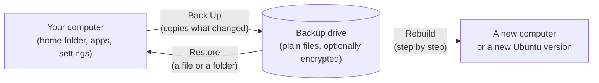

# Deucalion

**Back up your Ubuntu computer to an external drive. Get files back when you need them, and set up
a new computer, or a new version of Ubuntu, from that backup.**

{ .shot }

Deucalion is a free backup tool for Ubuntu. You can use it as an app with buttons and windows, or by
typing commands in a terminal. Both do the same things.

## What it protects you from

- **A lost, stolen or broken computer.** Your files, and a description of how your computer was set
  up, are on your backup drive. Deucalion can set up a new computer from it.
- **Upgrading to a new Ubuntu version.** Install the new version fresh, then let Deucalion put your
  files, apps and settings back, one step at a time.
- **Deleting or overwriting something by mistake.** Restore one file or a whole folder. Older
  versions of changed files are kept on the drive too.
- **Someone else reading your backup.** You can encrypt the backup drive with a password.

## Who it is for

Anyone with an Ubuntu computer (Ubuntu 24.04 or newer; on 22.04, from the command line) and an external drive, such as a USB hard disk
or SSD. You don't need to know how to use a terminal: every task can be done in the app, and every
tutorial shows the app first.

## How it works, in 30 seconds

1. **You back up.** Deucalion copies your home folder to the drive, plus a *system recipe*: a list
   of your apps, software sources, desktop settings and other system settings. The next backup only
   copies what changed.
2. **The backup is normal files.** You can open it on Linux, Windows or macOS, even without
   Deucalion.
3. **Nothing on the drive is thrown away by a backup.** If you change or delete a file on your
   computer, the old copy is moved to *Removed Files* on the drive. Only you can empty it.
4. **You restore or rebuild when you need to.** Deucalion always shows what it will change before
   it changes anything, and keeps a copy of anything it replaces on your computer.

## Start here

-   :material-download: **[Install Deucalion](getting-started/install.md)**

    A few minutes. You need an internet connection.

-   :material-backup-restore: **[Your first backup](getting-started/first-backup.md)**

    Prepare a drive and back up, in the app or in a terminal.

-   :material-laptop: **[Rebuild your computer](tutorials/rebuild.md)**

    New Ubuntu version or new computer? Start here.

-   :material-help-circle: **[Something went wrong?](troubleshooting/index.md)**

    Messages you might see, and what to do.

!!! note "What Deucalion does not do (in version 0.2)"
    Deucalion runs only when you start it: there are no scheduled or automatic backups yet. It keeps
    one up-to-date copy of your files (plus the old versions in Removed Files), not a history of
    daily snapshots. It does not copy Docker images or virtual machine disks; it only lists them.
    See the [plan](developers/plan.md) for what is planned next.
