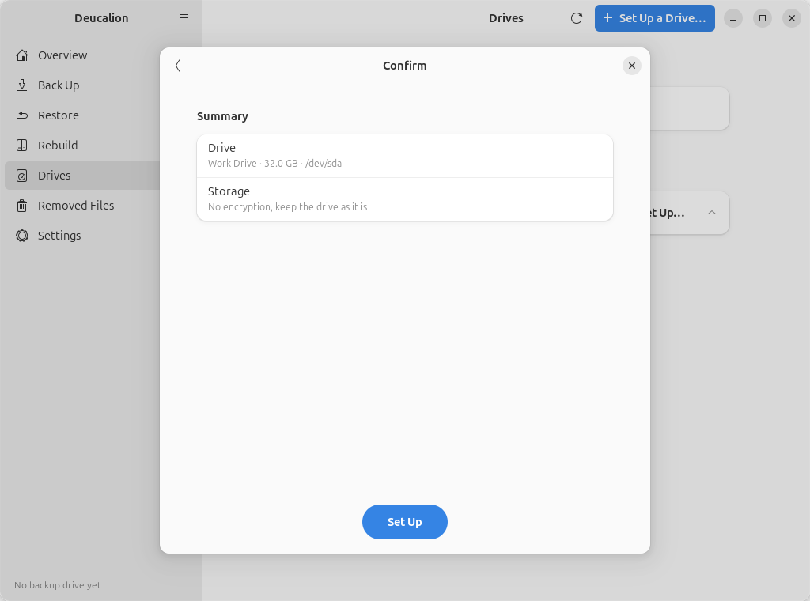

# Set up a drive: use a drive as it is

**What you'll do:** back up to a drive without formatting it: Deucalion adds a folder to it.<br>
**What you need:** Deucalion [installed](../getting-started/install.md); a drive that is mounted (open
it once in the Files app) with enough free space.<br>
**How long it takes:** 2 minutes.

**Good for:** a drive you already use, for example one that came from the shop formatted as NTFS, when
you don't need encryption.
**Keep in mind:** the backup is not encrypted. Where it can be opened depends on the drive's format:
exFAT everywhere, NTFS on Windows and Linux (read-only on macOS), ext4 only on Linux. On a Linux
format (ext4, Btrfs…), file names and permissions are kept natively; on others, Deucalion stores
[names exFAT-safe](../concepts/file-names.md).

=== "App"

    1. Plug in the drive and make sure it is mounted.
    2. In Deucalion, go to **Drives** and click **Set Up…** next to the drive.
    3. Choose **No encryption, keep the drive as it is** and click **Next**.

        { .shot }

    4. Type a **Name of the backup drive** (here `Work`) and click **Next**.
    5. On the **Confirm** page, nothing will be erased: click **Set Up**.

        { .shot }

    6. When it is ready, click **Done**.

=== "Command line"

    Run `deucalion setup-drive` and answer: the drive; **5** (*No encryption: use the drive as it
    is*); a name; `y` to continue.

    ```text
    --8<-- "snippets/cli/setup-as-is.txt"
    ```

    Or use [`deucalion register /media/alex/Work`](../cli/register.md): it does the same without
    putting a copy of Deucalion and a READ-ME file on the drive.

## What is on the drive now

Your files, plus `Deucalion-Backup` (the backup), `Deucalion-Tool` and `READ-ME-FIRST.txt`:

```text
--8<-- "snippets/cli/work-drive.txt"
```

**What you have now:** a backup folder on your drive, registered as your default backup drive.

**Next steps:** [Make a full backup](full-backup.md). Before unplugging, **Unmount** it on the
**Drives** page or run `deucalion close`.
