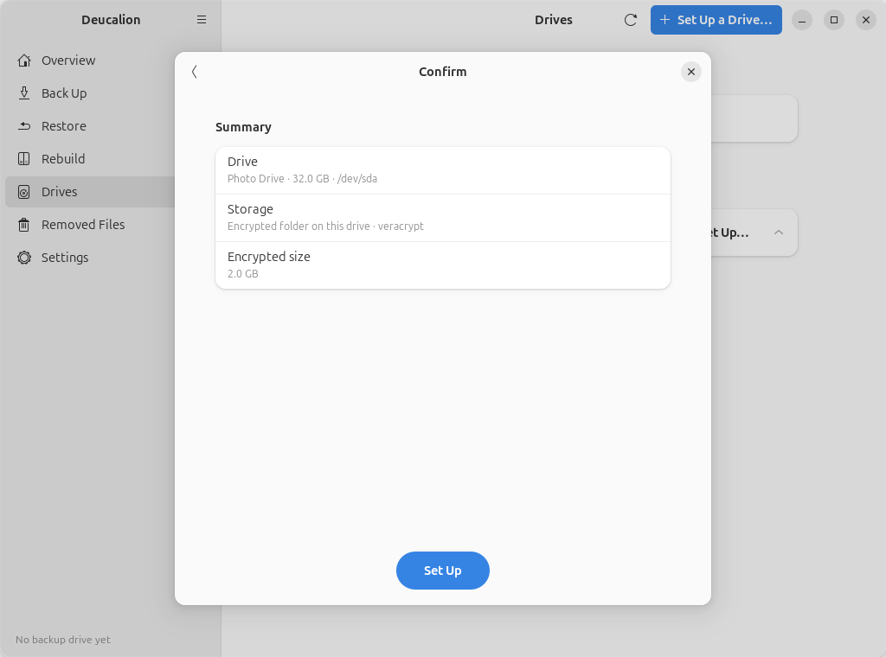
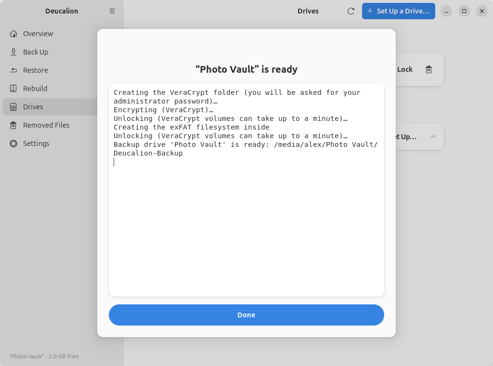

# Set up a drive: encrypted folder on a drive you use

**What you'll do:** create an encrypted backup inside one big file on a drive that already holds
your files, without erasing anything.<br>
**What you need:** Deucalion [installed](../getting-started/install.md) (with VeraCrypt for a VeraCrypt
folder); a drive with free space that is mounted (open it once in the Files app); a password you will
remember; your administrator password (VeraCrypt).<br>
**How long it takes:** 5 minutes of your time; creating a VeraCrypt folder fills it with encrypted
data, from seconds for a small folder to hours for a very large one (LUKS is quick).

**Good for:** a drive you already use for other things, such as a photo drive or a drive that came
formatted as NTFS.
**Keep in mind:** the encrypted folder **has a fixed size** that can't grow later. Choose it with room
to spare.

Before: a drive called **Photos** (NTFS) with some folders on it.

=== "App"

    1. Plug in the drive and make sure it is mounted (open it in the Files app).
    2. In Deucalion, go to **Drives** and click **Set Up…** next to the drive.
    3. Choose **Encrypted folder on this drive** (it says *Keeps everything already on the drive*) and
       click **Next**.

        { .shot }

    4. Choose **VeraCrypt** (or **LUKS**) and click **Next**.
    5. Type a name (here `Photo Vault`), the **Size of the encrypted folder (GB)** (the suggestion is
       80 % of the free space) and the password twice. Click **Next**.

        { .shot }

    6. On the **Confirm** page, nothing will be erased: click **Set Up**.

        { .shot }

    7. When it is ready, click **Done**.

        { .shot }

=== "Command line"

    1. Plug in the drive and make sure it is mounted (open it in the Files app).
    2. Run `deucalion setup-drive` and answer: the drive; **3** (*Encrypted folder on this drive*);
       the encryption; the size in GB; a name; `y` to continue; the password twice.

        ```text
        --8<-- "snippets/cli/setup-folder.txt"
        ```

!!! warning "Write the password down"
    Nobody can recover it. Without it, the backup can't be opened.

## What is on the drive now

Your files are untouched. Next to them are the encrypted folder (`Deucalion-Backup.hc` for VeraCrypt,
`Deucalion-Backup.luks` for LUKS), a copy of Deucalion and the READ-ME file:

```text
--8<-- "snippets/cli/photos-drive.txt"
```

```text
--8<-- "snippets/cli/readme-folder.txt"
```

!!! danger "Don't delete or move `Deucalion-Backup.hc`"
    That one file *is* your backup. Deleting it deletes the backup.

**What you have now:** an encrypted backup folder, unlocked and registered as your default backup
drive, on a drive that still holds your files.

**Next steps:** [Make a full backup](full-backup.md) · [Unlock and lock an encrypted drive](unlock-lock.md).
