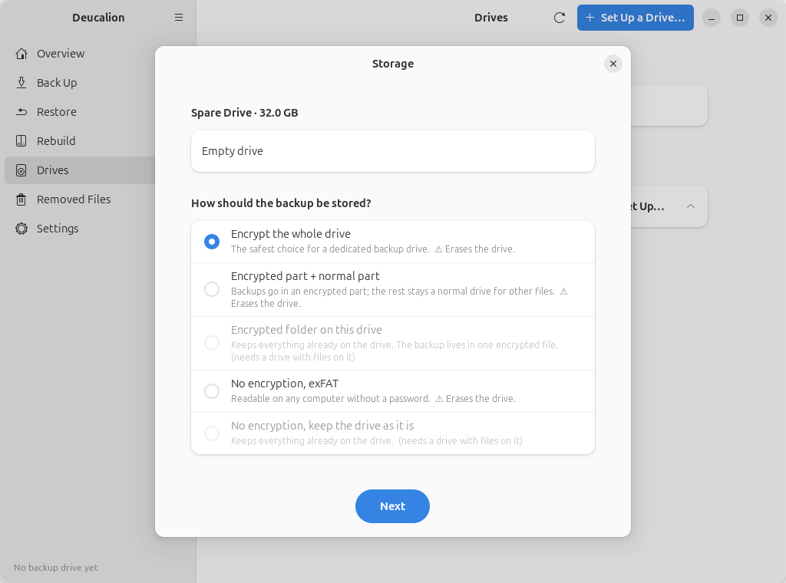
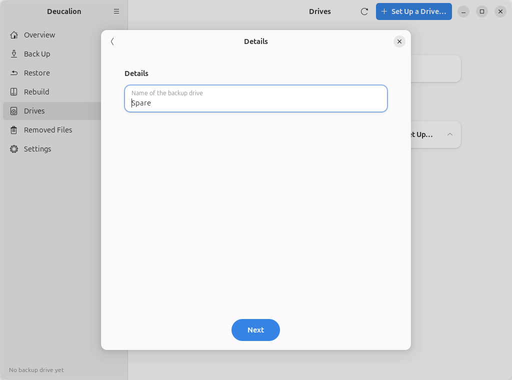
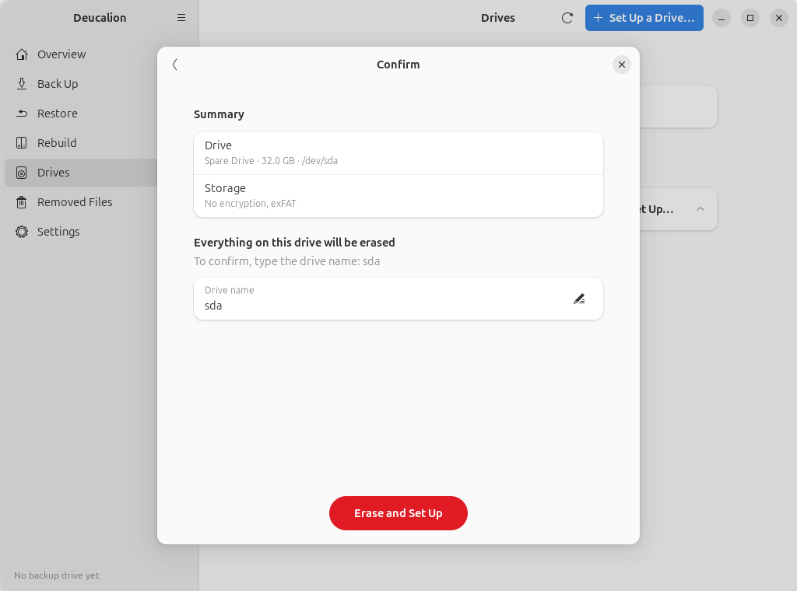
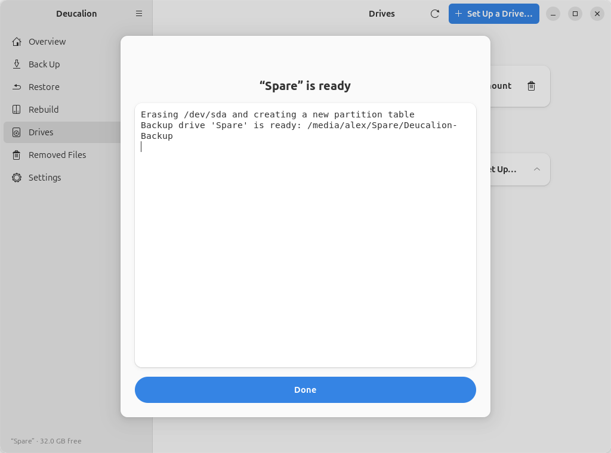

# Set up a drive: plain exFAT, no encryption

**What you'll do:** erase a drive and format it as exFAT, without a password.<br>
**What you need:** Deucalion [installed](../getting-started/install.md); an external drive whose
contents you don't need.<br>
**How long it takes:** 2 minutes.

**Good for:** a backup you want to open on any computer without a password or extra software.
**Keep in mind:** anyone who has the drive can read everything on it, including saved Wi-Fi
passwords and keys. Keep the drive somewhere safe.

!!! danger "This erases the whole drive"
    Everything on it is deleted. Copy anything you want to keep somewhere else first.

=== "App"

    1. Plug in the drive. In Deucalion, go to **Drives** and click **Set Up…** next to the drive.
    2. Choose **No encryption, exFAT** and click **Next**.

        { .shot }

    3. Type a **Name of the backup drive** (here `Spare`) and click **Next**. There is no password.

        { .shot }

    4. Type the drive's name shown on the **Confirm** page and click **Erase and Set Up**.

        { .shot }

    5. When it is ready, click **Done**.

        { .shot }

=== "Command line"

    Run `deucalion setup-drive` and answer: the drive; **3** on an empty drive (*No encryption: erase
    and format the whole drive as exFAT*; on a drive that has files it is **4**); a name; the drive's
    short name to confirm.

    ```text
    --8<-- "snippets/cli/setup-plain.txt"
    ```

## What is on the drive now

One exFAT part with the backup folder, a copy of Deucalion and the READ-ME file:

```text
--8<-- "snippets/cli/readme-plain.txt"
```

The drive is formatted with 8 KB clusters, so millions of small files don't waste space.

**What you have now:** a backup drive readable everywhere, registered as your default backup drive.

**Next steps:** [Make a full backup](full-backup.md). Before unplugging, **Unmount** it on the
**Drives** page or run `deucalion close`.
