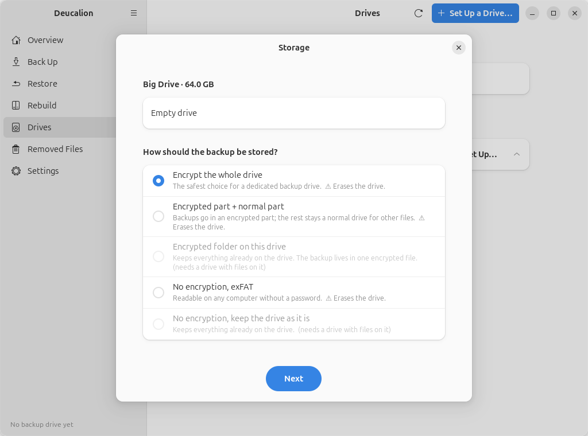
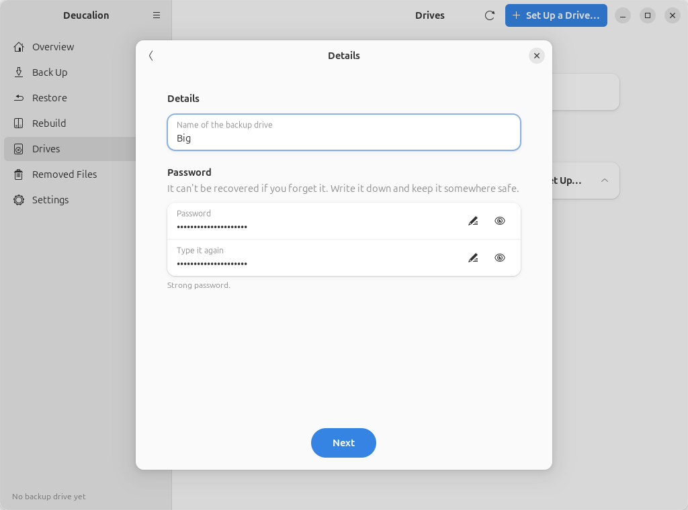
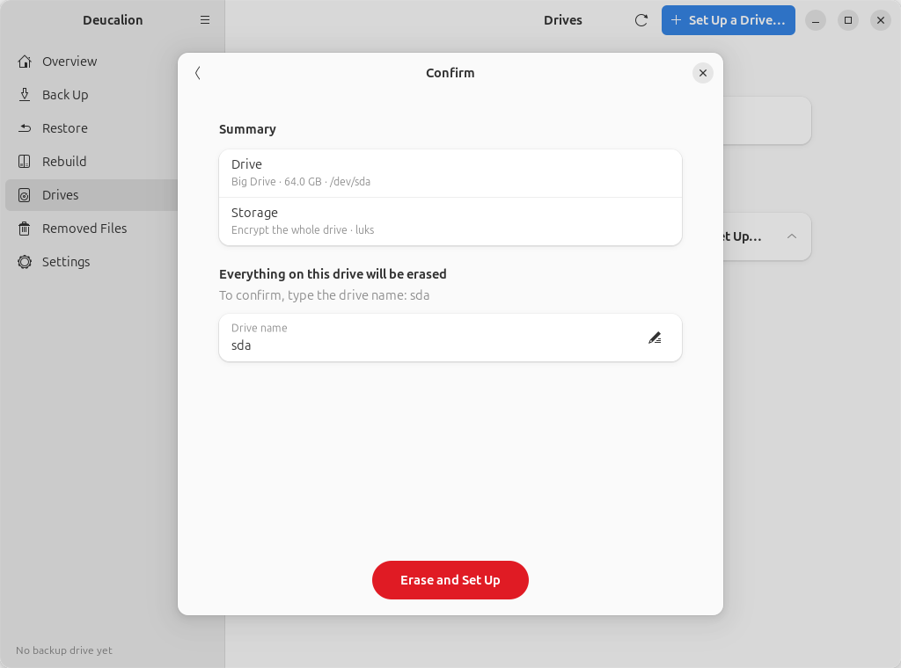
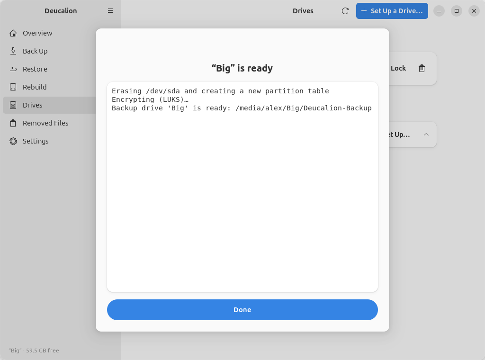

# Set up a drive: whole drive, LUKS

**What you'll do:** encrypt a whole drive with LUKS, the encryption built into Ubuntu.<br>
**What you need:** Deucalion [installed](../getting-started/install.md); an external drive whose
contents you don't need (it will be erased); a password you will remember.<br>
**How long it takes:** about 5 minutes.

**Good for:** a backup drive used only with Linux. No extra software, no administrator password, and
Ubuntu itself asks for the drive's password when you plug it in.
**Keep in mind:** Windows and macOS can't open it. The drive has no unencrypted part, so no copy of
Deucalion and no READ-ME file on it. Inside, the backup uses ext4, which keeps Linux permissions and
names as they are.

!!! danger "This erases the whole drive"
    Everything on it is deleted. Copy anything you want to keep somewhere else first.

=== "App"

    1. Plug in the drive. Open Deucalion, go to **Drives**, and click **Set Up…** next to the drive.
    2. Choose **Encrypt the whole drive**, click **Next**.

        { .shot }

    3. Choose **LUKS (Linux only)**, click **Next**.
    4. Type a **Name of the backup drive** (here `Big`) and the **Password** twice. Click **Next**.

        { .shot }

        !!! warning "Write the password down"
            Nobody can recover it. Without it, the backup can't be opened.

    5. Type the drive's name shown on the **Confirm** page and click **Erase and Set Up**.

        { .shot }

    6. When it says the drive is ready, click **Done**.

        { .shot }

=== "Command line"

    1. Plug in the drive and open a terminal.
    2. Find the drive's name with `deucalion drives` (here `/dev/sdb`), then run, with that name:

        ```bash
        deucalion setup-drive /dev/sdb --layout encrypt-all --method luks --name Big
        ```

        Type the drive's short name to confirm, then the password twice:

        ```text
        --8<-- "snippets/cli/setup-luks-whole.txt"
        ```

        !!! warning "Write the password down"
            Nobody can recover it. Without it, the backup can't be opened.

**What you have now:** an encrypted LUKS backup drive, unlocked, registered as your default backup
drive.

**Next time you plug it in,** Ubuntu asks for its password and opens it. Deucalion then finds the
backup by itself. You can also unlock it with Deucalion (**Unlock** in the app, or `deucalion open`).

**Next steps:** [Make a full backup](full-backup.md) · [Unlock and lock an encrypted drive](unlock-lock.md).
