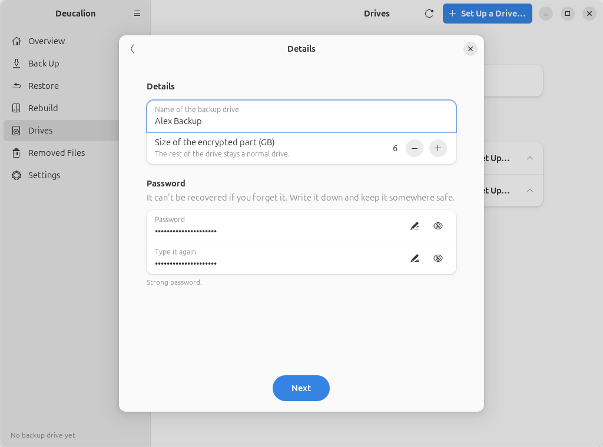

# Set up a drive: encrypted part + normal part

**What you'll do:** split a drive into an encrypted part for your backups and a normal part that any
computer can read.<br>
**What you need:** Deucalion [installed](../getting-started/install.md) (with VeraCrypt for a VeraCrypt
encrypted part); an external drive whose contents you don't need (it will be erased); a password you
will remember; your administrator password (VeraCrypt).<br>
**How long it takes:** 5 minutes of your time; creating a VeraCrypt part fills it with encrypted data,
from a minute on a small drive to hours on a large hard disk (LUKS is quick).

**Good for:** most people. The backup is encrypted, and the normal part carries a copy of Deucalion
(`Deucalion-Tool`) and `READ-ME-FIRST.txt`, so a [rebuild](rebuild.md) on a new computer can start
straight from the drive. You can also keep other files on the normal part.

!!! danger "This erases the whole drive"
    Everything on it is deleted. Copy anything you want to keep somewhere else first.

=== "App"

    The app's steps are shown in full in [Your first backup](../getting-started/first-backup.md):
    **Drives → Set Up…** next to the drive, **Encrypted part + normal part**, **VeraCrypt** (or
    **LUKS**), then the name, the **Size of the encrypted part (GB)** and the password, then type the
    drive's name and click **Erase and Set Up**.

    { .shot }

    The **Size of the encrypted part** is how much of the drive holds the backup; the rest stays a
    normal exFAT part. The suggestion is 80 % of the drive. The encrypted part can't be resized later
    without erasing the drive, so give the backup room to grow.

=== "Command line"

    Run `deucalion setup-drive` and answer: the drive; **2** (*Encrypted part for the backup + a
    normal part*); the encryption; the **size of the encrypted part** in GB (++enter++ for the
    suggestion); a name; the drive's short name to confirm; the password twice.

    ```text
    --8<-- "snippets/cli/setup-split-cli.txt"
    ```

    Without questions (only the password is asked):
    `deucalion setup-drive /dev/sdb --layout encrypt-part --method veracrypt --size 5 --name Backup --yes-erase sdb`.

!!! warning "Write the password down"
    Nobody can recover it. Without it, the backup can't be opened.

## What is on the drive now

Two parts with the same name. In the Files app (and in `/media/<you>/`, or `/run/media/<you>/` on
Ubuntu 26.04 and newer), the second one opened gets a number added: for example **Alex Backup** and
**Alex Backup1**.

- The **normal part** (exFAT, readable everywhere) holds:

    ```text
    --8<-- "snippets/cli/tool-folder.txt"
    ```

    `READ-ME-FIRST.txt` explains how to open the backup on Linux, Windows and macOS:

    ```text
    --8<-- "snippets/cli/readme-split.txt"
    ```

- The **encrypted part** holds the `Deucalion-Backup` folder. Windows sees it as a Linux partition
  and doesn't offer to format it. If Windows ever says a drive needs formatting, choose **Cancel**.

**What you have now:** an encrypted backup drive with a normal part, unlocked and registered as your
default backup drive.

**Next steps:** [Make a full backup](full-backup.md) · [Unlock and lock an encrypted drive](unlock-lock.md) ·
[Rebuild your computer](rebuild.md).
