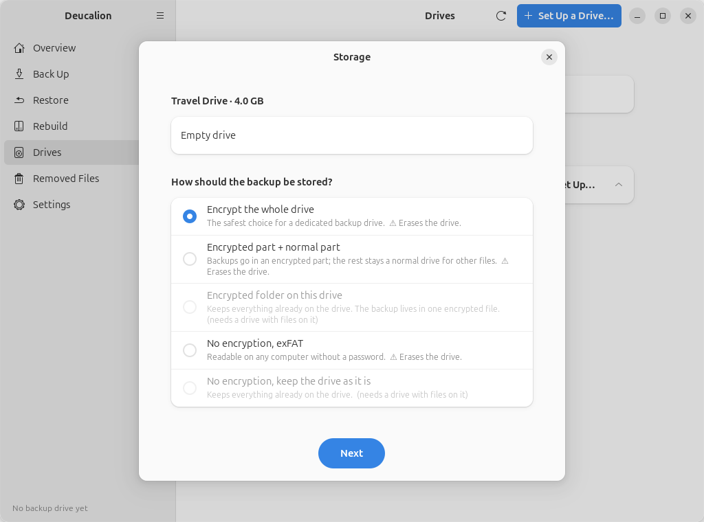
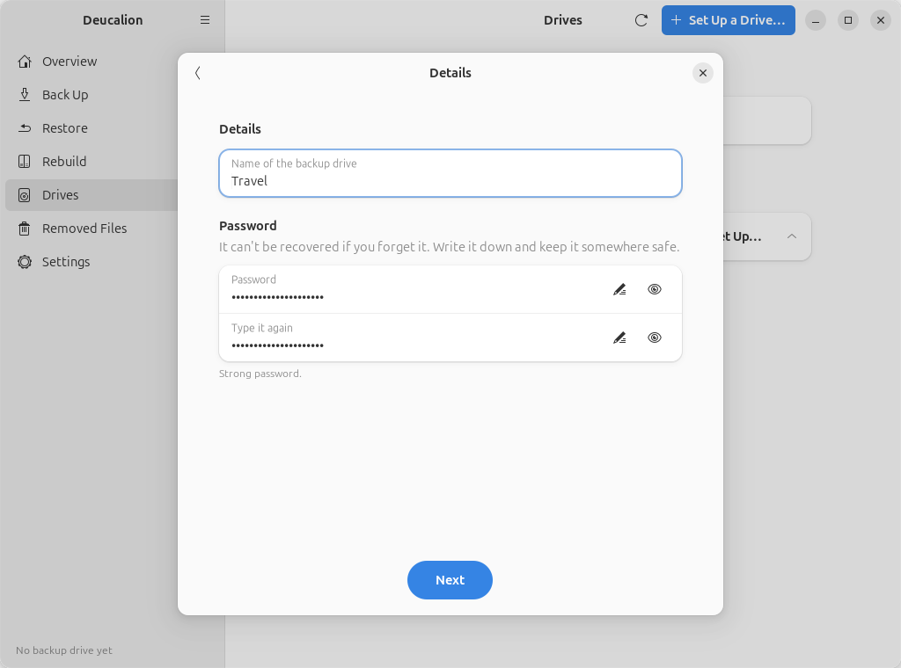
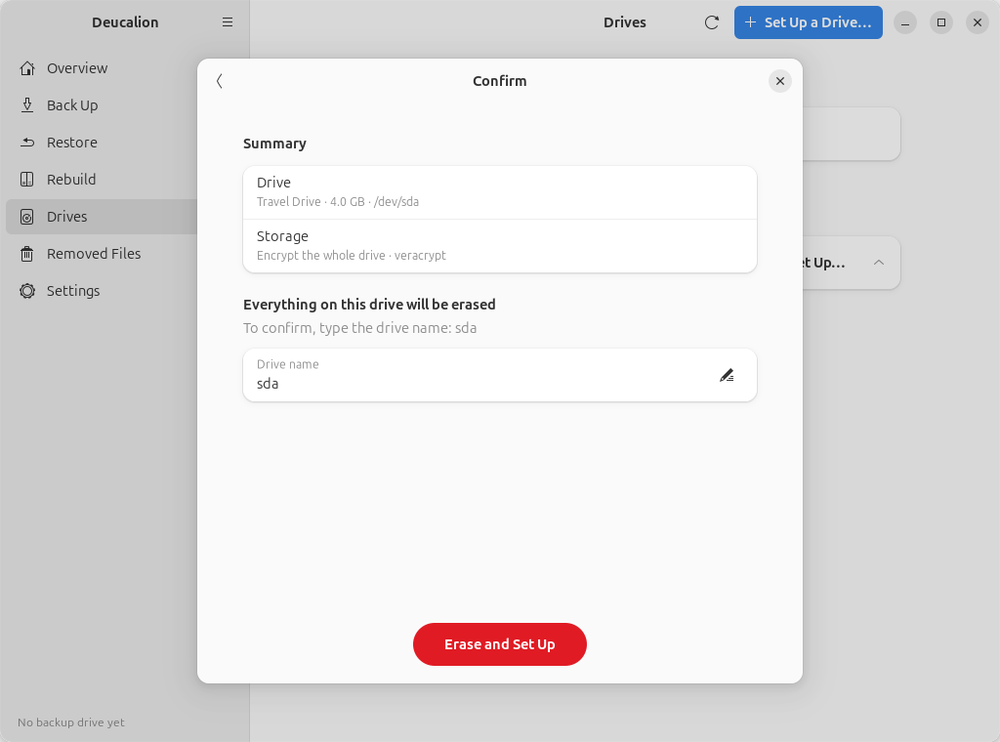
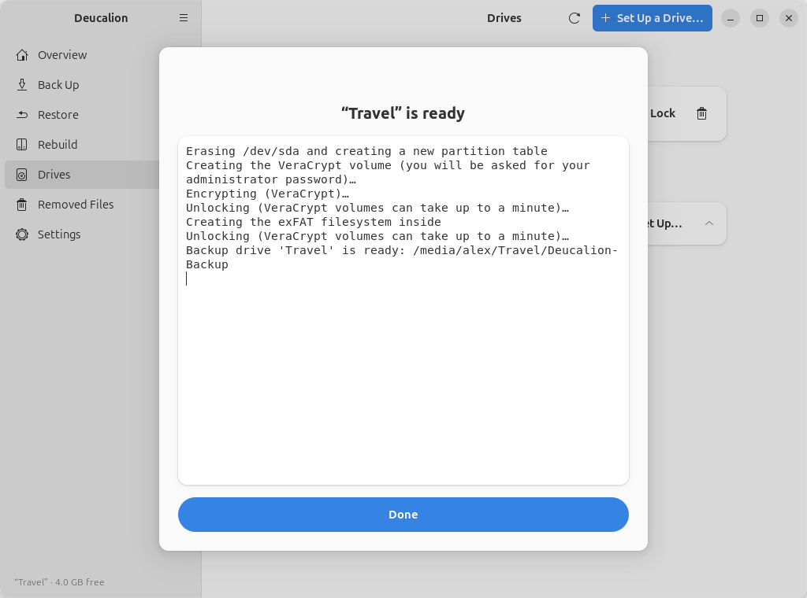

# Set up a drive: whole drive, VeraCrypt

**What you'll do:** turn a whole drive into one encrypted VeraCrypt volume for your backups.<br>
**What you need:** Deucalion with VeraCrypt [installed](../getting-started/install.md); an external
drive whose contents you don't need (it will be erased); a password you will remember; your
administrator password.<br>
**How long it takes:** 5 minutes of your time. Creating the volume fills the whole drive with
encrypted data, which takes from a minute on a small drive to several hours on a large hard disk.

**Good for:** a drive used only for backups, that you may need to open on Windows or macOS.
**Keep in mind:** the drive has no unencrypted part, so it carries no copy of Deucalion and no
READ-ME file. On a new computer, [install Deucalion](../getting-started/install.md) first.

!!! danger "This erases the whole drive"
    Everything on it is deleted. Copy anything you want to keep somewhere else first.

=== "App"

    1. Plug in the drive. Open Deucalion and go to **Drives**.
    2. Next to the drive under **Connected drives**, click **Set Up…**.
    3. Choose **Encrypt the whole drive** and click **Next**.

        { .shot }

    4. Choose **VeraCrypt** and click **Next**.
    5. Type a **Name of the backup drive** (here `Travel`) and the **Password** twice. Click **Next**.

        { .shot }

        !!! warning "Write the password down"
            Nobody can recover it. Without it, the backup can't be opened.

    6. Type the drive's name shown on the **Confirm** page (for example `sdb`) and click **Erase and Set Up**.

        { .shot }

    7. Ubuntu asks for your administrator password. Deucalion creates the volume, unlocks it, creates
       the backup folder, and registers the drive.

        { .shot }

    8. Click **Done**. Under **Connected drives**, the drive now shows one encrypted part holding a
       Deucalion backup:

        { .shot }

=== "Command line"

    1. Plug in the drive and open a terminal.
    2. Run `deucalion setup-drive` and answer: the drive; **1** (*Encrypt the whole drive*);
       **1** (*VeraCrypt*); a name; the drive's short name to confirm; the password twice. Your
       administrator password is asked when the volume is created.

        ```text
        --8<-- "snippets/cli/setup-veracrypt-whole.txt"
        ```

        !!! warning "Write the password down"
            Nobody can recover it. Without it, the backup can't be opened.

    3. Check it:

        ```text
        --8<-- "snippets/cli/drives-veracrypt-whole.txt"
        ```

    The same without questions (only the password is asked):
    `deucalion setup-drive /dev/sdb --layout encrypt-all --method veracrypt --name Travel --yes-erase sdb`.

**What you have now:** an encrypted backup drive, unlocked, registered as your default backup drive.

**Next steps:**

- [Make a full backup](full-backup.md).
- [Lock the drive](unlock-lock.md) before unplugging it.
- To open it on Windows or macOS, see [Open your backup without Deucalion](open-without-deucalion.md).
