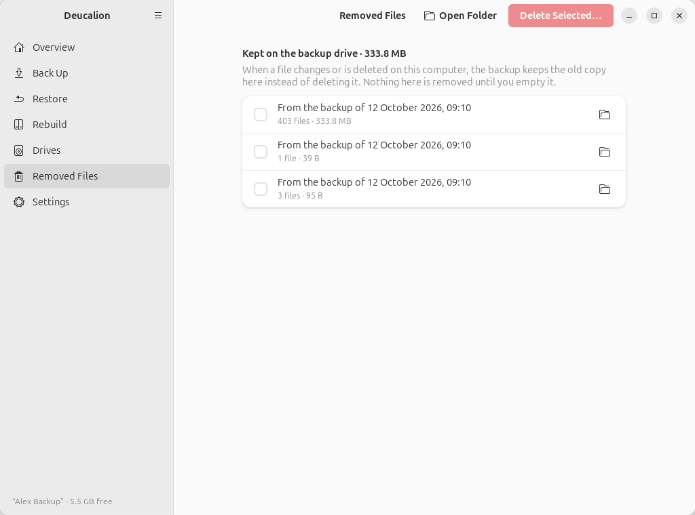
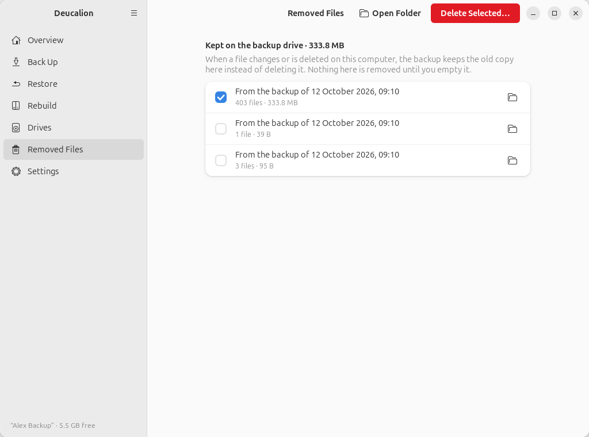
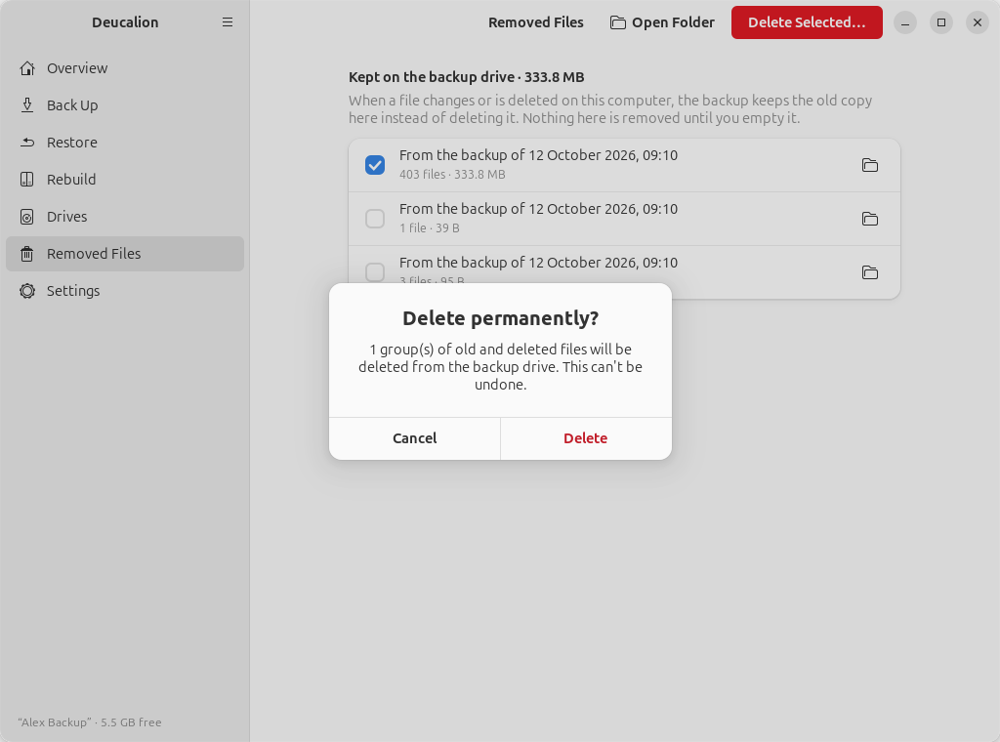

# Free space on the drive

**What you'll do:** see what takes space on the backup drive, and free some.<br>
**What you need:** your backup drive.<br>
**How long it takes:** 5 minutes.

Space on a backup drive is used by:

1. **The backup itself**: what you back up. Make it smaller by [leaving out](leave-out.md) what you
   don't need.
2. **[Removed Files](../concepts/mirror-and-removed.md)**: old versions and deleted files, kept until
   you empty them. This usually grows over time, and it is the first place to free space.

## See and empty Removed Files

=== "App"

    1. Go to **Removed Files**. The title shows the total; each row is one backup's old and deleted
       files, newest first.

        { .shot }

    2. To look inside a group first, click its folder button: it opens in the Files app.
    3. Tick the groups you don't need (usually the oldest) and click **Delete Selected…**.

        { .shot }

    4. Confirm with **Delete**. A message says how much space was freed.

        { .shot }

=== "Command line"

    1. List the groups (batches), oldest first:

        ```text
        --8<-- "snippets/cli/removed-list.txt"
        ```

    2. Delete one or more by name (or all of them with `deucalion removed empty`), and answer `y`:

        ```text
        --8<-- "snippets/cli/removed-empty.txt"
        ```

!!! danger "This can't be undone"
    What you delete from Removed Files is gone from the drive. Only delete versions you are sure you
    don't need.

## When the drive is full

Before copying anything, Deucalion checks that the backup fits. If it doesn't, it stops without
copying and says how much is needed:

```text
--8<-- "snippets/cli/backup-full-drive.txt"
```

In the app, the same message appears in a bar above the plan, and **Start Backup** is greyed out.

What to do, in this order:

1. Empty old groups in Removed Files (above), then back up again.
2. [Leave out](leave-out.md) large folders you don't need backed up (the plan's **Largest folders**
   list shows what is big).
3. Move to a bigger drive: see [Move your backups to a bigger drive](bigger-drive.md).

If the drive fills up *during* a backup (for example because files grew while it ran), the backup
stops with *"The backup drive is full. Free some space (for example empty \_removed/ with: deucalion
removed empty, or leave out large folders) and run again."* Nothing is damaged: free some space and
run the backup again; it continues where it stopped.

**What you have now:** room for your next backups.
