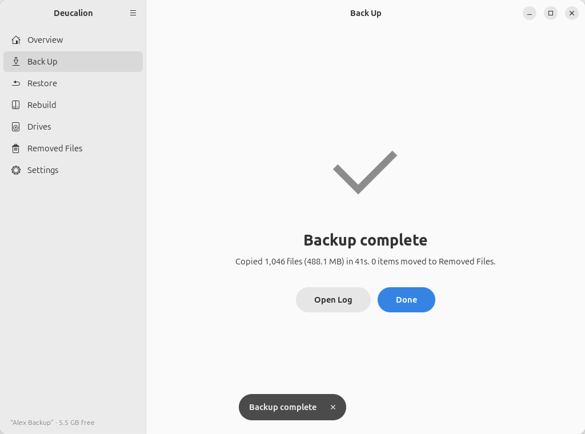

# Make a full backup

**What you'll do:** back up everything: your home folder, your extra folders and your system
recipe.<br>
**What you need:** a [backup drive](../choosing-a-drive.md) set up; its password if it is encrypted;
your administrator password (for the protected settings, unless you turned them off).<br>
**How long it takes:** a few minutes when little changed; the first backup copies everything.

Back up as often as you like. Only new and changed files are copied, and the old versions of changed
files are kept in [Removed Files](../concepts/mirror-and-removed.md).

=== "App"

    1. Plug in the backup drive.
    2. Open Deucalion. On the **Overview** page, click **Back Up Now**. (If the drive is locked, type
       its password and click **Unlock**.)
    3. Deucalion saves your system recipe (Ubuntu asks for your administrator password) and compares
       your files with the backup. Nothing is copied yet.
    4. Read the plan: **New files**, **Changed files**, **Gone from this computer**, **Unchanged** and
       **To copy now**:

        { .shot }

        **Gone from this computer** lists files and folders that are in the backup but no longer on your
        computer. They are moved to Removed Files, not deleted. If that number is much larger than
        you expect, click **Back** and check why (for example, a folder that is on a disk that isn't
        mounted).

    5. Click **Start Backup**. You can keep working while it copies.
    6. When it says **Backup complete**, click **Done**.

        { .shot }

    You can also start from the **Back Up** page: choose **Everything**, then **Check What Will Be
    Copied**.

=== "Command line"

    1. Plug in the backup drive and open a terminal.
    2. Optional: see what will be copied first:

        ```bash
        deucalion backup --dry-run
        ```

    3. Back up (it asks for the drive's password if it is locked, and for your administrator password
       for the protected settings):

        ```text
        --8<-- "snippets/cli/backup.txt"
        ```

        The **Gone/excluded** line counts what is in the backup but no longer on your computer (or now
        left out); it is moved to Removed Files, not deleted.

**What you have now:** an up-to-date backup of your files and of your system recipe. The **Overview**
page (or `deucalion status`) shows when it finished.

**Next steps:**

- Lock or unmount the drive before unplugging it: [Unlock and lock an encrypted drive](unlock-lock.md).
- Now and then, [check that the backup is intact](verify.md).
- [Leave out](leave-out.md) big folders you don't need.
