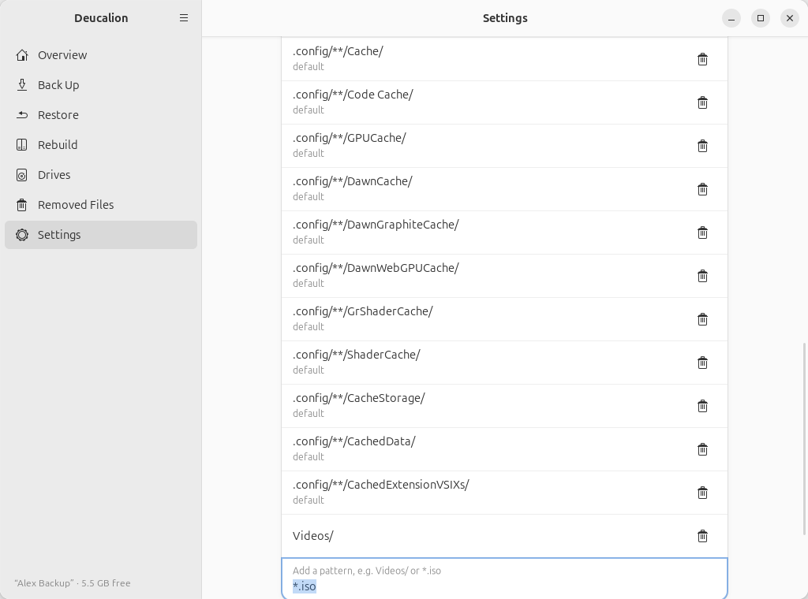

# Leave folders out

**What you'll do:** stop backing up folders or files you don't need, to save time and space.<br>
**What you need:** Deucalion; nothing else.<br>
**How long it takes:** 2 minutes.

Deucalion already leaves out caches, the Trash and similar folders (see
[Default exclusions](../reference/exclusion-patterns.md#default-exclusions)). Good candidates to add:
large folders you can download again (`Downloads/`, `Videos/`), disk images (`*.iso`), virtual
machine disks, and folders that programmers' tools recreate (`node_modules/`, `.venv/`).

In this example, Alex leaves out the `Videos` folder (it is copied elsewhere) and `node_modules`
folders.

=== "App"

    1. Open Deucalion and go to **Settings**.
    2. For programmers' folders, turn on the switch under **Leave out developer folders**, for example
       **JavaScript packages (node_modules)**.

        { .shot }

    3. For anything else, scroll to **Leave out of backups**, type a pattern in **Add a pattern, e.g.
       Videos/ or \*.iso** and press ++enter++:
        - `Videos/` leaves out every folder called `Videos`;
        - `*.iso` leaves out every file ending in `.iso`;
        - `Projects/old/` leaves out only `~/Projects/old`.

        { .shot }

    4. To remove a pattern, click its bin button. **Restore Defaults** puts back the default list.

=== "Command line"

    1. Add patterns (in quotes):

        ```text
        --8<-- "snippets/cli/exclude-add.txt"
        ```

    2. Remove one:

        ```bash
        deucalion exclude remove "*.iso"
        ```

    3. Programmers' folders are patterns too: `deucalion exclude add node_modules/`.
    4. `deucalion exclude` shows the list; `deucalion exclude reset` puts back the defaults.

## What happens to what was already backed up

The next full backup moves what you now leave out from the backup to **Removed Files** (it counts as
*Gone*). It is not deleted: it stays in Removed Files until you empty it.

```text
--8<-- "snippets/cli/backup-after-exclude-dry-run.txt"
```

Here, 2 items (the `Videos` folder and the `node_modules` folder) will move to Removed Files.

**What you have now:** smaller, faster backups.

**Next steps:** see [Exclusion patterns](../reference/exclusion-patterns.md) for more examples, and
[Free space on the drive](free-space.md) to free the space the old copies take.
