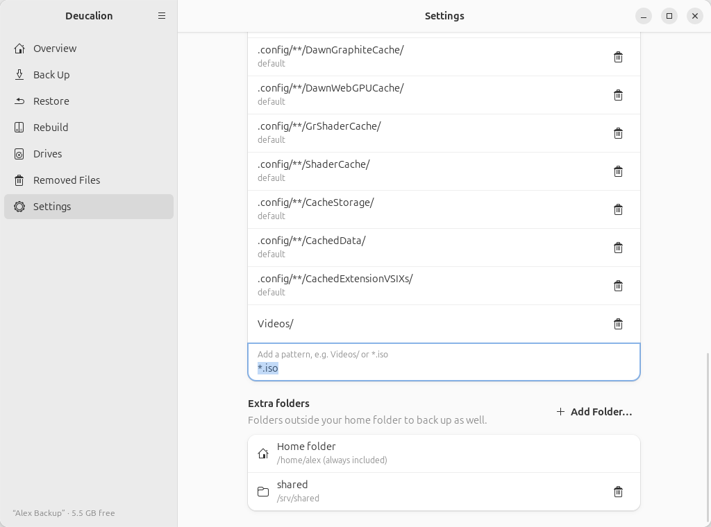

# Back up a folder outside your home

**What you'll do:** add a folder that isn't in your home folder (for example `/srv/shared`, or a
second disk mounted at `/data`) to your full backups.<br>
**What you need:** a folder you can read.<br>
**How long it takes:** 2 minutes, plus the next backup.

=== "App"

    1. Open Deucalion and go to **Settings**.
    2. Scroll to **Extra folders** and click **Add Folder…**.
    3. Choose the folder and click **Select**. It appears in the list with a short name (the last part
       of its path):

        { .shot }

    4. Back up (**Back Up Now** on the Overview page). The folder is included in every full backup.

=== "Command line"

    1. Add the folder:

        ```text
        --8<-- "snippets/cli/folder-add.txt"
        ```

    2. Back up with `deucalion backup`. The folder is included in every full backup. You can also
       back it up alone: `deucalion backup --only /srv/shared`.

## Where it goes in the backup

In `extras/<name>`, next to `home` and `system`:

```text
--8<-- "snippets/cli/ls-after-folder.txt"
```

On restore, it goes back to its original place (`/srv/shared`), or wherever you choose.

!!! note
    - A folder inside your home folder is refused: your home folder is always backed up.
    - Deucalion reads the folder as you: files only the administrator can read are skipped (with a
      warning).
    - If the folder is empty at backup time but the backup has files from it (for example because its
      disk isn't mounted), Deucalion skips it to keep the backup safe.

**What you have now:** the folder is part of every full backup.

**Next steps:** to stop backing it up, remove it in **Settings** (bin button) or with
`deucalion folder remove shared`. What was already backed up stays in the backup.
