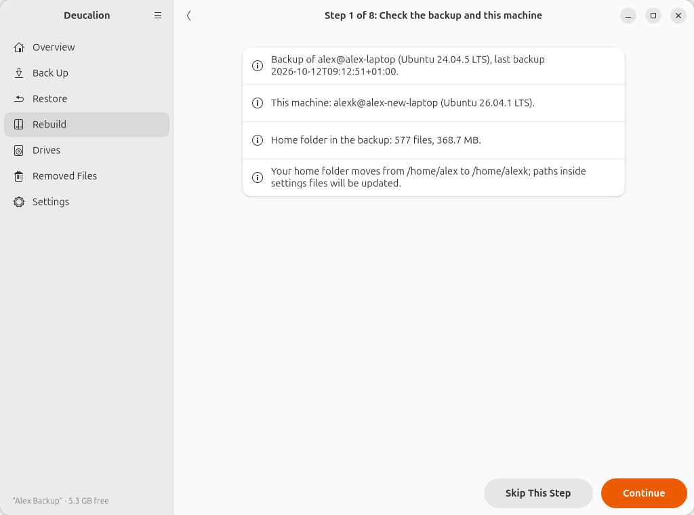
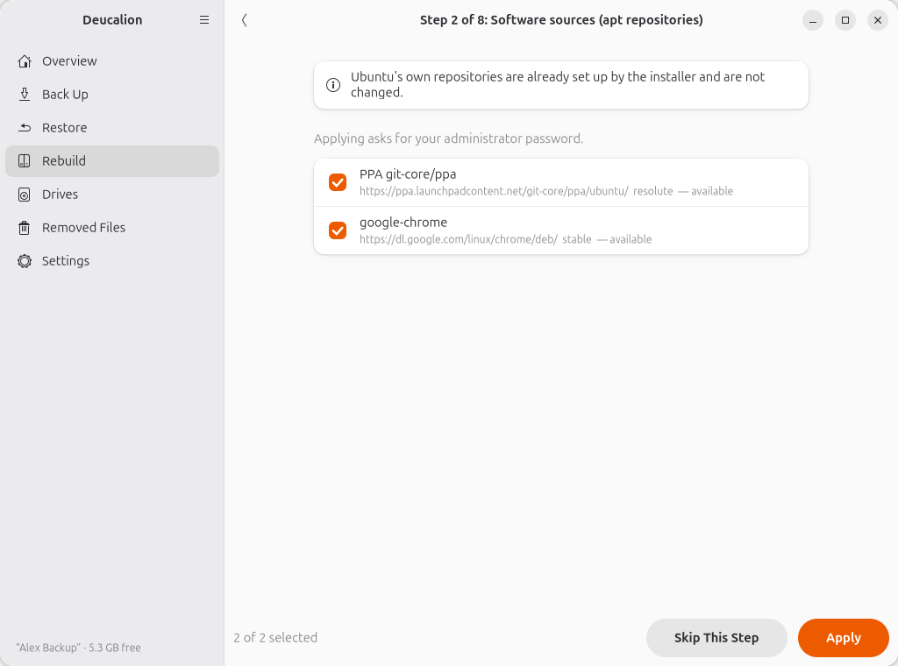
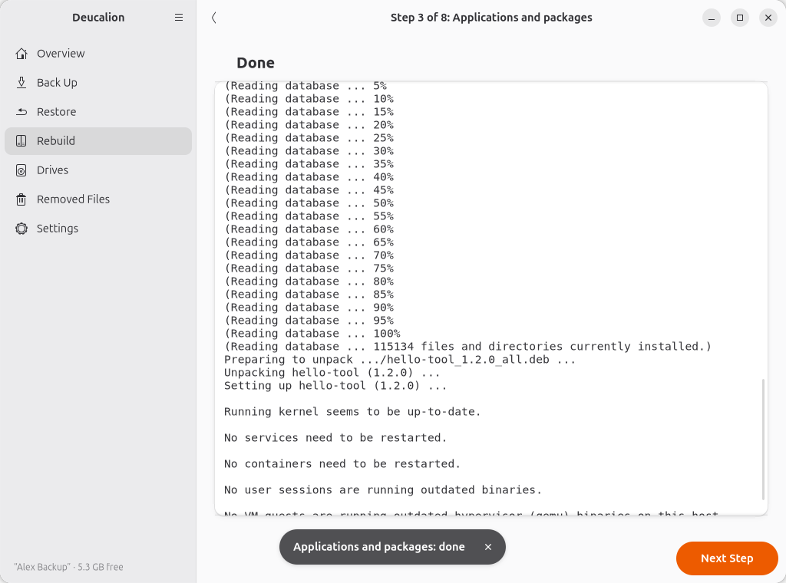
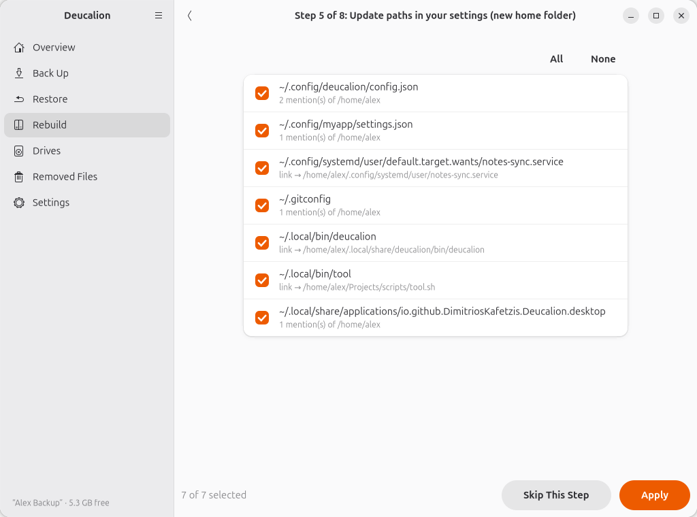
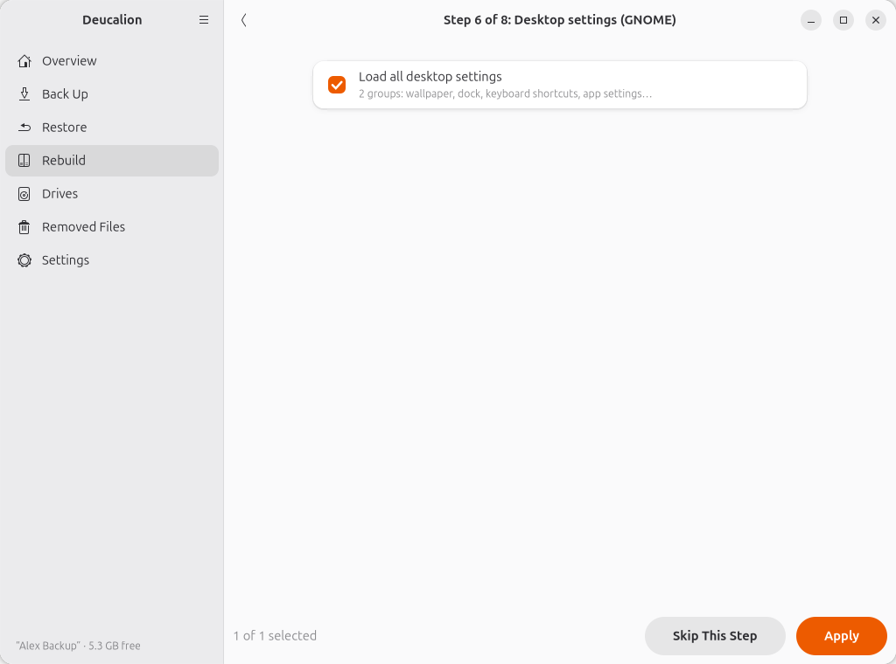
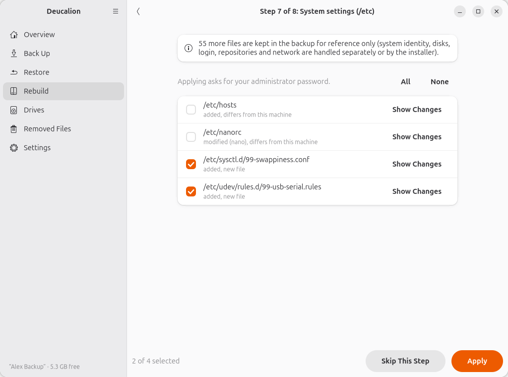
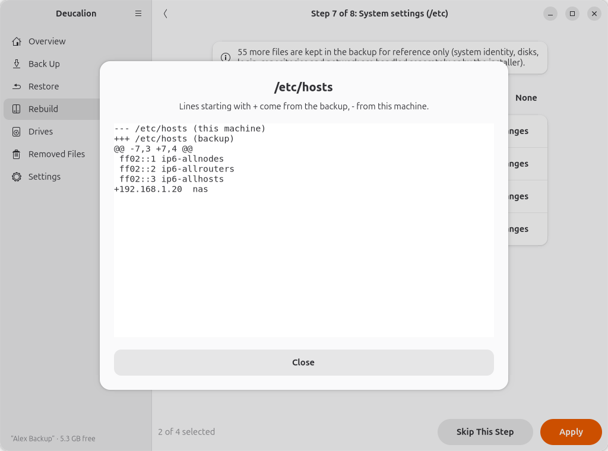
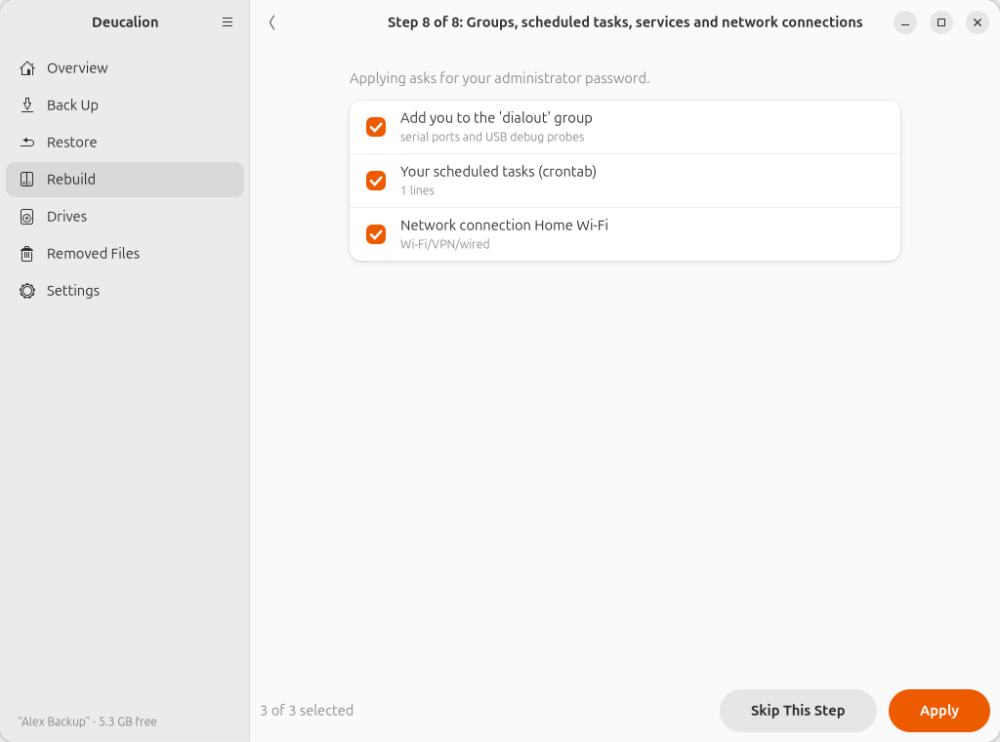
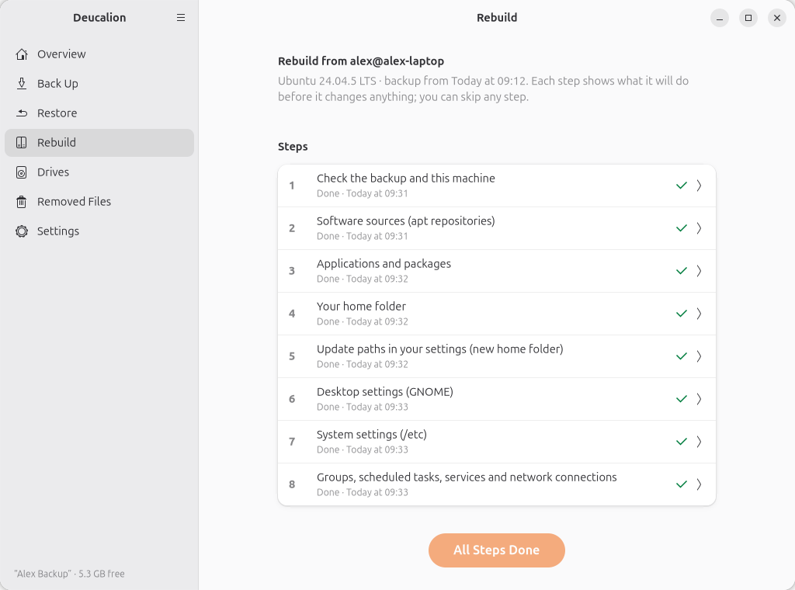

# Rebuild your computer on a new Ubuntu version or a new computer

**What you'll do:** set up a freshly installed Ubuntu from your backup: your software sources, apps,
files, settings, scheduled tasks and network connections, step by step.<br>
**What you need:**

- a **full backup** made on the old computer (with the system recipe; see
  [Make a full backup](full-backup.md));
- the backup drive and its password;
- the new computer (or your computer after a fresh install of a newer Ubuntu), with an internet
  connection;
- your administrator password on the new computer.

**How long it takes:** about an hour of your time, plus downloading your apps and copying your files.

In this walk-through, Alex's old laptop ran Ubuntu 24.04 with the user name `alex`. The new laptop
has a fresh Ubuntu 26.04, and this time Alex chose the user name `alexk`, so the home folder moves
from `/home/alex` to `/home/alexk`. The backup drive has an encrypted part and a normal part, with a
copy of Deucalion on it.

## Before you start (on the old computer)

1. Make a **full backup** (**Back Up Now**, or `deucalion backup`). The Overview page shows when it
   finished.
2. Optionally, [check it](verify.md) with `deucalion verify --full`.
3. Lock the drive and unplug it.

Write down the backup password if you haven't already.

## 1. Install Ubuntu on the new computer

Install Ubuntu as usual from [ubuntu.com](https://ubuntu.com/download/desktop). Use any user name.
Connect to the internet and let Ubuntu finish its updates. **Don't restore anything by hand yet.**

!!! tip "Same disk, new version?"
    If you are upgrading the same computer by installing a newer Ubuntu from scratch, make sure the
    backup is complete *before* you erase the disk: the installer erases everything.

## 2. Open Deucalion from the drive

1. Plug in the backup drive. Ubuntu shows its **normal part** in the Files app and in the dock.
2. Open the normal part in the Files app. It contains `READ-ME-FIRST.txt` and the `Deucalion-Tool`
   folder.
3. Open the `Deucalion-Tool` folder, right-click an empty area, and choose **Open in Terminal**. A
   terminal opens in that folder.

    !!! note "Where is the drive?"
        Ubuntu 26.04 shows drives under `/run/media/<your name>/`; older versions under
        `/media/<your name>/`. **Open in Terminal** takes you to the right place either way.

    !!! note "No Deucalion-Tool folder?"
        A drive encrypted as a whole has no normal part. Then [install Deucalion](../getting-started/install.md)
        on the new computer first (and VeraCrypt for a VeraCrypt drive), and use `deucalion` instead
        of `bin/deucalion` below.

4. Unlock the backup. Deucalion finds it from the drive's `Deucalion-Tool/drive.json`, asks for the
   password, unlocks it and registers it on this computer:

    ```text
    --8<-- "snippets/cli/new-open.txt"
    ```

    For a VeraCrypt drive it also asks for your administrator password (*"Unlocking (you will be asked
    for your administrator password)…"*).

!!! warning "Don't back up yet"
    If you back up now, the drive would become a mirror of this new, empty computer: everything only
    in the old backup would move to Removed Files. Deucalion warns you, and asks first:

    ```text
    --8<-- "snippets/cli/new-other-machine.txt"
    ```

    Rebuild first; back up after.

## 3. Rebuild

Do this either in the app (recommended) or in the terminal. Both do the same steps. Close other apps
first. Every step first shows what it will do, and changes nothing until you **Apply**. You can stop
at any time and continue later.

=== "App"

    1. In the terminal (in the `Deucalion-Tool` folder), start the app:

        ```bash
        bin/deucalion
        ```

    2. Go to **Rebuild**. It shows where the backup comes from and the eight steps:

        { .shot }

    3. Click **Start**. Each step opens in turn. At the bottom: **Skip This Step**, and **Apply** (or
       **Continue** when there is nothing to do). After applying, click **Next Step**.

    **Step 1: Check the backup and this machine.** Read it: where the backup comes from, this
    computer, the size of your home folder, and that your home folder moves from `/home/alex` to
    `/home/alexk`. A **WARNING** appears if there isn't enough free space or the processor type is
    different. Click **Continue**.

    { .shot }

    **Step 2: Software sources.** Your extra software sources, adapted to the new Ubuntu version and
    checked online. Ones that are **NOT available for this Ubuntu version** are unticked. Ubuntu's own
    sources are never touched. Click **Apply** (Ubuntu asks for your administrator password). Deucalion
    adds the sources and refreshes the package lists.

    { .shot }

    { .shot }

    **Step 3: Applications and packages.** The apt packages, snaps and downloaded `.deb` files you
    had, that aren't installed here. Untick what you no longer want; **All** and **None** help with
    long lists. Kernel and hardware packages are left to the installer, and packages that don't exist
    any more are listed for information. Click **Apply**. This downloads and installs everything, so it
    can take a while; the log shows the progress.

    { .shot }

    { .shot }

    **Step 4: Your home folder.** One line per folder of your home folder in the backup. Untick folders
    you don't want here (for example if the new computer has less space). Click **Apply**. Files that
    already exist and are different are first moved to `~/Deucalion-before-restore/`.

    { .shot }

    **Step 5: Update paths in your settings.** Because the home folder moved, settings files and links
    that still mention `/home/alex` are listed. Click **Apply**: Deucalion replaces the old path with
    `/home/alexk`, only where it is a whole path, and keeps the originals in the undo folder.

    { .shot }

    **Step 6: Desktop settings (GNOME).** Loads all your desktop settings. Your current ones are saved
    first. Click **Apply**.

    { .shot }

    **Step 7: System settings (/etc).** The system files you had changed. Files in well-understood
    places are ticked; others are not. Click **Show Changes** to see the difference for a file (`+`
    lines come from the backup, `-` from this computer). Tick only what you understand and need. Click
    **Apply** (administrator password). Replaced files are kept in `/var/backups/deucalion/`.

    { .shot }

    { .shot }

    **Step 8: Groups, scheduled tasks, services and network connections.** Adds you to the groups you
    were in (for example `dialout` for serial ports), restores your crontab, enables services, and
    imports your Wi-Fi and VPN connections. Click **Apply** (administrator password).

    { .shot }

    4. When the last step is done, the list shows every step as done (or skipped):

        { .shot }

=== "Command line"

    1. Optionally, see every step's plan without changing anything:

        ```bash
        bin/deucalion rebuild --dry-run
        ```

    2. Run the rebuild:

        ```bash
        bin/deucalion rebuild
        ```

        At each step, read the list. ++enter++ applies the ticked items; `n` skips the step; numbers
        (`2 5-7`) tick or untick items; `all` / `none`; `d 1` shows the changes of item 1 (step 7);
        `q` stops (run it again later to continue). Step 1 asks **Continue? [y/N]**: type `y`.

        A complete run on Alex's new laptop:

        ```text
        --8<-- "snippets/cli/rebuild-cli.txt"
        ```

## 4. Log out and back in

Log out and back in (or restart). New group memberships and some desktop settings only take effect
then.

## 5. Check the result

- **Your files** are in your home folder. Anything that was already on the new computer is still
  there; a file it replaced is in `~/Deucalion-before-restore/`.

    ```text
    --8<-- "snippets/cli/after-new-file.txt"
    ```

- **Paths** in your settings point to the new home folder:

    ```text
    --8<-- "snippets/cli/after-gitconfig.txt"
    ```

    ```text
    --8<-- "snippets/cli/after-link.txt"
    ```

- **Software sources** were added as new files; Ubuntu's own are unchanged:

    ```text
    --8<-- "snippets/cli/after-sources.txt"
    ```

- **Groups**:

    ```text
    --8<-- "snippets/cli/after-groups.txt"
    ```

- Open your apps and check they work. Apps installed by hand (in `/opt`, `/usr/local`), Flatpak apps,
  and VeraCrypt itself are listed by step 3 but not installed: install them yourself.
- Check your Wi-Fi connects, your printer works, and your scheduled tasks run.

## Running it again

It is safe to run the rebuild again: finished steps are skipped, and a second run of a step changes
nothing that is already right.

```text
--8<-- "snippets/cli/rebuild-again.txt"
```

To redo one step, open it from the list in the app, or use `--step` (for example
`bin/deucalion rebuild --step packages`).

## Then: back up again

When you are happy with the new computer, [install Deucalion](../getting-started/install.md) on it and
make a [full backup](full-backup.md). The first time, Deucalion warns that the drive holds the backup
of the old computer (in the app, a bar above the plan; in the terminal it asks **Continue anyway?**,
answer `y`). From then on, the drive mirrors the new computer. Files from the old computer
that you didn't restore move to Removed Files, where they stay until you empty them.

**What you have now:** your new computer, set up like the old one.

**See also:** [What a rebuild restores](../concepts/rebuild.md), [`deucalion rebuild`](../cli/rebuild.md),
the app's [Rebuild page](../app/rebuild.md).
