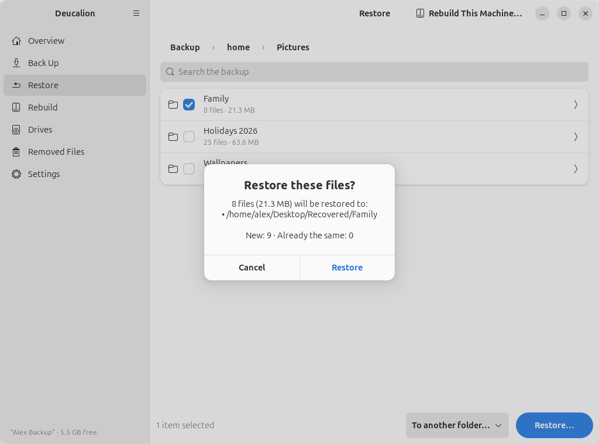
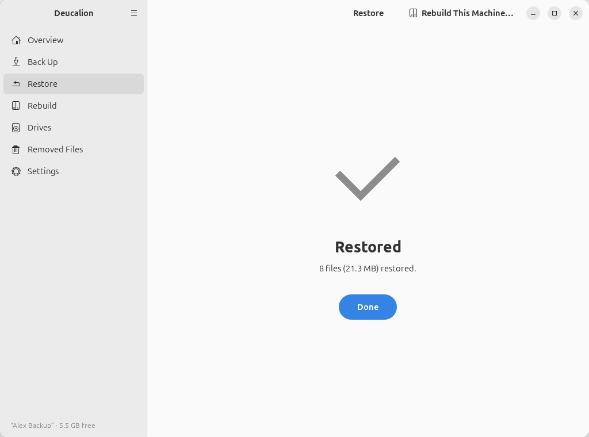

# Restore a folder to another place

**What you'll do:** copy a folder from the backup into a folder of your choice, without touching the
current version.<br>
**What you need:** your backup drive.<br>
**How long it takes:** 2 minutes, plus copying.

Useful to compare the backup with what you have now, to look at the [system recipe](../concepts/system-recipe.md),
or to restore files onto another computer's account.

=== "App"

    1. In **Restore**, browse to the folder and tick it (here **Pictures › Family**).
    2. In the list at the bottom, choose **To another folder…**. A folder chooser opens: pick (or
       create) the folder to restore into, here **Desktop/Recovered**. A message confirms *Restoring
       into …*.

        { .shot }

    3. Click **Restore…**. The preview shows where the folder will go: inside the folder you chose,
       with its own name.

        { .shot }

    4. Click **Restore**. When it says **Restored**, click **Done**.

        { .shot }

=== "Command line"

    Add `--to` and the folder to restore into:

    ```text
    --8<-- "snippets/cli/restore-to.txt"
    ```

    `~/Documents/Work` is restored as `~/Desktop/Recovered/Work`. Nothing in `~/Documents` is
    touched.

**What you have now:** a copy of the folder, as it was at your last backup, in the place you chose.

!!! note
    If the folder you restore into already has an item with the same name, that item is replaced, and
    its current version kept in the undo folder, as with any restore.

**Next steps:** [Undo a restore](undo-restore.md).
