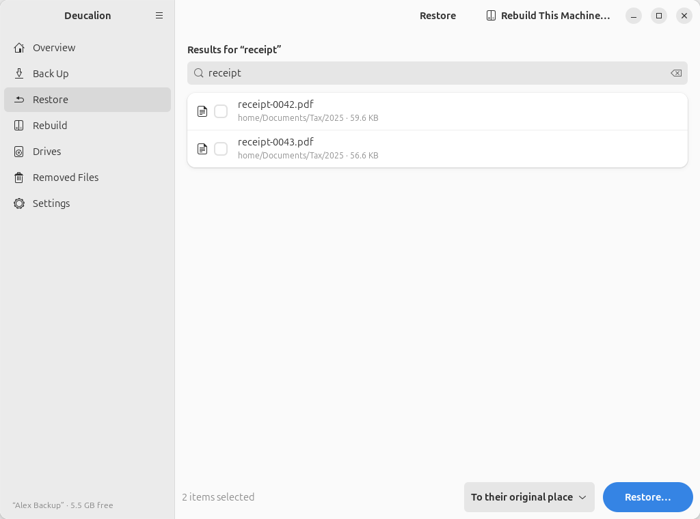
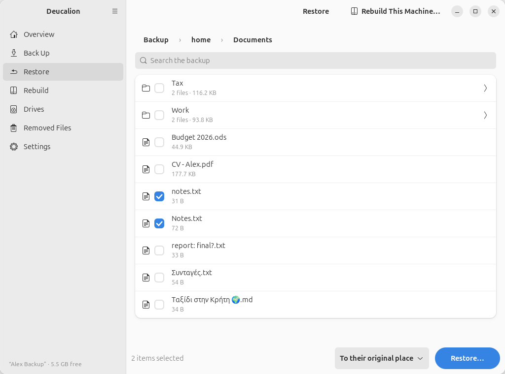

# Find and restore a file

**What you'll do:** get back a file you deleted or changed by mistake.<br>
**What you need:** your backup drive (and its password if it is encrypted).<br>
**How long it takes:** 2 minutes.

In this example, Alex overwrote `~/Documents/Notes.txt` by mistake and deleted `notes.txt`.

=== "App"

    1. Plug in the backup drive. Open Deucalion and go to **Restore**. (If the drive is locked, click
       **Unlock** and type its password.)
    2. Find the file:
        - **Browse**: click **Home folder**, then the folders down to the file (**Documents**). The
          names are the original ones.
        - Or **search**: type part of the name in **Search the backup**. Results come from the whole
          backup, with their folder.

        { .shot }

    3. Tick the file (or several files, or a whole folder).

        { .shot }

    4. Keep **To their original place** and click **Restore…**.
    5. Read the preview. Files that are **different and will be replaced** are listed; their current
       versions are kept in the undo folder **Deucalion-before-restore** in your home folder.

        { .shot }

    6. Click **Restore**.

        { .shot }

    7. Click **Done**.

=== "Command line"

    1. Plug in the backup drive and open a terminal.
    2. Find the file. `deucalion ls` lists a folder of the backup with the original names:

        ```text
        --8<-- "snippets/cli/ls-documents.txt"
        ```

    3. See what a restore would do, without changing anything:

        ```text
        --8<-- "snippets/cli/restore-dry-run.txt"
        ```

    4. Restore it (put names with spaces in quotes), and answer `y`:

        ```text
        --8<-- "snippets/cli/restore.txt"
        ```

    You can name several files or folders in one command.

**What you have now:** the file as it was at your last backup, in its original place, with its
permissions and date. The version it replaced is in `~/Deucalion-before-restore/<date and time>/…`.

!!! tip "An older version"
    The backup holds the version from your *last* backup. Older versions of a changed file may be in
    [Removed Files](../app/removed-files.md): open the drive's `Deucalion-Backup/_removed/` folder in
    the Files app and look in the dated folders.

**Next steps:** [Restore a folder to another place](restore-elsewhere.md) · [Undo a restore](undo-restore.md).
