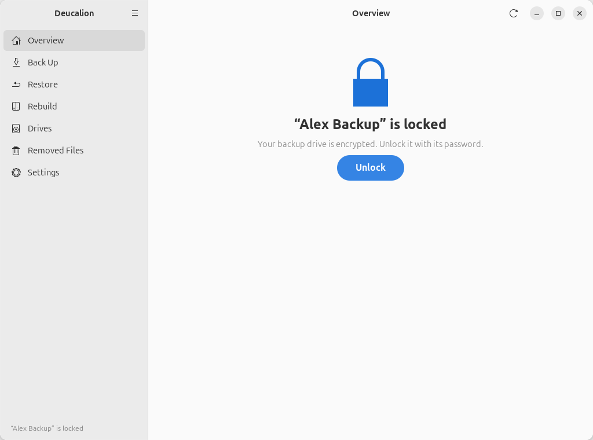
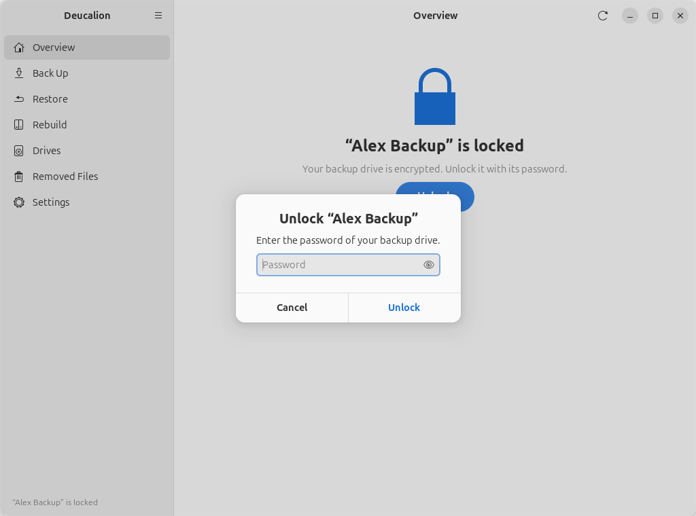
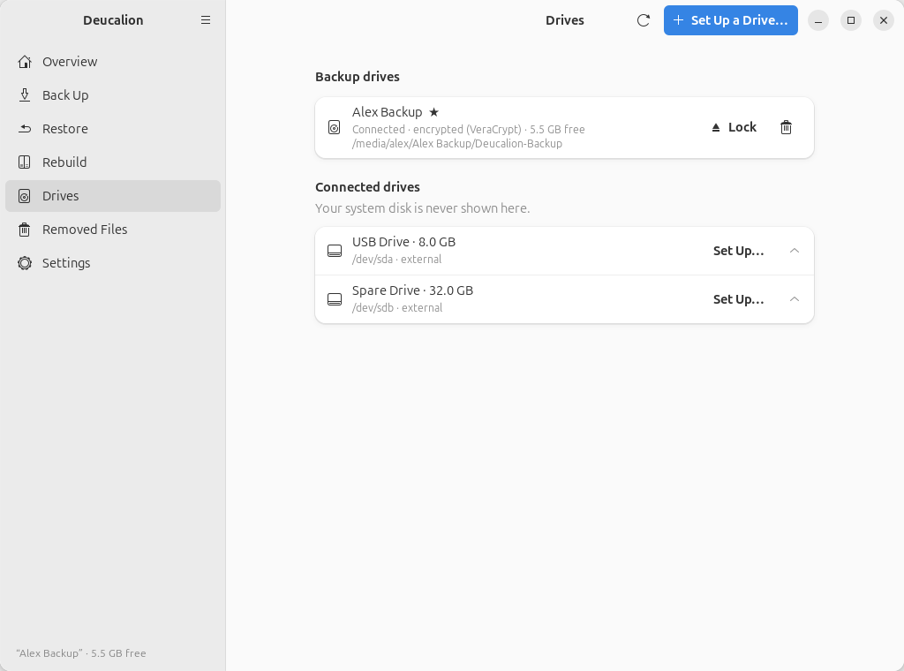

# Unlock and lock an encrypted drive

**What you'll do:** open an encrypted backup drive with its password, and close it again before you
unplug it.<br>
**What you need:** the drive and its password; for VeraCrypt, your administrator password.<br>
**How long it takes:** under a minute (unlocking VeraCrypt can take up to a minute).

You don't always need to unlock by hand: the app's **Back Up Now** and **Restore**, and every command
that needs the drive, ask for the password when the drive is locked. A **LUKS** drive is also unlocked
by Ubuntu itself when you plug it in (it asks for the password).

## Unlock

=== "App"

    1. Plug in the drive. The **Overview** page says the drive **is locked**:

        { .shot }

    2. Click **Unlock**. Type the backup's password and click **Unlock**.

        { .shot }

    3. For VeraCrypt, Ubuntu asks for your administrator password. A message at the bottom says the
       drive is unlocked, and the **Overview** page shows it as **Ready**.

    The **Unlock** button is also on the **Drives**, **Restore** and **Rebuild** pages while the drive
    is locked.

=== "Command line"

    ```text
    --8<-- "snippets/cli/open.txt"
    ```

    On a computer where the drive isn't registered yet, `deucalion open` finds it, unlocks it and
    registers it (see [`open`](../cli/open-close.md)).

## Lock (before unplugging)

=== "App"

    Go to **Drives** and click **Lock** next to the drive (**Unmount** for a drive that isn't
    encrypted). When the message *You can unplug the drive now* appears, unplug it.

    { .shot }

=== "Command line"

    ```text
    --8<-- "snippets/cli/close.txt"
    ```

If it says the drive is in use, close any Files window (or program) that shows the drive's files, and
try again.

!!! warning "If you forget the password"
    It can't be recovered, by you or by anyone else, and Deucalion doesn't store it. The backup can't
    be opened without it. If you still have your computer, set up the drive again (erasing it) with a
    new password and make a new full backup.

**Next steps:** [Open your backup without Deucalion](open-without-deucalion.md).
